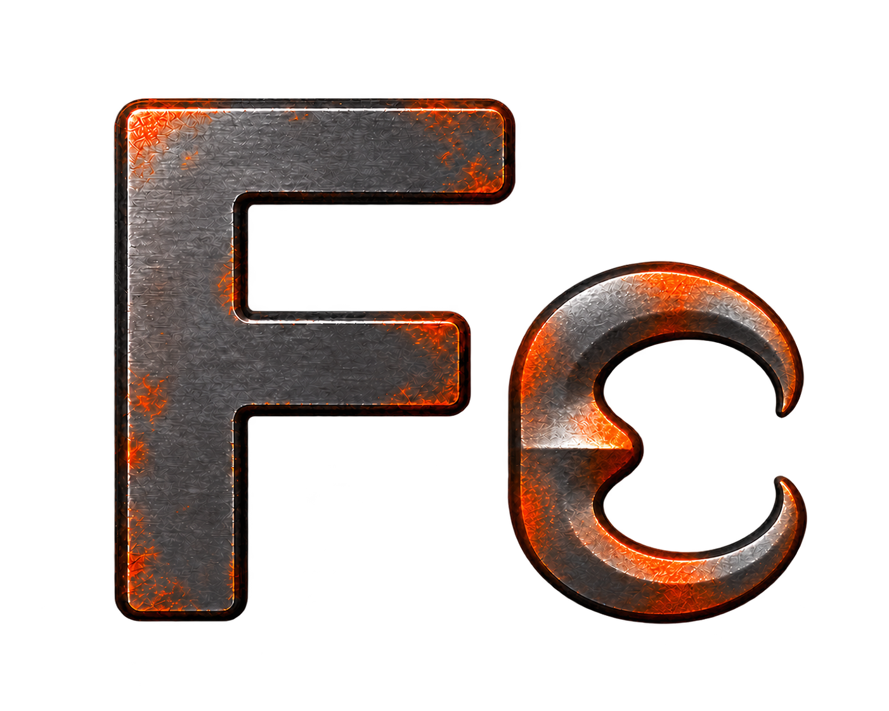

<p align="center"></p>

# Fe

[English](../../../README.md) · **简体中文**

用 Rust 重写并加速 Emacs 的编辑器项目。

[](https://crates.io/crates/femacs)
[](../../../LICENSE)
[](https://femacs.com/)

## 名字的来历

`Fe` 是铁的元素符号，而 `Rust` 本义就是铁锈——铁锈由铁而生，两者互为表里。
把一把用惯了的编辑器重新回炉，用 Rust 再锻打一遍，正是这个项目想做的事。

## 目标

- 用 Rust 重写编辑器内核，逐步替掉 Emacs 里历史包袱最重的部分
- 保留 Emacs 真正值得保留的东西：Lisp 扩展能力、包生态、用户既有的配置习惯
- 让启动时间、编辑延迟与批量操作提升一个数量级，用真线程而不是绕路方案
- 把文本编辑当成系统问题来做：增量解析、异步 I/O、原生渲染

## 现状

Rust 内核及原生 Swift macOS 界面已有可运行实现；功能验收与性能目标分开，不声称性能已达标。

在 Apple Silicon macOS 安装 Xcode 命令行工具、Python 3、rustup 和 GNU awk（`brew install gawk`）后，在仓库根目录执行：

```sh
cargo run -p xtask -- build-terminal
build/terminal/port/src/emacs -Q -nw
cargo run -p xtask -- build-macos
dist/macos/Femacs.app/Contents/MacOS/Femacs -Q
```

源码已经提升至根目录。构建从已提交的原始数据和生成器自举，不依赖被忽略的参照目录、旧缓存或已安装的编辑器。详情见[独立构建与验收](../../repository-bootstrap.md)。

### macOS 命令行入口

构建或安装 Cocoa 应用后，在仓库根目录运行 `cargo install --locked --path cli`，同一个包会安装两个命令。

- `femacs notes.org` 将参数原样交给 Fe。用 `femacs -nw notes.org` 进入原生终端模式。
- `fe notes.org` 使用快捷终端预设。`fe -1 a.txt b.txt` 逐个打开文件，`fe -R -nw notes.org` 清掉预设后按原生参数启动。

两条命令都需要 Cocoa 应用。应用若在常用的 Applications 目录之外，用 `FEMACS_APP` 指定应用包路径。详见[命令行入口说明](../../../cli/README.md)。

## 文档

- [docs/i18n](../../i18n/README.md)（语言索引）：其他语言的译文统一放在 `docs/i18n/<locale>/`
  下，路径与英文原文一一对应。

## 许可证

femacs 采用 **GNU General Public License 第 3 版或更新版本**（`GPL-3.0-or-later`）。
完整条款见 [LICENSE](../../../LICENSE)。
