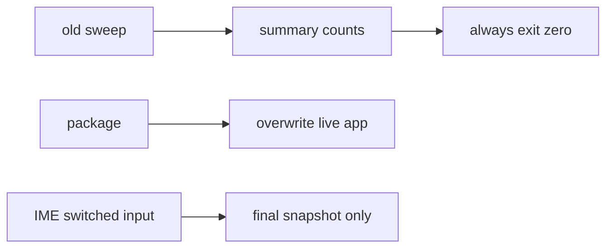
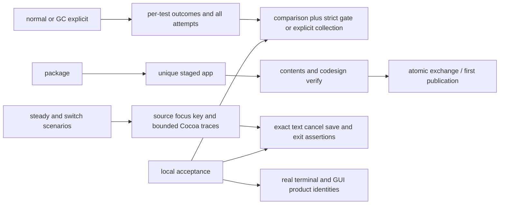
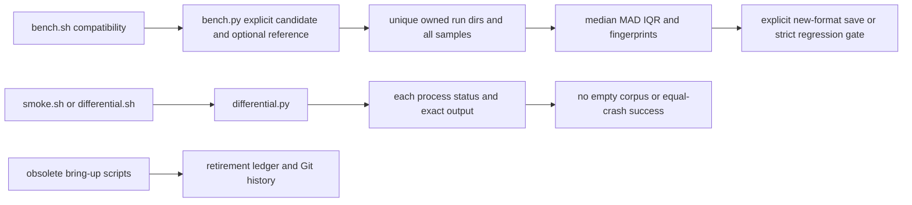

# Modernization: stable delivery, retirement, then Lisp runtime work

Baseline: `3d24214a9b1f12316f7263bade8faa95651df066`, master, clean at authorization. The user explicitly authorizes implementation in this order: (I) agreed local-delivery repairs, (II) planned removal/renovation of obsolete infrastructure and device support, (III) Lisp compiler/interpreter/GC improvements and measured native/JIT exploration. Codex is primary developer and an independent fixed-model partner owns tests and final review. Private identities/logs remain outside tracked documents. No remote CI is used; delivery commits carry `[skip ci]` to prevent push-triggered runs.

The previous one-to-one transcription is a baseline, not a prohibition on the newly authorized modernization. Observable Lisp evaluation/error behavior, saved data and useful editor workflows remain compatibility constraints. Swift Cocoa and Kotlin platform integration are not obsolete merely because they are not Rust. Do not mechanically rewrite dictionaries, Unicode generators or copied Lisp to satisfy a language count. The optional reference checkout remains read-only and is never a build prerequisite.

## Stage boundaries and status

| Stage | User-visible outcome | Status |
| --- | --- | --- |
| I | Reliable local macOS delivery, honest test outcomes, configurable drag callback, isolated app publication, traceable IME checks | D: implementation and supported local checks passed; real cross-window drag remains unaccepted |
| II | Explicit supported-platform matrix; retired paths with replaced readers; modern Rust tooling where it reduces maintenance; helpers and selected feature delivery | Platform decision pending; inventory/design follows stage I |
| III | Measured Lisp runtime improvements with semantic fallback; evidence-based choice among bytecode, native/AOT/JIT and generational GC | Research/feasibility follows stage II; no blanket adoption or speed claim |

Stages are the user's explicit sequence. Each stage independently follows full design -> all cases written without running -> all implementation -> consolidated local tests and independent review. This is not permission for per-file test/review loops.

## Stage I requirements

R1: ERT comparisons preserve test identities, outcomes, skips and timing. Zero executed cases are untested, not equivalent success; failures/unknowns cannot produce gate success. Collection-only mode is explicit. Retries retain every attempt and still run the reference. A failed retry is not called a passing flaky case.
R2: Normal and forced-GC sweeps are distinct, chunking remains resumable, subprocess failures reach the caller. Enumeration does not require any binary or mutate Git metadata. Default product is `build/terminal/port/src/emacs`; optional reference audit stays separate.
R3: Native drag motion calls the configured `Vns_drag_motion_function` with frame/x/y. Preserve the default and user replacement callback; do not hard-code the default symbol.
R4: Package into a unique sibling staging app, validate contents and signature, then publish. Existing app stays untouched on preparation/sign/verification failure. Deleted source resources disappear from a replacement app. Publication of an existing app uses macOS atomic directory exchange; do not pretend ordinary rename overwrites a nonempty directory. Cleanup only owned staging/old swapped app.
R5: IME diagnostics are opt-in and bounded, default editor behavior unchanged. Separate stable-source composition from source-switch pressure in fresh processes; record actual source/focus/key/Cocoa callback time lines. Commit must equal the configured expected text, not merely contain any Han character. Preserve every failed attempt; no retry-to-green. Unknown cause remains unknown until trace supports a fix.
R6: Provide a local validation entry with explicit current product paths, source/config/product hashes and per-check status/duration. No network/remote runner. Report reused products as reused; command completion alone does not certify functional parity.

## Current and target structure

```text
platform/macos/nsterm.swift       # key/IME callbacks; draggingUpdated omits function argument
xtask/src/macos.rs                # build, copy_tree, package merges into old app
xtask/src/main.rs                 # command dispatch
xtask/src/standalone.rs           # current terminal output
xtask/src/bundle.rs               # NEW isolated staging/publish helper and component cases
 tools/check-ert.py               # summary-only comparator and unconditional successful exit
 tools/l5-sweep.sh                # wrong nonempty STRESS expansion, pipeline masks errors
 tools/test-ert-harness.py        # NEW independent partner-owned unit/integration cases
 tools/local-acceptance.py        # NEW current-artifact local acceptance driver
 tools/verify-dod.sh              # historical audit requires explicit opt-in
 tools/test-macos-ime.py          # existing real keyboard workflow, one mixed scenario
 tools/fixtures/macos-ime.el      # existing Lisp state report
 tools/fixtures/macos-input-source.rs # source selector; ADD status query
 tools/test-macos-stability.py    # NEW diagnostics/source-contract cases
 docs/current-state.md            # current header still uses historical terminal path
 docs/modernization.md            # this sole current roadmap and stage-I execution checklist
```





## Exact construction map (baseline line anchors)

| ID | Path / baseline anchor | Target design | Cases |
| --- | --- | --- | --- |
| D1 | tools/check-ert.py:39-69, 123-178, 181-309 | Remove Gitfile creation. Dataclass RunResult(status:str, ran:int, expected:int, unexpected:int, results:dict[str,str], test_seconds:dict[str,float], elapsed_seconds:float, note:str). `parse_result(text:str, returncode:int, elapsed_seconds:float)->RunResult`; parse native ERT result lines and summary, reject duplicates/missing/contradictory detail. `compare_results(port:RunResult, reference:RunResult)->tuple[str,str]` compares names/status before counts; verdicts same, both-fail, port-worse, port-better, different, zero-tests, incomplete, crashed, flaky/both-capped. `gate_exit(verdicts:list[str])->int`: only same and port-better with complete details pass; all unknown/failed/untested/flaky rows fail. `--collect-only` explicitly returns successful collection despite recorded failures. `--results-json` records metadata, each attempt, per-test IDs/status/timing; TSV compatibility columns remain. Every program/fixture path explicit, reference optional only for standalone local delivery, required for differential audits. | T1-T12 |
| D2 | tools/l5-sweep.sh:16-44 | `set -euo pipefail`; argument array for optional GC; default evidence build/acceptance/l5, validate positive chunk; pass explicit program paths/options; collect chunks then aggregate nonzero gate status without discarding failure rows. Never infer total from an error line. | T13-T16 |
| D3 | platform/macos/nsterm.swift:9009 / draggingUpdated | `[Vns_drag_motion_function, frame, make_fixnum(Int(x)), make_fixnum(Int(y))]`. No behavior change elsewhere. | T17 |
| D4 | xtask/src/macos.rs:165-207 / package; NEW bundle.rs | `bundle::publish(destination:&Path, populate:impl FnOnce(&Path)->Result<(),String>, verify:impl FnOnce(&Path)->Result<(),String>)->Result<(),String>` creates unique owned sibling, rejects symlink destination, removes only owned stage on failure, uses `renamex_np(..., RENAME_SWAP)` for existing app, fs::rename for first publication; swapped old app cleanup follows success. macos `package` builds stage with existing copy logic, signs stage and runs strict/deep verification before publishing. | T18-T23 |
| D5 | platform/macos/nsterm.swift:before EmacsView and keyDown 8367, setMarkedText9159, deleteWorkingText9182, insertText9205, firstRect10578 | Add private `ns_input_trace(_ event:String,_ details:String="")` using optional FEMACS_INPUT_TRACE env, FileHandle JSON lines of monotonic uptime/event/details/key-window/marked state at call sites; create mode0600, cap1MiB, default no file/writes. Record callbacks without altering their event order. | T24-T27 |
| D6 | tools/fixtures/macos-input-source.rs:35-72 | Add `status PID` read-only JSON source/frontmost/focused_window using current TIS ID plus Accessibility queries. Preserve select/current/list/restoration. | T28 |
| D7 | tools/test-macos-ime.py:13-74; fixture state report | `--mode steady|switch|all` default all, `--expected` default 你好, each scenario fresh unique out dir/process, reject reused out directory. Split mode selection, verify source+frontmost+focused window before input; record each key time/source status and full trace. Wait on observed states with deadline, no arbitrary extra readiness claim. Store all attempts/scenario outcomes and restore original source even on failure. Exact committed text and normal exit required. | T29-T33 |
| D8 | NEW tools/local-acceptance.py | Arguments --terminal/--app/--out, optional --sender/--sources/--gui/--ime. Persist HEAD, dirty patch digest, selected configs/toolchain/binary/dump hashes; run selected layers sequentially with command/status/elapsed logs. Defaults use fresh owned output paths, never legacy fallback. Existing products explicitly marked reused (build logs are separate provenance). Fail on missing requested dependencies/products. No implicit builds or network, no skipped requested GUI/IME counted as pass. | T34-T37 |
| D9 | AGENTS.md current-phase pointer; docs/current-state.md current header; README build/acceptance; PORTING.md/status.md | Correct current path/header, retain historical records; document local gate, trace/privacy/default-off, exact supported host, new stage order and policy supersession. Commit uses skip-ci token; no remote CI invocation. | T38 |

## Cases and writing ownership

Partner owns NEW `tools/test-ert-harness.py` only: real transcript parser samples, identity swaps, count mismatch, zero tests, skips/expected failures, contradictory/duplicate/incomplete lines, failed and successful retries retaining reference, collect-only vs strict exit, --list without products/Git mutation, normal/stress wrapper argv and pipeline failure. It may use deterministic fake programs and unittest mocks, but must execute real parser/classifier/driver code. Tests record per-case duration via a unittest result adapter. No execution before all implementation finishes.

Primary owns all production code/documents plus bundle component tests (in bundle.rs) and NEW tools/test-macos-stability.py: first publication/replacement/deleted resource, populate/verify failure keeps old app, symlink rejection, and staging cleanup; trace off/on/bounded contract, configured callback argument contract, IME mode/exact-text/out-dir behavior; local acceptance metadata and failure propagation. Existing terminal/native keys/files fixtures are reused; real GUI cases stay a distinct final layer. No edits to copied test/ or data trees.

## Construction checklist

- [x] C0 full stage-I source/design, interfaces and cases specified
- [x] C1 all partner ERT/wrapper and primary bundle/IME/local-driver cases written, not run
- [x] C2 complete ERT parser/comparison/retry/results and strict exit semantics
- [x] C3 complete wrapper modes/path/error propagation
- [x] C4 configured native drag callback and bounded input trace
- [x] C5 isolated/verified app publication and failure recovery
- [x] C6 input-source observation and independent exact-text IME scenarios
- [x] C7 current-artifact local acceptance driver and documentation
- [x] C8 all implementation complete; freeze same snapshot, enter D
- [x] C9 supported local build/UI checks and independent review complete, with A5 explicitly unaccepted
- [ ] C10 signed skip-ci commit, signature verification and immediate push

## Final acceptance checklist (only in D)

- [x] A1 parser/gate/wrapper component and deterministic process cases, with every case duration and failures/skip states
- [x] A2 Rust publication component cases, including failed signing/verification and unchanged old app
- [x] A3 clean exported source builds terminal and GUI without reference/cache; both final dumps and bundle strict signature valid
- [x] A4 actual terminal and GUI classic keys + Unicode file/clipboard/GC flows; identify exact artifacts
- [ ] A5 real configurable drag callback receives selected frame/x/y (static argument contract alone is not full drag acceptance)
- [x] A6 steady-source and switched-source IME exact commit/cancel/minibuffer/save/exit; separate failures/permissions/lock state, restore user source
- [x] A7 local driver binds metadata to actual paths and fails requested missing/failed layers; normal vs GC argv distinct
- [ ] A8 independent review of one frozen snapshot; tracked source/data/reference preservation and signed/pushed delivery with no remote CI

## Future stage design boundary

II begins with a reader/replacement/retirement inventory, supported targets and a retention map. Remove only owned repository code with proven replacement or explicitly retired feature, keep licenses and actionable history, archive useful decisions as searchable docs rather than deleting evidence. Rust tooling consolidation is driven by duplication and dependencies; necessary platform languages/raw-data generators are evaluated individually. User platform response determines retirement scope.

III begins with current evaluator/bytecode/compiler/allocator/root-scanning/GC object graph and real workload measurements. Research native/AOT/JIT backend costs and deoptimization/error/unwind/GC interaction, and generational GC root/write-barrier/pdump/FFI constraints. Java/Go are design references, not drop-in runtime replacements. LLVM reuse must include language semantics, GC safe points and fallback design, not just arithmetic toy results. Prefer an isolated opt-in prototype with unchanged default behavior; promote only with compatibility and real performance evidence. The scope and exact implementation are written after stages I/II establish a stable baseline.

Stage-I B additions: primary bundle component cases and local-driver/exact-text/output-preservation cases are written in xtask/src/bundle.rs and tools/test-macos-stability.py. Configurable-drag real acceptance fixture is tools/fixtures/macos-drag.el. No tests or compiler have run. New driver helpers are run_check(name, argv, out, env=None) -> dict and fingerprints(paths: dict[str, Path]) -> dict; IME helpers commit_matches(state, expected) -> bool and new_output(path) -> Path reject reused evidence directories.

Stage-I C begins after the partner wrote tools/test-ert-harness.py (T01-T16 plus subcases). Primary cases/fixtures are complete. No test, lint, typecheck or product build has run in A/B.

C completion: old verify-dod.sh now requires --historical-audit before any preparation or legacy product access. Its logs remain in owned build evidence. The new local entry never silently falls back to it. All stage-I production/test/documentation changes are now written; enter D once on a frozen snapshot.

D batch 1: publication/local-driver components passed 7+7; independent ERT/wrapper cases were 14/16, exposing the system Bash empty-array nounset behavior. Use the portable guarded array expansion; preserve original failed evidence. IME success now also requires bounded native callback evidence, so an old uninstrumented binary cannot masquerade as diagnostic acceptance. No product-specific IME logic has been changed.

D batch 2: local-1 preserves a failed GUI paste check, while both 26-case key suites, terminal file flow and exact-text steady/switch IME passed. A direct system clipboard probe showed pbcopy exits 0 but drops UTF-8 text under C locale; en_US.UTF-8 preserves it. Fix only the test clipboard CLI boundary, add a component regression, and rerun the affected GUI file flow. The native editor clipboard implementation is unchanged; no product rebuild or repeat of unaffected key/IME suites is warranted.

D evidence: clean tracked-source terminal and Cocoa builds completed without reference/cache (351.257s / 404MiB RSS and 555.451s / 903MiB RSS). ERT/wrapper 16/16, publication 7/7 and final local-driver components 8/8 passed; independent reviewer verified all 20 frozen files and ran the affected cases. Actual terminal/native keys each 26/26, terminal file flow, native Unicode/GC/clipboard flow and separate steady/switch IME passed. IME had 371/390 native callback records, exact 你好, cancel/minibuffer/save/normal exit and source restoration. The first integrated local-1 report remains failed; after correcting only the clipboard test locale, targeted gui-file-2 passed in 15.065s. These results do not certify full ERT parity or all input methods.

A5 remains unaccepted: native argument/configuration contracts are verified, but the manual cross-window drag run did not produce callback evidence. Native UI binding encountered multiple same-bundle paths and reopening rather than a reliable existing-process binding. No direct Lisp invocation is substituted for a real drag. The owned test processes were closed; retain this explicit gap rather than claim complete UI acceptance. Finder/LaunchServices cold start is also not certified. The normal app was atomically republished from the new Cocoa build; the terminal checkout-path build is being refreshed before delivery. Current test host is Apple Silicon macOS 27.0.1; older macOS is not inferred from that result.

## Stage II exact tooling cleanup design

The unanswered platform preference does not authorize removal of any operating system. Retain existing macOS/Android/native glue and every other platform tree until retirement is explicit. This stage removes obsolete bring-up scaffolding and the rejected disconnected asm source, modernizes measurement/differential entry points and records the retention map. Raw Lisp/data, active cross-link scripts and licenses remain. No interpreter/GC behavior changes in stage II.

Current flow: `bench.sh` writes fixed scratch filenames, reports minima, and needs a reference even for current-only measurement; `smoke.sh` can compare empty output from failed processes as success; `differential.sh` accepts equal abnormal exits. `verify-dod.sh -> gen-lisp-mk.py` only generates unused legacy Makefile variables. `l1-worklist.sh`, `loadup-fixture.sh` and `reconcile-link-ratchets.sh` are unused completed-transcription helpers. `spikes/bytecode-hot/bytecode_hot.rs` is not linked and its rejection table stays in README/P-325.

```text
current -> target
 tools/bench.sh                 -> tiny compatibility launcher
 tools/bench.py                 -> NEW candidate/optional-reference measurement
 tools/smoke.sh                 -> tiny compatibility launcher to differential.py --smoke
 tools/differential.sh          -> tiny compatibility launcher
 tools/differential.py          -> NEW strict optional-reference audit driver
 tools/pgo_bench.py             -> retained marker/stat/hash helper, no PGO required by new tool
 tools/pgo/eval.el              -> retained real VM/edit/load/regex/GC corpus
 tools/test-modernization-tools.py -> NEW independent partner-owned cases
 tools/{verify-dod.sh,gen-lisp-mk.py,l1-worklist.sh,loadup-fixture.sh,reconcile-link-ratchets.sh} -> removed
 spikes/bytecode-hot/bytecode_hot.rs -> removed, negative evidence README retained
 tools/check-all-units.sh       -> obsolete removed-tool comment corrected, no platform rewrite
 tools/test-macos-stability.py  -> removed historical guard test replaced by retirement contract
 docs/retired-scaffolding.md, AGENTS.md, README.md, docs/current-state.md, PORTING.md, docs/status.md -> current entries and retirement records
```



| ID | baseline anchor | precise change / interface | acceptance |
| --- | --- | --- | --- |
| II-D1 | tools/bench.sh:29 PROG through end; tools/pgo_bench.py:121 parse_markers / 145 summarize | New `tools/bench.py`: `parse_samples(text:str)->dict[str,float]` validates six BENCH and four TASK markers; `summarize(rows:list[dict])->list[dict]` uses existing stats helper, preserving every per-process sample. `measure(binary:Path,home:Path,log:Path)->dict` streams stdout/stderr to owned log, rejects nonzero/timeout/missing/duplicate/extra/nonfinite markers, retains failure log. CLI --prog current terminal default, --ref optional, --rounds positive default5, --out new only, --save/--gate exclusive, --tolerance nonnegative default0.15, --force and --max-load-per-core default0.10. Each process runs actual eval.el corpus; startup wall time recorded separately. JSON contains source HEAD/dirty digest, program/dump/corpus hashes, per-round side/order/case/value_ms, stats/elapsed; raw process min5 remains labelled. Baseline TSV columns case/port_ms/ref_ms/date/metric, metric `process-median-of-min5-v1`; reject old minima baseline as incompatible. --save requires quiet load unless explicit force; gate rejects missing/duplicate/invalid/nonpositive baseline cases and fails any median regression beyond tolerance. Existing shell becomes `exec python3 <dynamic tool path> "$@"`; no nested resource executor or additional shell logic. | II-T1-T7 |
| II-D2 | tools/smoke.sh:17 PROG / 37 CHECKS; tools/differential.sh:15 REPO / 50 loop | New `tools/differential.py`: `compare(port:CompletedProcess,ref:CompletedProcess,stderr:bool)->bool` requires both exit0 plus byte-equal stdout and optional stderr; `read_forms(path:Path)->list[str]` ignores comments/blank, rejects empty. CLI --prog current terminal, --ref optional audit default build/emacs-ref/src/emacs, --forms baseline corpus, --smoke selects existing eleven printed forms, --stderr/--keep accepted, --out new only, --timeout positive default60, old --memory-mib accepted as deprecated start hint (no wrapper inside; caller protects whole audit). Unique evidence dirs below build/acceptance; HOME/TMPDIR in owned dir. Always retain JSON, per-form outputs/status/duration, no global scratch and no ref checkout mutation. Nonzero/missing product/timeout/mismatch always nonzero. | II-T8-T12 |
| II-D3 | obsolete five tool entrypoints / spike asm source; current production readers none except verify->gen-lisp | Delete exactly five tools and one detached asm file after recording original purpose/replacement/date/source baseline in retirement ledger. Preserve original historical docs and rejected performance numbers, mark archived recipe source recoverable from Git baseline rather than claim executable replay. Replace test-macos-stability historical guard with exact retirement/replacement presence contract; correct active references in README/AGENTS/current-state/check-all-units. No mass platform deletion. | II-T13 |
| II-D4 | docs/current-state.md current header; AGENTS.md tool policy; docs/retired-scaffolding.md | Record policy: Rust build/link/gate drivers remain xtask, Python measurements/data generators retained where appropriate, minimal shell compatibility launchers do not own policy; Swift/Kotlin native bridges retained. Existing unsupported/untested targets are not called retired. Inventory category counts and reader/replacement map remain searchable; compilation warnings and Android reference-config dependency remain explicit future work. | II-T14 |

- [ ] II-C0 design fully specified and discussed
- [ ] II-C1 all independent cases written without running
- [ ] II-C2 all measurement, differential, compatibility launcher and retirement implementation written
- [ ] II-C3 current documentation/readers integrated; freeze and enter D
- [ ] II-A1 deterministic parser/stat/baseline/gate/argv/failure isolation cases timed and pass
- [ ] II-A2 real candidate-only benchmark produces complete samples and strict new baseline; matching self-reference full differential plus deliberately failed fixtures fail honestly
- [ ] II-A3 no production reader of deleted asm/helpers; raw/source/data/license/platform trees preserved
- [ ] II-A4 independent frozen review; signed skip-ci commit and immediate push

All workloads that start the compiled editor run under the external controlled executor once; wrappers do not nest it. A new measurement baseline does not retroactively prove a speedup or native/JIT feasibility. Stage III uses these complete samples to select a bounded real-runtime optimization, after stage II delivery.

II testable interfaces: bench `load_baseline(path:Path)->dict[str,float]` validates exact case set/metric/finite positive values; `gate_rows(summary:list[dict],baseline:dict[str,float],tolerance:float)->list[str]` returns regressing case names, compares side candidate medians only; `main(argv:list[str]|None=None)->int` on both new tools. `new_output(path:Path)->Path` creates an exclusive fresh directory, never wipes existing evidence. `bench.summarize(rows)` expects keys case,side,value_ms and returns case/side/n/min/median/mad/iqr via the existing shared stats helper; side names candidate/reference. `bench.measure(binary,home,log)` returns keys samples (case/value_ms list), wall_ms, exit_code (0); raw logs exclusive; on execution/parse failure raise `MeasurementError` after retaining the log. `parse_samples` returns ten cases keyed by canonical names (six MICRO_CASES and four TASK_CASES without startup); per-process startup wall time is separate metadata, never a microbenchmark row. `differential.compare` rejects either nonzero returncode even if both match. Constructors/defaults may be exercised through `main` with mocks, so tests must not launch an actual editor before D.

Root-path delivery refreshed: terminal complete bootstrap/dump succeeded in 420.553s (400.2MiB peak RSS); real terminal file workflow then passed. The published root app passed strict/deep signature verification and batch Unicode/calendar load. Both normal trial paths now contain this build; no generated binaries are committed.
