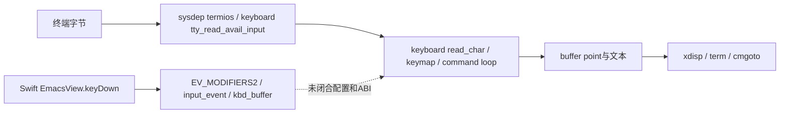
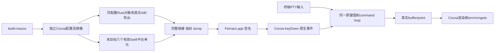
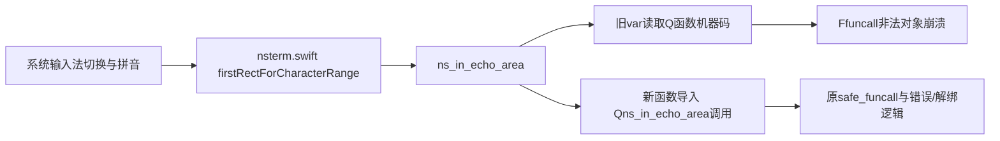

# 二期：macOS 图形版与经典键盘输入

## 基线、范围与执行状态

基线 `12922baf`，分支 master，工作区起始干净；一期记录不改写。A（设计）、B（用例编写）、C（全量实现）及 D（集中构建/验证/修复）已执行，现交付本机试用版；未测边界逐项保留。不恢复旧 goal，不另启其他实施者。性能不是本期验收项。

最新补充授权：旧实现可现代化重写；本期应用于macOS界面与输入链路修复，行为兼容和可运行交付不变，性能不列入本期。

需求：Q1 交付真正的 Cocoa 图形程序及可启动的 Femacs.app，使用现有 Rust 核心和 Swift 平台实现，不能用终端套壳或另一个编辑器替代。Q2 修复终端及图形环境中的经典控制/Meta组合键与方向键。Q3 真实验证输入、光标、编辑、打开/保存、退出，以及图形窗口/菜单、剪贴板、输入法；保留可用终端版与原始 Lisp/测试/参照树。

用户明确现场：C-p/C-n 可以，C-a/C-e 和方向键不行。诊断分别记录原始事件、this-command、point和可见光标，不先假定是终端设置问题。

### 当前源码与数据流

```text
femacs/
  xtask/src/main.rs       # 配置、materialize、build_finished_tus、gate_load、dump
  src/{keyboard,sysdep,cm,term,frame}.rs # 输入、termios、光标、目标分支
  src/{abi_shim.rs,include/} # 既有跨语言导出、布局、Lisp对象与全局
  platform/macos/{nsterm,nsfns,nsmenu,nsselect,nsimage,macfont,nsfont,nsxwidget}.swift
  lisp/term/{xterm,ns-win}.el # 原样输入，不修改
build/port/src/{emacs,emacs.pdmp} # 一期可用终端产物，独立保留
```



现状来自直接读取源码：femacs 没有可用的代码图索引。Swift八单元仅单独编译过；默认冻结配置关闭NS。xtask build_finished_tus 的普通pass没有传config_features（checking pass有），gate_load从固定终端参照的对象配方取输入，不能据此链接Cocoa。frame.rs Fx_parse_geometry的声明被no_value条件错误隔离。Swift导入的头内联/宏/常量仍有未导出的实际符号，需要按本来实现提供，不能以默认值stub或允许未定义符号跳过。

## 设计与逐文件施工差异

| ID | 基线文件/位置与锚点 | 精确变化 | 需求/依赖 |
|---|---|---|---|
| D1 | xtask/src/main.rs L170 main、L243 config_features、L498 gen_config、L3457 materialize | 注册build-macos；独立Cocoa配置路径FEMACS_CONFIG_FILE、镜像FEMACS_CONFIG_RS；materialize仅将include/config.rs重定向到本次生成镜像；不覆盖终端配置 | Q1 |
| D2 | 同上L3790 buildable_units / L3821 build_finished_tus | 普通与checking pass使用同一config_features/target；NS构建加入abi_shim；独立对象/日志目录 | Q1/D1 |
| D3 | 同上L2924 gate_load / reference_members | FEMACS_REFERENCE_BUILD选择独立Cocoa参照配方；读取make -n仅确定对象，不链接任何原C对象；Swift对象匹配同名.m单元；链接AppKit/Carbon/CoreText/Swift运行库及abi_shim | Q1/D1,D2 |
| D4 | 新xtask/src/macos.rs | build_macos()->i32：准备独立build/macos；配置只读参照的out-of-tree configure；冻结预处理后的目标JSON并生成config.rs；逐Rust/Swift单元构建、链接、指纹/dump、打包签名。任何失败保留日志返回非0，不产出冒充成功的app | Q1/D1-D3 |
| D5 | src/frame.rs L7054 Fx_parse_geometry；include布局及其他窗口分支 | 修正条件与参照窗口目标一致；按集中构建实际发现的目标分支问题成批修正，维持布局、求值/错误/GC语义 | Q1 |
| D6 | src/abi_shim.rs、platform/macos八单元；新tools/gen-macos-exports.py | 复用既有C ABI导出机制，生成实际Q符号、常量、内联函数/宏入口；名称/参数/返回值按Swift导入与Rust提供者映射，不创造业务逻辑。未识别项显式报错，集中整合时补全；校正原生对象/结构体ABI与跨单元所有权 | Q1/D1 |
| D7 | keyboard.rs L2383 make_ctrl_char、L8877 tty_read_avail_input；sysdep.rs L2185 init_sys_modes；cm.rs L454 cmgoto；nsterm.swift L8327 keyDown / L9166 insertText | 所有输入走现有command loop和原键图；普通字符、Ctrl、Meta、方向键分别对拍；修复集中验证定位的实际转写/显示差异，不用重新绑定键掩盖核心错误；Option=Meta在GUI保持已有ns变量语义，终端说明escape编码边界 | Q2 |
| D8 | 新tools/test-macos-delivery.py、tools/fixtures/macos-keys.el、tools/fixtures/macos-events.rs | 静态构建契约、真实PTY按键对拍、真实Cocoa事件/窗口验收；每例隔离文件/缓冲区、单调计时，退出/超时均回收；按层可选，不替换原测试 | Q1,Q2,Q3 |
| D9 | docs/current-state.md、本文件、PORTING.md、docs/status.md；新docs/macos-tryout.md | 以本期清单为入口，维护施工/验收分离；记录可执行启动方法、Ctrl/Option含义、实测与遗留；保留一期历史 | Q1-Q3 |

新增配置/生成物由build_macos的PathBuf root管理：reference、config、femacs、load、port、swift、app，均位于独立构建根；所有输出断言不在只读参照源下。build_macos失败不改默认终端程序；Femacs.app包含真实GUI可执行文件、同指纹dump、Lisp/数据/工具资源和Info.plist，CFBundleExecutable=Femacs，bundle ID org.femacs.editor。完成后以实际签名产物启动，不用未关联旧dump。

跨语言生成器：读取Swift @_silgen_name函数声明、Rust头定义/宏/常量与既有导出集合；只对已有真实提供者生成转发入口，保留映射清单，未知名字作为真实错误处理。Lisp_Object保持tagged word；所有对象/结构体参数按准确C ABI对齐，不能把Swift引用或闭包的ABI当作C ABI。GUI的C-g、非局部退出、GC根与事件处理必须在原执行帧内安全工作。

### 目标源码树与流程

```text
xtask/src/{main.rs[修改D1-D3],macos.rs[新增D4]}
src/{frame.rs[修改D5],abi_shim.rs[扩展D6],keyboard/sysdep/cm[按D7实际根因修改]}
platform/macos/*.swift [D6/D7，保留原平台实现]
tools/{gen-macos-exports.py,test-macos-delivery.py}[新增]
tools/fixtures/{macos-keys.el,macos-events.rs}[新增，不改原样测试树]
build/macos/{config,reference,load,port}[生成、不提交]
.femacs-cache/macos/{target-id}/*.o[中间对象，不提交]
dist/macos/Femacs.app[试用交付，不提交]
docs/{phase2-macos.md,macos-tryout.md,current-state.md}[D9]
```



### D集中整合发现（2026-10-23）

终端修正后已重编680单元、完整链接及dump。首轮全输入验收52个执行中46通过（含可见光标坐标），剩余两侧同型：Home/End测试没有按应用光标模式发送SS3 OH/OF；C-g按参照会丢弃同批后续输入，恢复动作必须另次发送。已修正验收驱动，补验这三项，不改生产键图。Cocoa真实配置已生成；完整目标首次构建收集到多处窗口头的前置类型/包含依赖缺失，正在集中修复，未产出GUI。


- 初轮PTY只检查命令/point会全部通过，但原始输出中参照在C-a/e、左右方向键后输出新光标坐标，端口没有输出。C-p/n输出一致。实际定位到xdisp.rs L17009的`'update`块：`break 'update`落到update_frame之后，跳过物理输出，而C的`goto update`应跳到输出之前。将块末尾移到L17466标签处、保留frame_pass和非redisplay分支；对应D7，需同时复验终端与GUI。新增涉及src/xdisp.rs，不改命令键图。
- 初次Cocoa configure因--without-all禁用了toolkit scroll bars而退出；已明确启用原生toolkit scroll bars。该失败不计GUI构建通过。
- PTY夹具初次强制退出与终端清理等待耦合，已改正常command-loop退出并先关闭PTY再有限回收；这属于验收驱动问题，不算产品失败。

## 施工清单（实现写完即勾，验收另记）

- [x] C0：源码/边界与设计。
- [x] C1：D8测试夹具、26项真实PTY对拍、Rust原生事件发送器及A1-A8验收步骤已写齐，未运行。GUI自动驱动在D按实际app PID接线；菜单/剪贴板/输入法保持独立真实验收。
- [x] C2：D1-D4独立目标、构建/链接/dump/打包入口已写，待集中整合。
- [x] C3：D5-D6配置、真实头提供者生成和Cocoa接线已写；未知导入在完整链接中显式暴露，待集中整合。
- [x] C4：D7现有输入/光标链路已完成静态对照；真实输入对拍用例及使用说明已写，不加未经证据支持的重绑定。实际失效根因在D统一定位修复。
- [x] C5：D9入口、P-326和状态已更新；当前进入D集中整合，所有A项仍待验。

## 验收清单（集中执行）

| ID | 对象/步骤及明确预期 | 状态 |
|---|---|---|
| A1 | 同配置普通/checking Rust和Swift构建；完整链接无未定义符号，ABI布局与对象/回调声明对齐 | 已通过；207个有效核心单元的双pass构建及后续受影响单元双pass复编，六Swift单元完整联编 |
| A2 | build-macos产出真实GUI app、签名/指纹dump匹配，Finder或open启动显示窗口 | 原生程序、窗口、dump及严格签名通过；直接启动已实测，Finder/LaunchServices冷启动待用户试用 |
| A3 | 真实PTY给同输入对照固定参照：C-a/e/b/f/p/n、四方向键、Home/End、M-b/f、C-M-b/f、M-</>；记录实际命令、point与结果，逐例计时 | 52/52通过，含实际光标坐标及正常退出；terminal-delivery-keys/results.json |
| A4 | 真实PTY C-x C-f打开、C-x C-s保存、C-x C-c退出；C-g取消、C-k/C-y、C-SPC/M-w/C-w、C-/撤销、M-x命令、C-s搜索 | 通过；相关按键包含在52项，文件工作流两侧2/2，退出0 |
| A5 | 真实Cocoa重复A3/A4；控制/Meta不落为文本、不被AppKit默认编辑动作吞掉，C-g后继续编辑 | 26/26通过，均正常退出0；gui-delivery-keys/results.json |
| A6 | GUI输入/保存/再打开内容正确；菜单打开/保存/退出、剪贴板、Unicode/组合输入及输入法标记处理；不把截图当业务验收 | 文件/剪贴板/Unicode/GC与菜单已通过；系统拼音候选及完整标记流程未测，不计全项通过 |
| A7 | 原终端版重建/回归、参照树干净；复制树不改、590覆盖检查与本次受影响门，集中审核并签名提交推送 | 编译/运行、复制树/参照只读及590检查通过；额外静态扫描缺口见下文；Git交付记录见提交历史 |
| A8 | 可供用户试用的app和启动说明，列明配置/键位、实际测过及未测的边界 | 本机app与试用说明已交付；未测边界保留 |

正向输入与错误/取消均覆盖；终端无法区分的传统字节组合不伪造键盘能力，必须报告终端发送原始字节与结果。若程序point正确但屏幕没移动，修显示路径；若字节正确而命令错误，修键图/事件转换；如果终端没有发送按键，明确说明对应终端设置且不偷偷修改用户全局配置。

集中构建/执行统一经controlled-run的build/runtime保护；未知重负载先单跑。静态生成器/文件/Git直接执行。无性能benchmark或VM派发重写。失败按根因收集成批修复再复验，未完成不勾。阶段完成后签名提交推送并提供app。

### D整合补充：Cocoa配置、布局及链接（2026-10-23）

- 经典按键最终按每个用例取最新成功执行：26项 × 参照/端口两侧 = 52/52；包含实际终端光标坐标。完整首轮的6个两侧同型夹具失败，已在独立补验纠正SS3 Home/End与C-g输入分批，保留原失败记录。
- 新增文件工作流首轮两侧都停在报告钩子：相对报告路径受打开文件后的default-directory影响，且minibuffer字符串带属性不能按JSON解析。验收驱动改成绝对运行时报告路径、无属性文本快照；没有改生产命令或键图，尚待补验。
- 当前Cocoa核心已按真实对象清单构建。补上C lisp.h派生HAVE_EXT_MENU_BAR/HAVE_EXT_TOOL_BAR后，两个首次暴露错误的单元keyboard/xdisp已定点重编普通与checking，两项及ABI都通过。其余414次普通/checking编译通过。
- 同配置、固定参照头的独立布局探针得到frame608、font216、face296、font_driver232、input_event64、ns_display_info280、ns_output280、Emacs_GC16、NSRect32；关键偏移及上述大小已写入Cocoa ABI断言，普通/checking均通过。事件NS_TEXT28、NS_NONKEY29、SLEEP30、PINCH36、MONITORS_CHANGED37，Swift改从实际核心取值。
- 六个本配置Swift平台单元（macfont/nsfns/nsimage/nsmenu/nsselect/nsterm）已-O整合编译通过。GNUstep的nsfont及关闭的nsxwidget不混进Cocoa目标。已把同单元的延迟C符号自调用改为直接调用真实Swift定义；原先间接调用会触发Swift 6.4 IRGen崩溃，未通过关闭检查或留空函数规避。
- 完整链接真实读取Cocoa Makefile变量展开，仅以其对象成员名筛选Rust归档，不要求参照C归档存在、不链接任何C对象。目前仍有120个缺失符号（build/macos/load/undefined.txt）：宏/字段入口、平台变量/符号，以及menu.rs此前只登记而没有转写的六个原生菜单函数。没有修改link-pending棘轮收纳它们，也未产出GUI成功结论。
- 下一修复批：D10 target-local Cocoa globals/内建符号与names数组（不覆盖终端元数据）；D11 根据实际共享记录补全字段与宏入口；D12 在原menu.rs位置转写六个Cocoa菜单函数并保留分配/GC/输入时序；D13 处理Swift平台变量及转发对象的真实静态存储，不能用临时指针或默认返回；D14 完整链接、dump、窗口/文件/输入验证后才更新A项。

### D集中整合补充：实际调用图与ABI

完整链接后的首轮运行定位到Swift subr注册的函数对象误转单字指针，已为60个实际函数显式指定C调用约定。新暴露的接口逐项接到真实记录字段、函数回调和原生方法；补上free_monitors本体、稳定的53项frame参数表和services菜单存储。Cocoa glyph_string.clip按NSRect布局修正，并按参照恢复get_glyph_string_clip_rects的Emacs_Rectangle到NativeRectangle转换分支。以上均须以重编后启动/dump/窗口输入实测收口，不以未定义符号减少视为功能通过。

D集中整合追加：启动栈定位到ns_create_terminal把display-info误传给frame视图，已拆开两种实际类型入口；后台fd_handler的初始nil池按原ObjC nil-release语义处理。Bundle数据放Resources，原生可执行文件单独放MacOS并签名；目标局部epaths从bundle相对位置重定位，dump输入指向端口自有数据，不记录机器安装路径。Cocoa对象改用仓库忽略的独立.femacs-cache，防止常规build产物回收打断目标链接；仍由同一controlled-run管理，不绕资源监控。

D启动验证：平台的ns_app_name/x_display_list/context_menu_value曾错误导出为函数而被其他单元当全局读取，现统一为真实静态存储；字体驱动选择条件发现丢失逻辑否定，按参照修回“请求的驱动启用并准备缓存”，不通过跳过缓存掩盖崩溃。新增真实GUI进程逐键驱动，fixture必须确认window-system=ns后才计输入测试。

D字体缓存根因：alloc.rs虽已转写窗口字体缓存的压缩/标记函数，实际GC调用仍展开为终端专用空宏；GC后缓存cons被回收复用。恢复窗口目标对真实函数的调用，终端目标仍为空分支，删除诊断打印。必须以真实GUI启动和强制GC后输入复验。

D原生生命周期修复：字体pseudovector尾部不由核心清零，CF强引用首写必须initialize，不能释放未初始化旧字；Swift-only对象工厂使用一致Swift ABI。核心裸对象字段的读取改显式borrow，写入采用retain/replace/release，窗口由frame view持有并在销毁时解除，避免把裸指针当ARC所有者。

D集中修复：恢复font-info和窗口级高度/像素查询的真实图形分支、Cocoa内建tab-bar-height/tool-bar-height/remember-mouse-glyph/lookup-image-map注册与实现，并恢复frame图像缓存创建/释放。终端仍走原分支；原生工厂、缓存GC、字体与窗口维度必须联验。

D原生完整首轮：26项中已观察到按键位置正确但正常退出期间定时器崩溃，不计完整通过。已将验收判据收紧为按键与正常退出同时成立；移除Swift强引用定时器、滚动条、局部按钮/图片的重复手动release，核心所有权边界的显式retain/release保留。光标颜色在首次绘制前通过普通frame参数流程初始化。

D最终界面验收补充：恢复多字节逐字符face选择与图形composition字体选择；字体family缓存使用真正的CF对象保留回调，raw-pointer比较的临时CFString显式保持生命周期。原生中文、组合字符和彩色emoji已目视确认。恢复Fmodify_frame_parameters图形派发、外部菜单位与更新；TYPE_RANGED_FIXNUMP的Swift一参入口按C int范围专门实例化，生成器拒绝普通内联接口参数数量不一致。键序列回显的三处指针差按ptr-buffer修正，菜单点击不再因负字符串长度中止。辅助功能文本快照按目标buffer与gap前后两段复制。

D真实操作：从File菜单打开本轮文本，C-e输入checked、C-a与Right显示正确光标，通过File/Save保存且磁盘字节确认；调用原生Open面板选择同一文件并返回，随后继续编辑；File/Quit退出码0。启动cwd为用户目录，资源从bundle重定位。原生系统拼音候选/标记输入尚未完整实测，不能由Unicode文本通过推断。

验收工具修正：普通文本模式保存会补最终换行，文件工作流按这一实际行为核对。字体探针加入明确错误记录和正常退出后，查询实际字体通过。GUI工具曾在崩溃后自动打开未带-Q的实例，已关闭；后续先核对受控进程存活，避免误操作用户配置实例。

### 最终交付读数

- `terminal-delivery-compile.log`：680 次普通/checking 编译、完整链接、编码 16/16、dump 成功；`terminal-delivery-keys/results.json` 52/52，`terminal-delivery-files/results.json` 两侧 2/2，全部正常退出 0。
- `gui-delivery-keys/results.json` 26/26；`gui-delivery-files/results.json` 原生文件、Unicode、GC、剪贴板完整流程 1/1。最终帮助文本调整后重编 emacs 单元、六 Swift 联编、重新 dump/打包；`gui-packaged-final/results.json` 四项原始故障键及 `gui-packaged-final-files/results.json` 文件流程再次通过。
- `gui-packaged-final.log` 明确 `dumped-with-pdumper=t`，dump-file-name、data-directory 和 calendar 实际加载文件均位于 app 内。签名后的执行文件哈希与未签名链接输入会因签名改变，dump 仍与同次链接指纹配对；`codesign --verify --deep --strict` 通过。
- 构建/日志及 JSON 证据保留在本机忽略的 `build/macos/logs`、`build/macos-acceptance`。最终定点构建 19.559 秒、整树计量峰值 838,762,496 字节；打包后运行复验 21.220 秒、峰值 454,213,632 字节，均退出 0 并完成回收。不是本期总耗时或全部成本统计。
- `extract-abi.py --all` 最终 590 done / 0 WIP / 0 failing；四项检查修正包括目标事件常量的安全整数表达式解析和便携文档根目录映射，新增四项变异测试通过。menu/xfaces 的 GUI 新增行数按既有逐文件容差机制记载，不改函数/声明覆盖要求。
- 文本门 globals、ledger-ticks、doc-numbers、dead-file-coverage、platform-inventory、typed-counts、c-string-literals、verbatim、declarations、own-voice 均通过。先前 gate-fast 原始失败保留；未声称整条 gate-fast 最终重跑通过。
- 额外 `check-mirror-dupes.py` 原检查器报告 15 条：4 条互斥 NS 注册声明；4 条函数/宏内部 extern；4 条其他平台与条件 NS 头的重复；3 条 sysstdio 名称/常量宏遮蔽。该扫描不理解所有条件包含和局部作用域，仍以原始非零结果登记。为避免扩大本期为其他平台检查器重构，试验性的解析改动已撤回，没有新增白名单或放宽该门。普通/checking 真实编译、完整链接与运行证据独立成立。
- 原样复制的 Lisp/数据/测试树无 Git 改动，参照检出保持干净。系统拼音候选及完整 marked-text 输入、个人配置/插件、打印和全套辅助程序、其他平台尚未完整验证；不将 Unicode 文本插入或覆盖率当作全部兼容证明。Finder/LaunchServices 冷启动列为用户试用检查，已实测直接原生启动。

最终清理按无占用精确清单删除1,641个中间/旧版本文件（逻辑711,925,903字节），加此前旧app副本逻辑194,006,334字节；不是物理释放量。保留app、终端quartet、config/生成源、日志及证据；清理后两版dump与算术/calendar smoke通过，签名复验通过。

## 输入法切换崩溃修复（基线48a9b97c）

用户实测切换输入法后SIGSEGV，栈为AppKit候选位置查询→`EmacsView.firstRectForCharacterRange`→`ns_in_echo_area`→`safe_funcall`→`Ffuncall`。工作区起始干净；固定只读参照仍为fd7afced403，不更新参照版本。代码图无femacs索引，本次直接读取相关实现。

```text
femacs/platform/macos/nsterm.swift [修改] Qns_in_echo_area导入与安全调用
 tools/gen-macos-exports.py       [修改] Q符号导入种类检查
 tools/test-macos-symbol-imports.py [新增] 合成变异及真实输入检查
 tools/fixtures/macos-input-source.rs [新增] Carbon输入源选择/恢复，AX激活受测PID
 tools/fixtures/macos-ime.el       [新增] 独立缓冲区与合成状态快照
 tools/test-macos-ime.py           [新增] 原生拼音事件、取消、保存及正常退出
```



|变更|基线位置与事实|目标与验收|
|---|---|---|
|I1|nsterm.swift L11150-11183把Qns_in_echo_area声明成var，而目标runtime.rs明确导出同名函数|改为零参函数导入并实际调用，safe_funcall参数数组在明确的buffer-pointer生命周期内；保留catch/quit/specbind/unbind行为|
|I2|gen-macos-exports.py L37的swift_imports只收集函数，看不到Q变量导入|验证活动Swift单元不得把Q符号导入为var/let；报明确文件和符号，不靠链接成功推断种类正确|
|I3|旧GUI用例仅发送Unicode或直接Ctrl事件，没有真实输入源切换和拼音候选|新增真实Carbon选择输入源、物理按键拼音组合/提交/取消、minibuffer组合、重复切换、文件保存和退出；退出时恢复原输入源|

A设计已完成；B先写齐变异测试和原生输入流程，C完成I1/I2，D最后集中构建与运行。原26项及文件流程按受影响范围回归。没有关闭输入法、吞掉安全调用或用默认矩形掩盖问题。

施工：[x] I1接口修复；[x] I2生成器防回归；[x] I3全部夹具与流程。当前进入D集中构建/复验。
验收：[ ] Q导入变异测试；[ ] 原生切换/拼音组合提交取消/minibuffer/保存退出；[ ] 原键与文件回归；[ ] 签名和提交推送。通过范围按最终结果逐项记录，不把未运行当通过。


输入法补修D读数：接口变异/活动源码检查4/4，完整Cocoa构建与打包退出0（137.358秒，峰值846,495,744字节），590/590覆盖通过；GUI26项与文件/剪贴板/GC流程再次通过，均正常退出0，严格签名通过。证据在本机忽略的`build/macos-ime`。

实际启用源是ABC及豆包拼音，没有启用Apple简体拼音；验收驱动已识别已安装的拼音源。首个仅识别Apple拼音的尝试在启动前失败，随后真实豆包流程的切换API8次返回成功，但组字只产生普通字母、没有进入marked状态，测试判失败并回收实例，已恢复原ABC源。原生UI工具确认Mac锁屏，因此不能据此宣称真实候选/提交/取消通过，也不从普通字母推断输入法正常；已请求解锁，待原生场景补验。

另试了直接调试器调用候选矩形接口以隔离系统输入法；三次均因调试表达式的类型导入问题未实际调用到目标方法，不计产品通过或产品失败。没有继续无效重试；所有调试实例已回收。

验收状态：[x] Q导入变异测试；[x] 原图形按键/文件回归及签名；[ ] 解锁后的真实豆包组字/提交/取消/minibuffer/保存/正常退出。补验前保留明确边界，不标整项完成。
