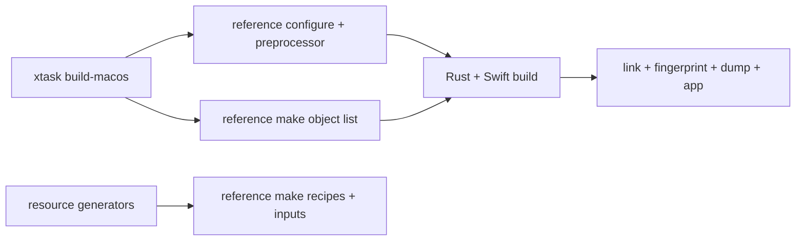
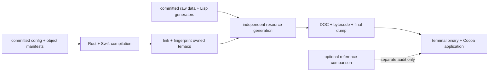

## G4 当前命令补充（实现待D验证）

正常 `xtask build-terminal` 和 `build-macos` 在最终 dump 后用当前自有程序导出 Org、生成完整68份 Info，并验证文件集合。终端以独占暂存/原子交换发布根 `info/`，保留旧集合；Cocoa 从自己的完整集合复制到包内后签名。需要 GNU Texinfo 的 `makeinfo` 与 `install-info`。显式 `cargo run -p xtask -- build-manuals --format html --program PATH --out build/NEW` 生成可选HTML；新输出必须不存在。忽略文件始终是产物，原始文档及导出器为已提交输入。

Android 独立入口为 `cargo run -p xtask -- android build --assets --package --debuggable --out build/NEW`，读取 `build-support/android/arm64/`，使用当前最新LTS JDK25、已安装SDK/NDK及Kotlin，不依赖参照configure或旧对象。构建/检查仍须在外部资源保护下运行。静态包、正常/checking共享库与设备验收分别记录；完整状态及保留平台见[support-matrix.md](support-matrix.md)。设备入口为 `tools/android-device.py accept --apk APK --so SO --out build/NEW`，仅创建本次所属的新模拟器；检查既有设备须显式 `inspect --serial SERIAL`，不隐式安装或重启。

`cargo run -p xtask -- audit-probe --list` 列出14种探针；明确请求的参照/NDK/Miri依赖缺失会失败，正常产品构建不要求这些可选审计依赖。L5与旧shell名称仍转发至唯一策略所有者。以下保留早期展开施工和已交付基线的历史说明，新候选尚未通过D。

# Flat repository and independent macOS bootstrap

Baseline: `24f8cf64`, branch `master`, initially clean. This delivery changes repository layout and build inputs, not editor semantics or performance policy.

## Requirements and design

Q1: Lift every owned implementation tree from `femacs/` into the repository root. Merge README content and build directories; preserve the actual root Git database, unrelated files and the optional read-only reference. The nested `.git` is only an obsolete redirect and must not replace the real database.
Q2: Generate runtime resources from committed raw data and generator sources, without accessing the optional reference checkout or its configured/build products.
Q3: Build terminal and native Cocoa products from a fresh tracked-file export with no caches, reference checkout, installed editor or prior binary. Package and run the new application. External prerequisites are Xcode command-line tools/Swift, Python 3, GNU awk, gzip and the pinned Rust toolchain. Supported independent target: Apple Silicon macOS; reject other hosts explicitly.
Q4: Anchor ignore rules to the new root. Keep raw dictionaries, Unicode data, grammar inputs, source icons and test fixtures tracked. Generated reports are distinct from XML test inputs.

### Historical pre-expansion tree and flow

```text
./tools/                         generators and audit tools
./docs/baseline/                  measured ABI/configuration inputs
./femacs/{src,lib,lib-src,...}/    translated core and header mirrors
./femacs/platform/macos/          six native Swift units
./femacs/{lisp,etc,admin,leim,...} copied data and Lisp generators
./femacs/xtask/                   compile, link, fingerprint, dump, package
./emacs/                         ignored optional reference; currently REQUIRED
./build/                         ignored configured reference and binary caches
```



### Exact implementation map

| ID | Baseline location and anchor | Change | Acceptance |
| --- | --- | --- | --- |
| C01 | `femacs/` tracked tree; root README and ignore | Move directories and hidden files, merge README, remove only nested Git redirect. Preserve six data trees byte for byte. Update operational path readers, generated map target paths and baseline path keys. | A01, A02 |
| C02 | `femacs/xtask/src/main.rs:16` REPO; 2521 reference_members; 2972 gate_load; 3863 buildable_units | Root cwd from CARGO_MANIFEST_DIR; committed per-target object/library lists replace make/archive discovery; preserve O2, checked builds, fingerprint and undefined-symbol failure. Add build-terminal and generate-resources entries. | A03, A04 |
| C03 | `femacs/xtask/src/macos.rs:65` build; active_objects/make_objects | Consume owned Cocoa target config, then build core/providers; link without reference gates; generate resources before dump, package generated Lisp/data. | A03, A05 |
| C04 | `tools/gen-macos-runtime.py:17` main | Owned declarative Cocoa symbol/global metadata replaces reading reference Objective-C. Swift forwarding records remain checked against metadata. | A03, A05 |
| C05 | new `build-support/` | Maintain target configs, ordered core/library object manifests, generator recipe JSON and Cocoa metadata. These are source build descriptions, with no machine paths or borrowed binaries. | A02, A03 |
| C06 | new `tools/bootstrap-resources.py`; existing tools/gen-*.py defaults | Generate subdirs/version stamps, charset maps from owned raw data; bootstrap from ldefs-boot, compile Unicode generators, produce tables before charprop; dictionaries and parsers; autoload/custom/finder/theme indexes; byte compilation and DOC from own carriers. Existing differential modes remain optional. Every subprocess must fail visibly, logs persist under build. | A03, A04 |
| C07 | `tools/gen-doc.py:590` build and main | Add independent owned-section mode; scan Rust/Swift carriers without requiring a reference DOC. | A03, A04 |
| C08 | `.github/workflows/ci.yml`, README, current-state and root rules | Document prerequisites/commands, add standalone macOS build CI, retain historical evidence as historical. Update project index outside repository. | A01, A06 |

Target interfaces: `bootstrap-resources.py --program PATH --family all|base|unicode|leim|grammars|indexes|bytecode|doc|versions|subdirs|charsets|ja-dic`; `--program` must be the newly built owned temacs, never an installed editor. Recipe JSON stores repository-relative argument vectors or charset pipelines; program substitution and cwd belong to the runner. Target link manifests store separate core and library object names and system library flags. No generated C objects are linked.

### Target tree and flow

```text
./{Cargo.toml,Cargo.lock,rust-toolchain.toml,.dir-locals.el}
./{src,lib,lib-src,lwlib,oldXMenu,nt,msdos,exec,platform,xtask}/
./{lisp,etc,admin,leim,test,doc}/   moved without changing source bytes
./build-support/                 owned target configuration and generation recipes
./tools/bootstrap-resources.py   independent resource orchestration
./tools/test-repository-bootstrap.py
./docs/                         delivery/design/audit records, distinct from doc/
./build/                        generated binaries, logs and clean-export acceptance
./dist/macos/Femacs.app          generated trial application
```



Failure semantics: a missing input or failed subprocess aborts with command/family/log, no stale fallback or reference binary. No generated resource is considered present solely because an old local build left it. Fresh-export verification excludes all ignored trees; checks resource presence, batch behavior, terminal editing and native GUI file editing. Existing IME test is reused where desktop access permits. Compiler/runtime tasks remain under controlled-run and execute serially.

## Construction checklist

- [x] C01 root migration and data preservation
- [x] C02 standalone xtask links and terminal entry
- [x] C03 standalone native Cocoa entry
- [x] C04 source-controlled Cocoa metadata
- [x] C05 self-contained build descriptions and raw inputs
- [x] C06 independent generators and command routing
- [x] C07 owned DOC generation
- [x] C08 documentation, ignore rules, CI and index

## Acceptance checklist (run only after all construction)

- [x] A01 no nested implementation root; metadata intact; root workspace and commands resolve
- [x] A02 moved data hashes preserved; no source input ignored; fresh export contains raw inputs and generator descriptions
- [x] A03 fresh export with no reference/cache/installed editor generates required resources and builds both targets
- [x] A04 terminal batch, key and file workflows pass with new products
- [x] A05 native app launches and key/file workflows pass; input method regression where unlocked
- [x] A06 independent CI/README commands match tested entry; Git delivery is evidenced by signed history and the remote branch

## Evidence

Pending integrated verification. Historical comparator tools may still require an explicit optional reference; ordinary build and generation must not.

## Generated files and source ownership

| Output | Committed input | Independent generation |
| --- | --- | --- |
| charset maps, charscript, emoji composition | admin/charsets data/scripts; admin/unidata text/AWK | --family base |
| Unicode property tables and charprop | admin/unidata data and unidata-gen.el | --family unicode |
| input-method dictionaries, pinyin, ja-dic | leim dictionaries; Lisp converters | --family leim / ja-dic |
| grammar parsers | admin/grammars .by/.wy; Lisp grammar generators | --family grammars |
| loaddefs, custom and finder indexes | Lisp autoload markers, defcustom and keyword metadata | --family indexes |
| bytecode | same-name .el source and byte compiler | --family bytecode includes the dump closure and five core compiler libraries; --all-bytecode for optional libraries |
| DOC | Rust/Swift documentation carriers and section-order manifest | --family doc |
| version stamps | src/emacs.rs version and committed .in templates | --family versions |

HTML/PostScript manuals, test outputs, bytecode for optional libraries, tag indexes and Android test archives are optional products of their respective documentation/test workflows; they are not inputs to the macOS bootstrap. Ignore rules do not assert that all optional products are generated on every build. Raw XML fixtures and source icons are not globally ignored. The application ships its generated runtime resource files despite those files being ignored by source control.

Construction C01-C08 is complete. Integrated build and runtime evidence follows; Git delivery is recorded separately.

### Integrated bootstrap repairs

The first clean build exposed three missing recipe details: the first dump must use pbootstrap (source Lisp may require libraries), recipe startup flags must not be duplicated, and Unicode generation runs with admin/unidata as cwd. The final dump needs bytecode for the actual bootstrap load-history closure and generated charscript/emoji tables, not just direct loadup calls. The independent runner now performs each explicitly. Release builders compile the core/library membership in the owned target manifests; low-level build-units can still compile the broader completed source set for development audits.

The independent target/path/ledger checks pass after root-prefix migration. A refreshed historical port-inventory currently reads 589 done / 1 WIP because include-dispextern retains an old unchecked prose item; the separate mechanical transcription check still reads 590 done / 0 failing. No historical checkbox was silently marked complete. The older membership-declaration audit still assumes the superseded product-name substitution policy and is not a standalone build prerequisite; the copied-data byte-identity gate passes without substitutions.

CI uses the macos-26 Apple Silicon hosted runner, matching the currently measured configuration family; older macOS releases and Intel are not claimed as verified by this migration. Runner architecture/label reference: [GitHub hosted runners](https://docs.github.com/en/actions/reference/runners/github-hosted-runners). Remote CI status must be reported separately from local acceptance.

## Local acceptance — 2026-10-23

Host: Apple Silicon, macOS 26.6.2. The two independent source exports were populated only from staged tracked files, with no Git metadata, reference checkout, prior binaries, target directory or build cache. Each normal entry ran without manual intervention after the bootstrap repairs.

| Case | Result | Local evidence |
| --- | --- | --- |
| Clean terminal build, generation and final dump | passed, 165.491 s, peak 382.9 MiB | build/layout-migration/clean-terminal.log |
| Separate clean Cocoa build, generation, final dump and signing | passed, 206.540 s, peak 809.8 MiB | build/layout-migration/clean-gui.log |
| Reference independence | neither export contained emacs/; Cocoa created no configured reference tree | clean-export input assertions and build logs |
| Root/source/ignore descriptions and moved data hashes | passed | tools/test-repository-bootstrap.py |
| Copied data fidelity | 6 trees, 4,604 files, 0 substitutions, 9 previously accepted absences, 0 failures | build/layout-migration/verbatim.log |
| Mechanical transcription | 590 done, 0 in progress, 0 failing | build/layout-migration/coverage.log |
| Target names / carried files / ledger binding | 0 findings / 0 failures / 0 failures | build/layout-migration/{target-names,carried,ledger}.log |
| Terminal classic key editing | 26/26 passed | build/layout-migration/terminal-keys/results.json |
| Relocated native app classic key editing | 26/26 passed | build/layout-migration/gui-keys/results.json |
| Native file workflow | passed: create, Unicode/combining text, save, GC, reopen, clipboard, save and exit | build/layout-migration/gui-file/results.json |
| Relocated bundle | strict/deep signature verified; batch Unicode edit and real native tests passed while original source-export path was unavailable | build/layout-migration/gui-acceptance.log |
| Real installed Pinyin workflow | repeat test passed: source switching, marked composition, commit 你好, cancellation, minibuffer, save and exit; original input source restored | build/layout-migration/ime-retry2/results.json |

IME qualification: the first run switched sources without crashing but did not reach the expected marked composition state (observed text hao / working ni). One retry did not execute because disposable helpers had been removed from the local environment; after rebuilding them, the full workflow passed. The first failed attempt is retained in build/layout-migration/ime/results.json. Its intermittent cause is not established; the later pass is not retroactively reported as a first-attempt pass.

Raw logs remain local because they contain machine paths and process metadata. This table records portable conclusions and repository-relative evidence locations. Performance, other platforms and remote CI are outside these local success claims.

Standalone builders call the explicitly named `link-owned` command. The historical `gate-load` command retains its optional-reference load/coding comparison steps; ordinary builds do not silently turn that audit into a weaker passing gate. Both routes link the same owned target object set, and unresolved symbols still fail. Reference-dependent audits are never prerequisites of build-terminal/build-macos.

Root trial outputs were then regenerated with the final generator/CLI wiring: build/terminal/port/src/emacs (142.699 s, peak 394.7 MiB) and dist/macos/Femacs.app. The root terminal batch Unicode edit and real PTY create/edit/save/close/reopen workflow passed. The explicit link-owned entry was compiled and linked separately after retaining the legacy comparison gate. Signed Git history and remote branch state are the authority for source delivery; no remote CI pass is inferred from local tests.


Compiler-library delivery (modernization): default/all bytecode generation explicitly
includes `emacs-lisp/{byte-opt,bytecomp,macroexp,cconv,cl-extra}.el`, independently
of the dump load history. It checks all five owned sources, removes their old
generated `.elc` outputs, compiles and verifies the five outputs; a stale ignored
file cannot satisfy the gate after a silent compiler error. Explicit path scopes
remain scoped. See `runtime-modernization.md` for the same-VM loading experiment
and its limits; this does not enable a native/JIT backend.


## Android device command migration

The old script names remain thin spellings for the owned Python lifecycle, not promises that historical temporary diagnostics still run unchanged. Always supply the current APK and native library to mutating modes; existing-device inspection always requires an explicit serial. There are no default historical artifact paths, shared AVD restarts, root/uninstall operations, signal injection or tombstone deletion.

| Previous spelling/capability | Current route and exact boundary |
| --- | --- |
| `device-run.sh --plan` | Preserved: print a nonexecuting lifecycle plan; no output directory, product, AVD or SDK process is created. |
| `device-run.sh --dump-only` | Preserved as read-only `dump`, now requiring `--serial`; it does not boot a historical AVD. Direct route: `android-device.py dump --serial SERIAL`. |
| `--memory MIB` / `--tail N` | Preserved for the owned emulator and trailing owned logs. Guest memory is independent of the external controller's hard limit; tail is0..10000 lines per log and full streamed logs remain on disk. |
| `android-input-probe.sh focus` | Positional stage retired. Use `android-device.py inspect --serial SERIAL` for current properties, window/input/IME focus, activity, current/crash logs and exit-info. This route is read-only. |
| `key` | Old screenshot-difference-only experiment retired. Use `android-device.py accept --apk APK --so SO --out BUILD_CHILD` for actual typed text, Ctrl-A/Ctrl-E and arrow observations. |
| `rotate`, `tap`, `insert-rotate` | Old focused screenshot experiments retired. The same `accept` route checks portrait/landscape/portrait, exact surviving buffer/PID, per-run glyph-cell rendering and post-tap survival. It does not certify every touch gesture. |
| `applog` | Use `inspect/dump --serial SERIAL --tail N` for current receiver logs, or a fresh owned `gui/probe --apk APK --so SO --eval EXPR --tail N`. A diagnostic is not readiness. |
| `threads` | Kernel-wchan-only experiment retired; current PID-bound logs/exit-info and explicit `batch --eval '(all-threads)'` cover maintained diagnostics. This is not a replacement native kernel wait-channel measurement. |
| `back` | Three-Back screenshot/liveness experiment retired; full `accept` does not claim Back-key semantics. Add a specific current input case if that behavior is required later. |
| `probes`, `bt`, `signal` | Temporary instrumented-build tags, root/debuggerd attachment and manual SIGIO experiments are retired. They are not silently emulated or reported as passing by a generic Lisp evaluation. Current failures use PID-bound native/crash/exit-info evidence. |

For arbitrary controlled diagnostic Lisp use `batch`, `gui`, or `probe` with `--eval` or `--elisp-file`. Positional legacy stages fail visibly with the migration pointer. For full editing readiness use `accept`, followed by `android-readiness.py --require --receipt RECEIPT --apk APK --so SO`; startup `smoke` is a narrower scope. CLI withdrawal identities and recovery are in [CLN-20261025-04](../maintenance/cleanup/reports/2026-10-25-04-android-tooling.md). None of these mappings introduces old instrumentation, root access or a new platform retirement.
