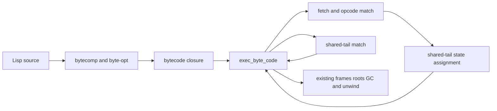
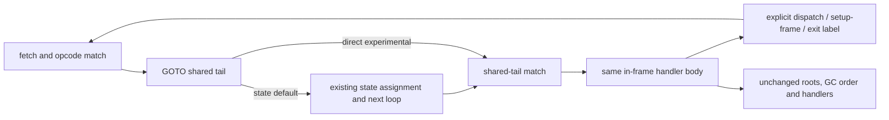
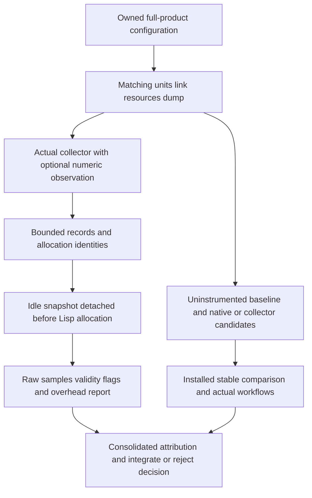

# Lisp runtime modernization: evidence and first bounded implementation

## Explicit physical product libraries (P464)

The first aligned original-corpus pair stopped before launching any editor:
the frozen driver inferred an App-local Lisp directory while the official
installed product uses its P462-bound shared library directory. The original
child exit2 and outer failure remain unchanged; all61 product identities and
complete receipts passed postflight, and the controller fully reaped its tree.

`--stable-product-libraries` selects registered physical Lisp roots using the
single `FEMACS_STABLE_PRODUCT_LISP` bridge key. It requires execute all/stable,
an explicit reference selection and an active stable pair scope. All48 declared
candidates remain supported. Collector/observer values and all other environment
keys retain strict validation; the official installation is not reshaped.

The coordinator captures the five current stable Python modules and the module
fixture configuration header into its owned output, protects them with the
existing artifact owner, and selects that driver only for stable actions. Helper
imports resolve inside this snapshot. The header is captured and revalidated
without adding a second non-Python entry to `harness_sources`; the per-file
module fixture binds the actual header hash. The original runtime wire schemas
are unchanged; explicit roots are recorded in existing `runtime_environment`.
P463 reconstructs the same environments when assessing closed stage results.

Root sources, captured sources/header, selection receipt and frozen counterparts
are rechecked alongside all61 products. Existing P461 runner selection composes
with this path; original tests, libraries, data and the frozen build stay intact.

- [x] C464: complete explicit-root and owned-harness implementation.
- [x] A464: four file/process integration cases and seven real editor processes;188 original cases passed.
- [x] A464-P:27 post-functional scope/path/header/lifetime protections passed.
- [x] A464-R: independent final review accepted; zero confirmed defects.

Synthetic integration retains its explicit stand-ins and acquisition isolation;
it does not certify original Lisp behavior. Separately, the five admitted
products pass the original22-case help file (110 observations), and the selected
reference/Cocoa-native products pass the original39-case module file
(78 observations). Both real module fixtures compile against the captured header.
All eight functional postflight checks pass; the first registry-shape failure
is retained as a failed predecessor. Five related regression groups pass.
CLN226 retires only consumed generated corpus/context copies and a redundant
publication copy;61 product receipts and the frozen export pass post-cleanup.
Independent final review accepts this unit with zero confirmed defects.
The complete555-file/48-candidate run remains pending.
[Measured scope and recovery](../maintenance/releases/2026-11-10-stable-product-libraries.md).

## Evidence-bound original stable-case accounting (P463)

The human approved itemized classification while retaining all555 original
entrypoints and all48 candidate profiles. Required functionality, actual port
regressions and unexplained differences must still be fixed. This supersedes
the former literal zero-skip policy; it does not authorize changing original
tests, libraries or data, or relabeling their outcomes.

`stable-classification.py` consumes closed original stage results after evidence
exists. It admits the P462 reference selection and all61 products, calls the
current `stable-suite.read_completion` over the unchanged frozen writer, and
writes separate accounting. The original child exit, failure/skip status,
`passed_count`, `failure_count` and `corpus_complete` keep their original meaning.
The original passing count includes ERT-declared expected outcomes according to
the existing runner; classified cases never increase it.

The catalog is `femacs-stable-classification-v1`: exact manifest and reference
selection SHA256; `contexts[profile]` binds context/run/completion SHA256; rules
name an exact profile, file, case ID, original input SHA256 and actual two-sided
status/diagnostic/event signatures. Context includes the entire profile,
program/dump/library identities, environment, harness and reference epoch.
Each rule also binds a reason and bounded literal-LF source anchors, including
the unchanged original test. No wildcard, tag exemption or historical31.1
runtime reuse is provided. A re-execution needs its own reviewed actual evidence.

Three categories are supported. Invalid upstream tests retain two failed
outcomes. Explicit optional capabilities permit observed skips, never failed
tests; required runtime features and declared native/window capabilities cannot
be excused by absence. Version evolution requires matching failures, both source
versions and a bound successful same-version original-file control with the
same candidate program/dump and a verified test fixture. Classification is an
evidence contract, not an automated proof that a written explanation is sound;
the independent review also checks those explanations and feature obligations.

The detailed JSON is decoded row by row in two bounded passes, without retaining
all diagnostic payloads. Full original file order, per-file evidence, generated
ID counts, registration, raw assessments and conservation are verified. Identity
change, incomplete execution, cleanup/registration/protocol failures and every
unmatched nonpassing case remain blocking. Catalog/source/control/raw evidence
is rechecked. The tool starts no editors or compilers and does not delete failure
state. Retained state is retired separately only after its evidence is consumed.

Use `--build`, `--reference-selection`, `--classification`, one or more closed
`--run-results`, and a fresh `--out`. Partial pair accounting states the remaining
profiles; only all48 accepted pairs can set `classified_stable_phase_complete`.
`compatibility_accepted` and Goal completion remain false pending the actual
full matrix and required feature coverage. This post-run entry avoids requiring
unknown future receipt hashes or changing a running catalog.

- [x] C463: complete classified reader and closed-stage command.
- [x] A463: four file/process integration cases pass using two actual Python
  children and two555-file synthetic runs. Whole-product admission is isolated;
  no actual editor or original corpus execution is claimed by these fixtures.
- [x] A463-P:24 post-functional identity, scope, event, source and failure
  protections pass; existing stable/runner integration and protections pass.
- [x] A463-R: independent final review accepts implementation, evidence and
  boundaries with zero confirmed defects.

[Measured tool delivery](../maintenance/releases/2026-11-10-stable-classified-accounting.md).
Actual full original-file runs and their classification catalogs remain pending.

## Explicit aligned reference epoch (P462)

The user authorized the official package installation pinned to upstream
`fd7afced4036fc1a221567d70705d20a2bd64713` and retention of the existing icon
configuration. The installed32.0.50 reference and its client now pass signature
verification; the real runtime probe and complete61-profile input admission
pass. Existing candidate programs/dumps/resources, compiled source and historical
31.1 observations keep their identities.

`--reference-selection` applies to prepare/execute/components and composes with
P461 runner selection. It binds an owned selection/products registry plus actual
recipe, install/runtime probe, captured patches and source-tree comparison.
Only the reference program/dump/resources/native feature may change; all60
candidate dictionaries, order, source cohorts and whole-product receipts remain
fixed. Default consumption rejects a replaced reference; explicit admission
reads its historical dictionary without opening the retired installation.

The package's runtime repository variable is null. Source commit is verified
through the pinned recipe and actual Homebrew install receipt; no synthetic
runtime value is substituted. A present runtime revision must match exactly.
Recorded capabilities, program/dump argv, reaped probe and installed identity
are cross-checked, then rechecked with every bound input on exit.

- [x] C462: complete single-protocol selection and coordinator integration.
- [x] A462: five file/process integration cases and actual installed-reference
  probe plus all61 complete product receipts pass; default/explicit runners
  compose and real owned-file protection/release is exercised.
- [x] A462-P:23 post-functional scope/provenance/mutation protections pass;
  existing phase/runner regressions remain passing.
- [x] A462-R: independent final review accepts the complete reference transition;
  zero confirmed defects.

[Installation, measurements and boundaries](../maintenance/releases/2026-11-10-aligned-reference-selection.md).
The old31.1 semantics phase is not relabeled. Full555-file/48-candidate stable
and qualified performance acceptance remain open. CLN225 removes consumed
reference source/cache and temporary verification material with public ledgers.

## Explicit stable runner selection (P461)

`runtime-stage.py --action execute --execution-phase stable --stable-runner
tools/fixtures/stable-suite-runner.el` captures the supplied runner into the
owned output and binds it to the original frozen runner. The option also works
with the complete `all` phase. Its source, captured copy and selection receipt
are checked again after execution; only the owned copy and receipt enter the
artifact owner's protected set. Invalid scopes or unsafe, empty, non-Lisp or
over1MiB inputs fail before output creation.

The coordinator passes the actual default or captured runner to the existing
frozen writer. Its bounded completion reader requires the matching unique
non-Python `harness_sources` entry. The completion writer and schema, compiled
products, source export, original555-file corpus and48-profile scope remain
unchanged. P462 separately binds the replacement reference epoch.

- [x] C461: complete explicit selection, bounded capture and postflight binding.
- [x] A461: eight real file/process/writer/reader integration cases pass through
  nine Python children, including the actual owned-file protection/release
  lifecycle; synthetic inputs do not certify editor behavior.
- [x] A461-P: after functional acceptance,20 critical CLI/scope/mutation checks
  pass; the existing phase integration and31 phase/stable protections pass.
- [x] A461-R: independent final review accepts the complete tool unit;
  zero confirmed defects.

[Evidence and boundaries](../maintenance/releases/2026-11-10-stable-runner-selection.md).
The P460 actual editor repair remains independently accepted; these additional
checks establish coordinator selection rather than another editor acceptance.

## Stable source-context library lookup (P460)

The closed first-pair audit pins five shared unexpected help-description
failures to the harness replacing physical product Lisp paths. Preloaded
definitions still name physical files; losing those prefixes prevents help
from shortening filenames and moves them off the tested first line.

The bridge now keeps mapped context paths first, retains unrelated entries,
and appends the original product directories with their original spelling.
The compiled `9e257276` matrix and its frozen source are unchanged. No original
test, library, data, selector or failure assessment changes.

- [x] C460: implement the complete source-context path correction.
- [x] A460: real complete22-case help-fns execution on the reference and four
  current normal baseline/native products through the original batch/context
  and fixture pipeline; all cases pass, identities stay fixed, owned state
  retires, and the five original failures are explicitly checked.
- [x] A460-P: after functional acceptance, protect path precedence, product
  subdirectories, unrelated/nil entries and prefix boundary handling.
- [x] A460-R: independent final review of the complete repair unit accepted;
  zero confirmed defects.

This bounded repair does not complete the555-file or48-profile corpus. Four
other shared unstable/FIXME failures stay unexpected failures with no waiver;
the existing comparator and whole-Goal completion rules remain in force.

[Measured repair and protection](../maintenance/releases/2026-11-10-stable-source-context-paths.md):
110/110 original-file observations and30/30 post-functional path protections
passed on five actual products; inputs and products stayed unchanged. CLN223
retired only the consumed owned corpus/context copies. Independent final review
accepted the repair; full stable and performance acceptance remain open.

The current frozen matrix coordinator still selects its frozen stable runner
by default. Before the next formal stable phase, explicitly bind the corrected
runner through the coordinator without changing compiled product identities.
The existing process-reporting bridge does not select the stable runner. The
semantics coordinator completed naturally before P461 changed these tools;
its receipt records the coordinator digest computed at import. Direct bounded
acceptance above used the explicit corrected runner and is not a claim about
the default frozen phase.

## Complete runtime measurement contracts (P459)

Baseline `1a8f68e4`; independent G5 static audit is closed. Complete its exact
dispatch/report/statistics gaps before freezing the next matrix. Existing
native/observer/collector implementations and Lisp workloads remain unchanged.

```text
execute performance/all
  primary performance -> own output -> strict performance completion
  performance-fallback -> distinct output + permanent-Full flag
                       -> strict performance completion and mode binding
both: all61 product identities before/after, frozen harness and original input

startup child: spawn timestamp -> owned wait thread observes reaped exit
               main thread keeps memory sampling/deadline/group cleanup
               lifetime endpoint + actual RSS/footprint + quiet observations
  2 warmups retained,7 measured samples/profile -> same statistics/comparisons

report: bounded full-scale raw JSON -> validated copied summary -> safe output
        no accepted speedup inferred from collection success
```

| Current source location | Complete change | Acceptance scope |
| --- | --- | --- |
| `tools/runtime-stage.py EXECUTION_PHASES`, `execution_plan`, `_execute_profiles` | Add distinct `performance-fallback` action ID to performance/all; canonical inner action remains performance, append the explicit flag, bind its mode through the completion input record. Preserve default full scope and all61 protection. | Real child/strict receipt integration verifies both runs and rejects a mode mismatch. |
| `tools/runtime-execution.py main`, `write_completion`, `read_completion` | Persist the explicit performance mode in inputs and reject a changed/mistyped mode binding; retain streamed detailed/index/retirement identities. | Current writer/reader and actual completion files, not an exit-code substitute. |
| `tools/runtime-execution.py run_process` | Add opt-in observed-exit timing for startup, using one owned wait thread and monotonic timestamps. Preserve total `seconds`, timeout and process-group cleanup; always join the waiter. | Actual finite Python child exits, memory observations and timeout/unwind. No editor claim from this integration. |
| `tools/runtime-execution.py prepare_memory_sampling`, `sample_memory` | Retain only immutable sampler bindings, initialize before measured child spawn and record preparation time separately. Reopen the PID after measurement because a psutil Process caches creation time. An empty retired tree is not a zero-valued memory sample. | Preparation is outside the measured window. Unknown/reused identities and missing positive observations cannot pass; no cached measurement substitutes. |
| `tools/runtime-execution.py run_performance` | Add successful measured startup rows to samples as case/mode startup, validate memory/timing/identity, retain raw warmups, and pair same-round reference and same-layout major/young startup controls. | Distinct startup lifetime and body timing; no20ms polling quantization claimed as startup time. |
| `tools/runtime-acceptance.py PERF_MODES`, `summarize_performance` | Admit distinct startup mode; add pause median/MAD and real footprint/accounted maxima. Missing physical observations remain null. Keep7-round, quiet and p95/p99 evidence requirements. | Actual writer/reader integration followed by critical accounting protections. |
| `tools/runtime-measurement-report.py` bounds, `CASE_FIELDS`, `validate_case`, fallback validation | Finite256MiB input,32,768 sample and4,096 case limits; validate/copy the new fields and distinct startup mode. Fallback accepts only interpreted/bytecode with no startup. Keep strict types, privacy, unknown-field and false-acceptance gates. | One full-shape primary report above the old limits and a fallback report, with actual bounded file/CLI reading. Synthetic values are never editor performance evidence. |

The current primary still runs303 mode/observer controls ×9 plus49 startups
×9 =3,168 child processes. Including measured startups gives13,069 samples
and1,867 summary cases. Body comparisons remain960, with48 reference and16
same-layout startup comparisons:1,024 total. Fallback remains882 workload
processes,4,116 measured samples and no repeated startup/native/observer sweep.
These are design cardinalities, not completed executions. The finite byte
limit is an engineering admission bound; actual full-matrix serialized size
has not yet been measured and must not be claimed from this estimate.

Phase22 remains collector preparation,23 frozen non-cons registry roots and24
dirty/raw-tainted old-cons children. Their records, allocation and survival
buckets remain in original per-case raw observations; do not label23/24 as
mark/sweep or invent phase averages. Interpreted/bytecode/native compilation
setup stays outside body wall timing and remains separately recorded.

Implementation precedes complete functional integration; only after that
passes add critical protection tests in the existing phase, accounting and
report test modules. Full editor performance and adoption remain later work.

- [x] C459: complete all dispatch, input, timing, summary and report changes.
- [x] A459: actual child/receipt/timing and full-shape file/report integration.
- [x] A459-P: subsequent critical mode/boundary/statistics protections pass.
- [x] A459-R: independent source and actual scoped-result review accepts.

Actual tool integration passes16 phase/receipt child calls plus167 measurement
and report child calls. The latter use explicit synthetic editor descriptors,
not editor execution. The full-shape inputs are79,036,726 and25,609,707 bytes;
current normalizer counts match the declared primary and fallback shapes.
Post-functional protections pass86 cases. Failed short-lived sampling and
fixture metadata runs remain failed; no original observation is promoted.
[Scoped evidence and remaining work](../maintenance/releases/2026-11-10-runtime-measurement-contracts.md).

## Bytecode indirect-call frame repair (P458)

Baseline `920c9896`: the first current-corpus run observes the original
`advice-test-called-interactively-p` failure: expected `(((1 . t) 11) t)`,
actual `(((1) 11) t)`. The same original file/test and static advice libraries
match the stable source. The independent review traced `src/bytecode.rs`
`do_call!` (baseline lines1056–1302), `src/eval.rs Fapply` (2756–2871) /
`Ffuncall` (3188–3233), and `nadvice.el advice--called-interactively-skip`
(635–682). Actual dumped definitions/backtraces were not sampled.

```text
current: do_call! records apply/funcall -> shortcut overwrites that frame
         -> setup_frame enters compiled closure without the outer call frame
repair:  do_call! records apply/funcall -> ordinary MANY subr Fapply/Ffuncall
         -> new target frame -> normal return/unwind -> outer frame remains
```

Remove only the MANY-subr funcall/apply shortcut block (baseline1136–1299)
and its sole-use `bc_prepare_apply_spread` helper (465–540). The normal MANY
call and ordinary direct bytecode closure dispatch stay. Removing the nested
funcall arithmetic/make-closure shortcuts also avoids executing a target
without its ordinary observable frame. Preserve the original function value
for the existing general slow path; do not invent stack reconstruction or
symbol-name exceptions. Original tests and packaged Lisp stay verbatim.

Root and the frozen source have distinct physical nodes. The first pair used
its original compiled59d4215c image and920c9896 Python coordinator. It stopped
at336/555 files and5,596 observations when the controller's owned-process
identity sampler returned EPERM; exit125 and complete process cleanup are
recorded. Its2,450,883,304-byte peak did not reach the memory limit. The exact
process causing the permission failure was not identified. The original
partial results stay incomplete, including all259 raw failures.

After confirming the owner had exited, the unchanged canonical artifact
release cleared the owned protection flags. Separate postflight verified all61
product identities, complete product receipts and the frozen source export.
That preservation result does not complete the interrupted pair. The affected
standard Terminal/Cocoa products were rebuilt serially from empty output
roots; prior reviewed products were retained until replacement acceptance.
The original failed pair was not replayed unchanged.

- [x] C458: restore standard indirect-call frame entry and remove dead helper.
- [x] A458: rebuild Terminal/Cocoa; complete original advice-file and real
  compiled funcall/apply/backtrace/interactive-advice functional acceptance.
- [x] A458-P: afterward add and pass critical call-frame/error/unwind protection.
- [x] A458-R: independent review accepts source and actual corrected results.

The old failure remains unchanged. The current 61-profile generation and
whole Goal stay unaccepted; a source repair requires new affected products,
semantic/stable results and measured performance before adoption/installation.

[Actual corrected products and functional results](../maintenance/releases/2026-11-10-bytecode-indirect-call-frames.md):
all7 owned cases plus the original13-test file agree on three products;
11 ordinary passes and2 original expected failures per file, zero unexpected.
The60 subsequent hot-path/bytecode protections,9 local checks and6 TTY cases
pass. Independent final review accepts the complete repair unit. CLN222 retires
the3 superseded owned backups, preserving current products/releases and the
running installed App. Whole-Goal completion remains open.

## Bounded complete stable pairs (P457)

Baseline `3ac14daf`: `tools/runtime-stage.py execution_plan` (line38),
`_execute_profiles` (line437), `execute_matrix` (line531) and `main` (line650)
dispatch all48 stable pairs serially. Each pair invokes the unchanged frozen
`stable-suite.py` and all555 original entrypoint files on both programs;
the current runner has no continuation API. Total work is53,280 file calls.
No measured full-pair duration exists for this new frozen-source generation.

```text
main --action execute --execution-phase stable --stable-profile ID [repeat]
  execution_plan: validate eligible unique IDs -> original-order complete pairs
  execute_matrix: all61 products before -> unchanged frozen child/strict reader
                  -> all61 products after + complete product receipts
  result: exact requested IDs, explicit remaining IDs, bounded scope completion
```

The selector is orchestration only, with default all48 pairs. It accepts only
non-diagnostic candidate IDs and never changes the product list, compiled
fields, original test bodies, file selection or runtime configuration.
`execution_complete` still describes the explicit invocation scope;
`stable_phase_complete` requires every pair, and a subset keeps `stable` in
`remaining_execution_phases`. Only a complete `all` invocation can report
`full_matrix_execution_complete`; compatibility/performance/Goal acceptance
remain false. Duplicate IDs and wrong-phase CLI options fail before output;
unknown/diagnostic IDs fail before product snapshots or editor dispatch.

First run one complete pair under the existing runtime controller,4GiB
initial/16GiB hard and a43,200s whole-run limit, retaining the300s default
per-load/per-test limit and the existing600s macOS remote file-notify case
exception. The full new pair has unknown case count and cost, so
this is a finite calibration window, not a duration prediction. Corpus
execution is serial and owned state is retired by the unchanged inner runner.
Bind the observed duration, storage and complete-tree peak before scheduling
the other47 pairs. Timeout/incomplete results remain failures; do not invent
coverage or discard their raw evidence.

- [x] C457: implement explicit complete-pair dispatch and remaining scope.
- [x] A457: real child-process/file integration validates selected scope and receipts.
- [x] A457-P: afterward pass critical selection/completion protections.
- [x] A457-R: independent review accepts the unit before current-corpus execution.

The integration exercised5 actual Python children: one selected pair, all
explicit pairs in product order, a changed detailed receipt rejected despite
exit0, and a complete failed original outcome preserved. Its result SHA256
is `39bd84c95a6a53a30e8d02bab27b29c2af4c728b69e25d64f86607ce8846383b`.
The subsequent16 protections passed, result SHA256
`418ee4d43871502c8cf3be99b93e450e35208d1b8696c4b89d239016750ae8f1`.
They isolate compiled-product admission; no editor or original corpus ran.
Both retained outputs contain only results after retiring owned fixtures.
Controllers exited0 with full cleanup under1GiB/120s. The first integration
fixture omitted a manifest parent directory and failed before child dispatch;
its failure log remains, and the complete fixture tree was still retired.

## Current execution phases (P455)

The current signed-source build and negative preparation are recorded in the
[matrix build report](../maintenance/releases/2026-11-10-current-runtime-matrix-build.md).
The outer coordinator may now schedule complete phases without changing any
frozen test body, product or inner acceptance rule:

```text
tools/runtime-stage.py main / execute_matrix
  execution_plan: all -> ert, negative, dump, relocation, performance + stable pairs
                  semantics -> ert, negative, dump, relocation
                  stable -> all reference/candidate corpus pairs
                  performance -> existing complete measurement action
  _execute_profiles -> frozen tools/runtime-acceptance.py or tools/stable-suite.py
  existing process receipts -> strict completion readers -> product/source postflight
```

Baseline `1a60b96b`: `tools/runtime-stage.py` previously dispatched all five
actions and then all stable pairs from `_execute_profiles` (line415); its
`execute_matrix` (line520) already enclosed the full execution in immutable
product checks. `execution_plan(phase, products)` adds only the scheduling
partition and expected outer case IDs. The CLI `--execution-phase` defaults
to `all` and rejects nondefault phases outside `--action execute`.
`execution_complete` describes the requested phase; `full_matrix_execution_complete`
can be true only for `all`. Missing/duplicate outer cases, incomplete inner
receipts or changed inputs cannot pass. Other phases remain explicitly listed.

Run each invocation under the existing external resource controller with a
whole-phase deadline and unchanged per-case `--timeout`. Begin with
`--action execute --execution-phase semantics --build BUILD --out FRESH
--retention-mode files --timeout 300`. All61 profiles remain in the product
list; applicability remains owned by each existing inner action. This does
not parallelize measurement or reduce the 48 stable pairs/53,280 file calls.
Review actual phase timings before admitting the next expensive phase.

- [x] C455: implement phase selection, exact dispatch coverage and result scope.
- [x] A455: real file/process integration verifies dispatch and strict receipts.
- [x] A455-P: add and pass critical scope/invalid-selection protections afterward.
- [x] A455-R: independent review accepts the complete coordinator unit; actual runtime outcomes remain separate.

The owned integration ran12 real Python children across all four phase choices
and rejected forged corpus receipts despite child exit0. It isolated compiled
product admission and did not execute an editor. Its result SHA256 is
`d2daa03bf28cb76110857c7f5232c240c3cc9fe1f8c346cfe541c4d1274de600`.
The subsequent14 scope protections passed, result SHA256
`aa4c1d95af1c2b44d6056c769ae943e36d26ccbf89475c7a8c792da68a46efd1`.
Both fresh outputs retain only their result; synthetic trees were retired.
Controllers exited0 with complete cleanup under1GiB/120s. This accepts
orchestration behavior, not the pending61-profile semantic execution.

Current acceptance amendment (2026-10-25): the user requires100% compatibility
and measured performance improvement against the system-installed macOS stable
editor, including stability, memory and GC latency. Its exact binary/dump,
version, configuration and execution modes must be recorded. No FTP download or
pristine-source rebuild is required; an optional Linux comparison may use its
distribution package. The authoritative new requirements and open coverage are
in [the persistent plan](modernization.md#full-scope-sequence-and-finish-conditions).
Historical measurements and rejected candidates below retain their original
controls and limits; none is a new stable-baseline speedup or complete
compatibility result. Rejecting a research candidate cannot by itself close the
current Goal's improvement requirement.

Current work continues in [Persistent Goal runtime stage A](#persistent-goal-runtime-stage-a).
That section binds the next implementation to current source; historical
experiments below are not an instruction to repeat the rejected dispatcher.

Baseline: `2415a335`, after local-delivery and tooling modernization. The user authorizes interpreter/compiler performance work and investigation of native/JIT compilation and generational GC. The real shared-tail dispatcher experiment below has been rejected and its production/build changes removed. The delivered VM stays unchanged; the historical design is retained to explain the measured result. It is neither a new bytecode format nor a claim that Lisp native compilation or a new collector has shipped. Current tracking remains in `modernization.md`.

## What exists today

```text
lisp/emacs-lisp/bytecomp.el, byte-opt.el  source -> optimized bytecode/constants
src/eval.rs                            Ffuncall -> funcall_general -> funcall_lambda
src/bytecode.rs                        exec_byte_code, bc_frame, shared-tail state loop
src/alloc.rs                           roots, conservative stack marking, heap tracing/sweep
src/include/lisp.rs                    tagged values and mutator stores
src/comp.rs                            native compiler integration, inactive target arm
build-support/macos/{terminal,cocoa}/config.json  HAVE_NATIVE_COMP undefined
xtask/src/main.rs                      configured unit compiler and independent linking/dumps
```

`src/eval.rs:3103` recognizes compiled closures with a fixnum argument descriptor and calls `exec_byte_code` (`src/bytecode.rs:524`). Lisp byte compilation already exists. The Rust implementation of the VM is compiled to machine code, while ordinary compiled Lisp still executes bytecode. `Fnative_comp_available_p` (`src/comp.rs:1232`) returns nil under the active configurations; the inactive integration uses external libgccjit APIs. Transcription coverage does not validate that inactive compiler or its dependency/ABI/cache/loading chain.

The current VM maintains its Lisp frame and stack in `bc_thread_state`/`bc_frame`. At `src/bytecode.rs:654`, a dispatch loop first handles a nonzero `goto: c_int` by matching one of eight shared tails. Opcode arms otherwise fetch/decode an instruction, then some set that state for the next iteration. This is a plausible cost, not demonstrated causal attribution: LLVM may already fold parts of it, and source branches are not branch measurements. The rejected external asm leaf had state-transfer costs; it does not establish that all in-frame dispatch designs fail.



## Actual measurements and their limits

Stage II recorded five alternating rounds, 110 samples, actual executable/dump/corpus hashes and median/MAD/IQR. The existing local reference is an explicit comparison artifact; its presence does not prove a fresh stable-version build. Selected medians in milliseconds:

| case | candidate | existing reference | ratio |
| --- | ---: | ---: | ---: |
| bc-loop | 7.3562 | 5.0490 | 1.457 |
| bc-sum | 15.4400 | 11.9581 | 1.291 |
| bc-car | 7.4520 | 4.9021 | 1.520 |
| load | 11.9400 | 6.2230 | 1.919 |
| edit | 21.0249 | 22.2270 | 0.946 |
| gc | 120.7421 | 115.8969 | 1.042 |

The host was busy (load/core about 1.00) and baseline saving was explicitly forced. These are investigative readings, not reliable speedup/slowdown promotion criteria. A similar GC time to the reference cannot show that generational collection would be useless: both run related collection algorithms, and no pause distribution or object-survival study was collected. Likewise, a load gap does not isolate reader, evaluator, allocator and filesystem costs. All 95 authored differential forms passed; this is bounded compatibility evidence, not full ERT, all plugins or latest stable language acceptance.

## GC and native backend feasibility

The collector traces static roots (`visit_static_gc_roots`, alloc.rs:6191), frame/bytecode roots and conservative stack regions (`mark_memory`, alloc.rs:5482). It maintains nonmoving object identities, weak tables and finalizers; string byte storage already compacts (`compact_small_strings`, alloc.rs:2313), so describing everything as immobile would be wrong. `XSETCAR`/`XSETCDR` (lisp.rs:905/908), `ASET` (:1374) and `SET_SYMBOL_VAL` (:1528) write directly. They are examples, not a complete inventory of all stores: raw field writes, buffers, hashes, pdump objects and FFI must also be accounted for.

Go's current runtime describes a concurrent, precise, non-generational, non-compacting mark/sweep collector with write barriers and size-segregated allocation. Its locality work is useful design input; a language's name is not a collector specification. [Official runtime source](https://go.dev/src/runtime/mgc.go), [GC guide](https://go.dev/doc/gc-guide), [Green Tea design](https://go.dev/blog/greenteagc).

Java G1 uses regions, young/old generations, remembered sets and evacuation, with a throughput/latency tradeoff. Those facilities rely on runtime/compiler cooperation. A nonmoving young generation would still need complete old-to-young store tracking here; a moving design additionally requires precise relocation or safe pinning of conservative roots and interior pointers. Both are possible research directions, not drop-in substitutions. [G1 design](https://docs.oracle.com/en/java/javase/25/gctuning/garbage-first-g1-garbage-collector1.html).

LLVM supplies compilation and GC integration mechanisms, not the editor's collector or Lisp semantics. ORC can host eager/lazy native materialization. Safepoints/statepoints and stack maps require a root model, and relocation requires consistent updates of derived pointers. Any Lisp backend must also preserve evaluation order, dynamic binding, errors/throw/quit, GC visibility, debugger/advice/redefinition, code lifetime and dump compatibility. [LLVM GC integration](https://llvm.org/docs/GarbageCollection.html), [statepoints](https://llvm.org/docs/Statepoints.html), [ORC](https://llvm.org/docs/ORCv2.html).

| route | reusable work | prerequisite proof | current decision |
| --- | --- | --- | --- |
| in-frame bytecode tail dispatch | current decoder, handlers, frame/GC/unwind ABI | all shared-tail transitions and actual A/B disassembly/timing | first bounded implementation below |
| allocator/reader tightening | existing bitmaps and data structures | phase attribution, retained memory and latency measurements | next measured hotspot, no assumed bottleneck |
| existing libgccjit integration | current Lisp native compiler and comp.rs structure | active-arm compile/FFI/dependency discovery, ABI hashes, real .eln load/unload and bundle delivery | feasibility work, not enabled by a config toggle alone |
| LLVM native/AOT/JIT | mature backend and ORC infrastructure | Lisp IR/lowering, roots/safepoints, unwind/deopt and cache/code lifecycle, real workload cost | candidate backend, not declared best without a prototype |
| nonmoving young generation | mostly stable object addresses | full store/barrier inventory, remembered set, weak/finalizer/pdump semantics and survival/pause data | separate collector design after attribution |
| moving regional collector | potential compactness/locality | precise roots or pinning, interior pointer relocation, every FFI/mutator boundary | largest change; preserve it as an option, not the first patch |

## Historical experiment design (retired; not current build instructions)

No algorithm, opcode, object/frame layout, Lisp compiler input/output or collector policy changes. Both dispatch modes use the same eight handler bodies. The experiment stays behind a build-time switch, so its overhead is eliminated from the unselected binary; there is no per-opcode external function or asm handoff and no runtime environment lookup in the hot loop.

```text
src/bytecode.rs                  MODIFY shared-tail macros + compile-time GOTO selection
xtask/src/vm_dispatch.rs         NEW parse mode -> rustc cfg arguments, primary-owned component cases
xtask/src/main.rs                MODIFY unit_codegen_flags and module registration
xtask/Cargo.toml                 MODIFY register vm_direct_dispatch feature
tools/fixtures/bytecode-runtime.el NEW independent partner-owned semantic and observation cases
tools/test-bytecode-runtime.py   NEW independent partner-owned strict multi-artifact driver
docs/runtime-modernization.md   this design and resulting evidence
docs/modernization.md           sole construction/acceptance checklist
PORTING.md, docs/status.md, docs/current-state.md  decision and delivery boundaries
```



### Precise change map (baseline 2415a335)

| ID | source and anchor | change / invariants | cases |
| --- | --- | --- | --- |
| III-D1 | src/bytecode.rs:513-541 state constants and goto local | Retain state constants and local only for state configuration as needed; retain op/arg/type_/top/pc types and scope. Public exec_byte_code symbol and signature unchanged. | all semantic cases; default/direct compile |
| III-D2 | src/bytecode.rs:649 NEXT and :654-825 state-tail block | Move NEXT definition inside the labelled dispatch body, expand to `continue 'dispatch` so an invocation inside Bswitch's search cannot continue the inner loop. Define VARREF/VARSET/VARBIND/DOCALL/DOUNBIND/EXIT/OP_BRANCH/PUSHHANDLER macros in that scope with the existing bodies. Keep same raw locals/frame and no Drop-owning local across sys_setjmp. State-only top match calls those same macros. GOTO!(label) expands to direct handler invocation under feature vm_direct_dispatch, otherwise only the original state assignment. | label boundaries; nested calls/GC/errors |
| III-D3 | varref/set/bind/call/unbind arms :841-931; branch/return :935-990; handler :1038/1043; Bswitch :1827/1840 | Replace state assignments with GOTO calls, preserve fetch/decode order and operand consumption. Preserve state-mode trailing NEXT and Bswitch search break; guard only unreachable direct-mode trailing transfers. Exit still reaches the existing frame restoration and TOP return. No opcode arm is removed. | short/8-bit/16-bit operand families; linear/hash switches; returns |
| III-D4 | OP_BRANCH :769-782 and PUSHHANDLER :786-821 | Preserve new_pc comparison, quitcounter wrapping, maybe_gc before maybe_quit, then pc assignment. On setjmp return preserve handler unlink, top/destination/root reload, optional bounds reload, pc reset, pushed thrown value, then branch. DOCALL preserves backtrace/GC/debugger order and lexbound continue setup_frame. Macros are not assumed risk-free; these transitions require runtime tests. | quit, caught signal/throw, nested handlers, GC under bytecode and debug/call state |
| III-D5 | NEW xtask/src/vm_dispatch.rs; main.rs:139 unit_codegen_flags; Cargo.toml [features] | `flags(mode:Option<&str>)->Result<Vec<String>,String>`: absent/empty/state -> empty flags; direct -> `[--cfg, feature="vm_direct_dispatch"]`; other values error. `FEMACS_VM_DISPATCH` read once per compiler invocation, default state. Register feature, test parse/default/direct/invalid without editing shared env. Do not change target CPU/overflow checks/PGO or other configuration. | primary component cases, both compiler legs |
| III-D6 | NEW fixture and driver | ERT tests execute real interpreted/bytecompiled functions, all shared-tail families, operand widths, special variables/watchers, calls/arity, branches/switch, catch/condition-case/unwind, quit and allocation/GC. Record deterministic critical observations and compare them across actual artifacts, beyond equal pass counts. Driver reuses strict ERT parser, isolated HOME/raw logs and real product identity hashes; missing/skipped/error/incomplete cases fail. | independent partner case matrix below |

Representative selection (identical handler bodies are not rewritten into separate Rust helpers):

```rust
macro_rules! GOTO {
    ($label:ident) => {{
        #[cfg(feature = "vm_direct_dispatch")] { $label!(); }
        #[cfg(not(feature = "vm_direct_dispatch"))] { goto = $label; }
    }}
}
```

The exact handler macros are moved from the existing state arms; calls to OP_BRANCH from the restored handler also use GOTO. `NEXT!` is deliberately bound to the outer dispatch label. Conditional branch fallthrough still consumes/discards its value once. Source-level removal of a state transition is not proof that generated machine code is faster.

### Required test matrix and ownership

The independent partner owns only the two new test files, writes all cases before execution and returns their exact map. Primary owns all production/build/documentation changes and compiler-mode component cases. No subagents or remote CI.

- T-VM1: varref/set/bind short, one-byte and two-byte operands, including >255 constant indices; emitted opcode/disassembly evidence must establish widths instead of assuming the compiler emitted them.
- T-VM2: subr/interpreted/lexbound compiled calls, optional/rest/wide arity, nested returns and wrong arity/error; preserve backtrace/evaluation depth restoration and argument order.
- T-VM3: conditional/unconditional forward/backward branches, nil/non-nil else-pop stack behavior, small linear and larger hash switch, exact once-only side effects.
- T-VM4: dynamic binding/unbinding, trapped symbol writes/watchers and unbound symbols, success and exceptional unwind with restored state.
- T-VM5: nested catch/throw/condition-case/unwind-protect, normal/popped handlers and nonlocal returns; allocate/collect while relevant bytecode constants/locals/return values remain live.
- T-VM6: backward-loop quit behavior, deep/nested calls, root/stack growth, forced-GC cases; compare deterministic observations across compiled modes/reference rather than demanding that an interpreter allocate identically.
- T-VM7: default/state/direct/invalid build-mode parsing and unchanged public ABI/opcode set; static label assertions supplement, never replace, execution.
- T-VM8: actual state/default and direct builds/dumps, full authored differential corpus, selected real ERT, terminal keys/files and direct Cocoa key/file/IME regression if the candidate survives semantic testing.
- T-VM9: alternating state/direct measurements with all samples, product/source/config identity, code-size/disassembly comparison and real workloads. Record host load/variability. No fixed invented speed threshold, no slower substitute reference or reduced functional standard.

### Build and acceptance recipe

After all A/B/C work is written, freeze exact sources and test files. First compile/check mode parsing and both VM configurations on the changed unit. Then export the complete staged tracked snapshot into an owned source tree without reference/cache and build the state terminal once. Preserve its executable/dump quartet and manifest. Existing compiler/link/dump commands may rebuild only bytecode for the direct variant if every reused object/config/source is bound to that same snapshot; otherwise rebuild the full object set. Both variants load the same immutable generated Lisp corpus. Keep the delivered root terminal/app intact during experiments. Record every command/config/mode and product hash; file presence alone is not build provenance.

Reusing standalone target configuration means preserving its actual config/epaths/object/tool-object/build-root environment and PGO-off state. Re-linking requires the current fingerprint tool and a fresh dump bound to that executable. Never mix a stale dump with a new binary or a checking/cross-target object with the normal host set. If incremental reuse cannot be established, use a clean full build rather than infer compatibility.

Run all semantic cases against state/direct and the existing reference. Then run the 95-form audit and real terminal workflows. Only a semantically sound candidate proceeds to full Cocoa build and native UI/IME checks. Any failure is retained and investigated in one consolidated repair batch; no retry-to-green or skipped required case. Performance promotion requires reliable actual-workload benefit without unresolved correctness, memory, key/IME or important workload regression. Busy-host results cannot alone justify switching the default. If the direct route fails, remove its active experiment from normal delivery and retain an honest compact conclusion; do not reflexively escalate to JIT, moving GC or a full asm rewrite.

The larger native/compiler and collector routes remain open after this bounded result. Before a collector change, collect object age/survival, allocation and retained-heap data, GC phase/pause distributions and a complete mutator/root inventory. Before a new native backend, specify typed/boxed IR, runtime calls, exact roots, safepoints, deoptimization and error/debugger/redefinition/code-lifetime behavior, then test real Lisp functions in the actual editor. No backend or collector is called best from documentation or an arithmetic toy.


### Independent design challenges resolved before B/C

The review identified concrete hazards and the design adopts them: explicitly cfg-remove the state guard/match in direct builds; define OP_BRANCH before PUSHHANDLER; merge Bpushcatch/Bpushconditioncase into one opcode arm selecting the unchanged handlertype so the direct VM has one setjmp expansion site; merge Bcall..Bcall7 into one arm that decodes arg with `match op { Bcall6 => FETCH!(), Bcall7 => FETCH2!(), _ => op - Bcall }` and expands DOCALL once. Tiny varref/set/bind/unbind tails may remain at their original operand-decode sites. State/default and direct use those same bodies. Seven old immediate trailing NEXT/break transfers are cfg-kept only in state mode, preserving default behavior without suppressing unreachable-code lints. No new external instruction dispatch function is introduced.

The state terminal is rebuilt from the full experimental source before comparison, so macro factoring is not confused with selecting direct dispatch. Preserve the original delivered terminal as a third control. Incremental direct rebuild is permitted only after verifying that vm_direct_dispatch affects bytecode.rs alone, its public ABI/layout is unchanged, all other objects belong to the exact same source/config, and both bytecode normal/checking objects are replaced. Record the actual standalone child environment and rebuild fingerprint/link/dump with that same environment. Copy every complete quartet/manifest before replacing a variant. If objects are absent or input identity is uncertain, full rebuild is required. Object filename or modification time is insufficient proof.


## Follow-up: release compiler bytecode coverage (A)

The state/original control exposed a different issue: fresh-export load median 95.005 ms vs delivered-tree 18.318 ms. This does not attribute the gap to dispatch. Direct inspection shows the clean build lacks `emacs-lisp/{byte-opt,bytecomp,cl-extra}.elc`, while the delivered tree contains them; macroexp/cconv are already compiled by the dump closure. The load workload explicitly reloads those five libraries. A release should not derive compiler-library performance from old ignored products.

Exact bounded change: `tools/bootstrap-resources.py`, `Generator.bytecode`, after collecting the bootstrap load history and before international tables, add the five tracked compiler libraries (byte-opt, bytecomp, macroexp, cconv, cl-extra) with deduplication. Missing mandatory source must fail. Before compilation remove only those five owned generated outputs, so an old ignored file cannot conceal a batch compilation error; after compilation verify their `.elc` products exist. Keep the original Lisp sources untouched, no reference/cache/network/native backend dependency and no all-library compilation expansion. `--all-bytecode` still includes them; an explicit user scope remains scoped and does not acquire unrelated mandatory outputs.

B cases in `tools/test-compiler-resources.py`: isolated minimal owned input tree and command recorder prove dump closure + history + compiler inputs remain selected exactly once; missing required source fails; explicit scopes stay scoped. These light cases do not execute a Lisp compiler. D separately runs the actual owned generator in the clean export, checks source/output identity, then compares immutable before/after five-library input snapshots with one identical actual VM, alternating order and retaining every sample/median/MAD. Each snapshot contains identical raw source bytes; only the three missing compiler bytecode outputs differ. Source-only and compiled input loading must produce equal defined compiler/closure observations. Existing bytecode semantic/ERT acceptance remains separate; no JIT/GC claim follows from precompiling existing Lisp libraries.

Source tree change: one Python generator and one new component test; existing Lisp/data and VM production sources are unchanged. Primary owns both; independent partner reviews the frozen final change. Checklist continues in modernization.md.


## D results and delivered boundary

Both VM configurations compiled normal/checking; mode components 3/3, original driver contracts 9/9. A tracked-only clean export completed the full terminal build/dumps with 324 compiler legs, 823.914 seconds, peak RSS 422084608 bytes; incremental direct rebuild replaced only bytecode.o and bytecode.checking.o, then re-linked and regenerated the matching dump (9.029 seconds). Hashes bound every reused object/config and both complete executable/dump quartets. Root terminal/app were not overwritten by the experiment.

Both state/direct passed all 95 authored differential forms against the existing local C reference. Selected eval/alloc ERT passed 27+4 cases on each of state, direct and reference. Initial new semantic suite failed the same five cases on all three: undeclared generated specials, lexical variables accessed through dynamic symbol values, folded wide constants, and captured nil recursive closure. A depth test also accepted any error instead of specifically proving excessive nesting; all original logs are retained and the fixture is corrected rather than changing VM semantics or skipping cases. Final corrected-suite evidence is appended below.

Eleven alternating rounds (242 observations including startup) on the same generated Lisp input tree:

| workload | state median ms | direct median ms | direct/state |
| --- | ---: | ---: | ---: |
| bc-loop | 9.670 | 9.938 | 1.028 |
| bc-sum | 18.852 | 20.506 | 1.088 |
| bc-car | 9.541 | 9.731 | 1.020 |
| load | 95.541 | 93.361 | 0.977 |
| edit | 27.414 | 28.122 | 1.026 |
| gc | 160.393 | 162.426 | 1.013 |

Load/core was 0.706. These are bounded investigation results, not quiet-machine certification. The VM text grew 6784 -> 7196 bytes (1696 -> 1799 AArch64 instructions); each still has one indirect dispatch branch. Static counts are not dynamic branch/predictor measurements. There is no demonstrated benefit sufficient to retain this candidate, so all active VM macro/feature/build-mode code is removed. Do not generalize this to the infeasibility of JIT, LLVM or generational GC. Current Cocoa/terminal product code remains the stage-I delivered VM.

Seven state/original control rounds (154 samples) showed compiler-library load 95.005 vs 18.318 ms; bytecode medians alone were near each other. That resource-tree difference prevents attributing this load gap to the macro factoring. The exact missing bytecode inputs were identified and corrected as above.

Actual corrected compiler generation in the clean export completed in 20.759 seconds (RSS 126304256 bytes). Four component cases pass with per-case timing; no reference tree is consulted. Before/after scopes retain identical five raw source files and the same existing macroexp/cconv bytecode; only the three missing bytecode products differ. One identical actual state VM alternates order for seven rounds (154 samples). All fourteen runs confirm the selected path/extension was really loaded and produce identical compiled closure results plus wrong-arity observations. Selected five-library load median 69.520 -> 12.2292 ms (MAD 3.098/0.5362 ms, about 82.4% lower); load/core0.419 remains a limitation. This is not an overall editor speed claim and startup/microbench noise is not promoted as a separate optimization.

Persistent raw evidence is in the ignored build/modernization-stage3 directory: freeze manifests, state/direct build logs and object/config hashes, semantic-1 failures, 95-form reports, selected-ert-1, bench-direct-state-1, bench-state-original-1, compiler-generation-1 and compiler-load-1. No binaries, private sessions or raw logs are committed. The selected input/measurement recipes above allow independent regeneration without a reference checkout.


Final semantic acceptance: all corrected ten groups and deterministic observations
agree on state, direct and the existing C reference; the original delivered root
VM independently passes the ten groups with the same observations. Root eval/alloc
ERT is 27/27 + 4/4, terminal keys 26/26 and Unicode save/reopen pass. The independent
partner's final driver contracts are 9/9 and frozen source review found no blocker.
Cocoa code/products are unchanged by stage III; strict app signing still passes,
while prior GUI/IME evidence is reused only for those unchanged artifacts. Real
cross-window drag remains unaccepted. No experimental candidate remains to require
an additional Cocoa build or to justify a default switch.

After all runs exited, targeted process/handle checks preceded deletion of 685
owned idle compiled files: 187264824 logical bytes (188780544 allocated bytes).
Retired comparison executables/dumps and exported object/compiler cache leaves are
removed; source, generated Lisp/data, sample/JSON/log/assembly evidence and normal
root trial products are preserved. Git state was unchanged by cleanup. This count
is not a measurement of host-wide free-space change.

Reproducing the scoped loading check: build the owned terminal; copy the five
compiler `.el` files into each of two owned `emacs-lisp/` input scopes. Copy the
same macroexp/cconv `.elc` into both, and the generated byte-opt/bytecomp/cl-extra
`.elc` into only the after scope. Run the same program with `-Q --batch --eval
"(add-to-list 'load-path SCOPE)" -l tools/pgo/eval.el`, alternating scopes each
round. Verify `load-history`/`locate-library` identify the intended scope and
extension, record every marker rather than a single best result, and compare an
actually byte-compiled closure result and wrong-arity error on both sides. Hash
all ten source/product inputs, the binary/dump and corpus; keep the scopes immutable.
This is a selected compiler-library loading experiment, not native compilation.

Final test maintenance removes source-shape assertions for private state labels/arms:
future runtime work is constrained by public ABI/opcode compatibility and the actual
ten semantic groups, not by spelling the old implementation identically. Retired
experimental build flags remain absent. The final driver-only contract run passes
9/9; runtime execution/observation code and the accepted Lisp fixture are unchanged.


Cleanup provenance is now maintained separately as engineering records: [retired
uncommitted dispatch experiment](../maintenance/cleanup/reports/2026-10-24-03-dispatch-experiment.md)
(inert patch and frozen file identities), [685 generated artifacts](../maintenance/cleanup/reports/2026-10-24-04-generated-artifacts.md)
(per-path byte inventory and explicit missing content hashes), and the [cleanup ledger](../maintenance/cleanup/LOG.md).
These reports supplement the original bounded results; archiving them performs no new cleanup or runtime change.


## Stage IV: instrumented workload baseline

Standalone input-selection repair (P433): the profiler now recognizes both supported macOS bundle
dump locations and the terminal executable's named sibling dump. Ambiguous or
missing images fail; `--dump` selects an explicit image. Both workload and startup
commands receive that exact dump path, and before/after fingerprints also bind
the profiler. This enables the installed stable reference's layout without
changing its files. A one-round functional check passes all six workloads and
one startup on each of the installed reference, terminal and Cocoa products;
input identities remain unchanged. All runs report `quiet=false`. These smoke
samples do not establish phase/survival attribution, compatibility acceptance or
a speedup. Eleven existing and post-functional component cases pass. See the
[evidence and retained initial test failure](../maintenance/incidents/2026-10-30-profile-runtime-image.md).
The larger runtime-stage runner
already selects its dump explicitly; its existing results remain unchanged.

`tools/runtime-profile.py --binary build/terminal/port/src/emacs --rounds 7 --out build/acceptance/runtime-profile` is the new controlled runtime entry. It keeps the historical benchmark and corpus unchanged. Six real workloads preserve automatic GC under normal defaults except two explicitly low-threshold allocation scenarios. Each retains wall latency, collector elapsed deltas and every post-GC pause, seven cumulative allocation-counter deltas, last-collector heap inventories and a verified workload result. Separate fresh-process startup samples do not claim filesystem-cold startup. All rounds are preserved and summaries use median/MAD/p95; sampled RSS has 10ms resolution and is not compressed footprint. Whole-tree resource evidence comes from the external controller.

These observations do not measure exact object age, complete phase breakdowns or prove a generational collector/native backend will improve performance. Heap inventory can be stale until a collection; allocation counters mix object, slot and character units. Instrumentation itself costs allocations/time. `quiet=false` explicitly rules out a promotion-grade comparison. `tools/test-release-baseline.py` independently verifies the parser/statistics and bounded real compatibility suite; batch custom/init loading does not substitute for actual interactive startup, which is separately exercised by `local-acceptance.py::user_init_workflow` on both products.

The final seven-round run on the newly built terminal retains 42 workload and seven fresh-process startup samples. Binary, dump, fixture and five compiler libraries' source/bytecode identities (13 files) are unchanged before/after. There was no compiler from this pair running concurrently, but host load/core reached 0.4713, above 0.10: **quiet=false**. This is instrumentation/bottleneck evidence, not a speedup, release performance certification or a new default decision.

| workload | median ms | MAD ms | p95 ms | collections, seven rounds |
| --- | ---: | ---: | ---: | ---: |
| load | 19.079 | 1.434 | 21.246 | 0 |
| edit | 1.551 | 0.066 | 1.813 | 0 |
| regex | 1.718 | 0.156 | 2.092 | 0 |
| bytecode | 0.669 | 0.035 | 0.770 | 0 |
| gc-churn | 531.914 | 12.259 | 576.051 | 357 |
| gc-retained | 85.664 | 4.222 | 97.936 | 56 |

GC pause median/p95/max is 9.897/11.953/40.232 ms for churn and 10.120/12.009/16.423 ms for retained allocations. The low threshold is an explicit stress condition, not a normal interactive pause prediction. Fresh-process startup median/p95 is 39.948/78.026 ms, including up to 10 ms polling overhead and uncontrolled filesystem caches. Sampled workload RSS is 20.55–20.80 MiB, not compressed footprint or total retained Lisp heap.

Next compiler/collector design still needs object survival/age and complete root/mutator inventory, GC phase attribution, quiet-machine repeats and representative user workloads. These measurements justify gathering that evidence; they do not establish that a moving/generational collector, LLVM or JIT is the best next implementation. No new collector or native backend is delivered in Stage IV.

Final tooling adjustment uses each isolated HOME as subprocess cwd instead of a literal filesystem root. The affected seven-round rerun also completed all42 workload and7 startup samples with13 stable artifact identities. It remains a separate, busier-host run: load/core1.0180, quiet=false; median load/edit/regex/bytecode/churn/retained is27.388/2.047/2.339/0.949/772.092/121.369ms, startup52.418ms. Churn pause median/p95/max13.839/18.203/71.610ms; retained14.118/18.295/18.674ms. Its different numbers must not be attributed to the cwd change or interpreted as a performance regression without a controlled paired comparison. The raw receipt is `build/acceptance/stage4-profile-owned-cwd/results.json`; the earlier independent measurement above is preserved, not silently overwritten.

## Persistent Goal runtime stage A

This is current construction design, not completed implementation or acceptance.
The sole scope/checklist remains [the persistent plan](modernization.md#persistent-goal-complete-the-seven-part-modernization-plan).
G4 implementation5118ed08 is the source baseline for the following anchors;
subsequent delivery documentation does not alter these runtime units. There is
no indexed project graph, so the positive facts below use bounded direct source
reads. They do not establish an exhaustive root/store or foreign-callback map.

The whole runtime stage includes G5 attribution, G6 a real compiler/native
candidate and G7 a real collector candidate. Finish their complete A contracts
together, write all B cases without running, implement the whole C scope, then
perform consolidated D. The observer contract below resolves concrete earlier
wire-format/export/unwind ambiguities; it does not authorize an early observer
test or claim the native/collector contracts are already complete.

### Current and planned flow

```text
Current
  alloc.rs::maybe_garbage_collect -> garbage_collect
    early buffer compaction -> public timer -> block_input
    roots/recursive tracing -> cache/undo -> finalizer queue -> weak fixpoint
    gc_sweep -> unblock_input -> original unbind -> finalizers
    public elapsed/count -> post-gc-hook
  runtime-profile.py + runtime-profile.el -> black-box samples only

Planned observer profile, feature-off production preserved
  alloc.rs -> gated include!("runtime_gc_observation.rs")
    gc_observation native storage -> outer token-specific unwind cleanup
    original collector ordering with named nested phase observations
    idle numeric snapshot -> explicitly rooted Lisp vectors -> private report
  standalone/Cocoa build owners -> selected owned config -> all units/link/dump
  baseline / observer-disabled / observer-enabled / native / GC candidate
    -> separate immutable products and measured comparisons
```



### G5 exact observer storage and private API

Add `src/runtime_gc_observation.rs`, containing a private `gc_observation`
module with `use super::*`; reach it once from `src/alloc.rs` under
`feature="femacs_gc_observer"`. The existing materializer resolves literal
include paths relative to the original file and preserves gated reachability
(`xtask/src/main.rs:3380,3401,3469`). Do not assume the generated crate root is
beside the new file. No shared object layout,128-byte `gcstat`, public elapsed
counter, ordinary Q/V symbol table or normal-product registration changes.

Planned record, `#[repr(C)]`:

```rust
struct GcPhaseRecord {
    cycle: u64,
    parent_cycle: u64,
    phase: u32,
    flags: u32,
    start_ns: u64,
    end_ns: u64,
}
```

The expected64-bit size is40 bytes; it is a B/D layout assertion, not a measured
result. Use4096 records and a second4096-record native snapshot, a16-cycle LIFO
context stack and16 open phase indices per context. No `Vec`, heap expansion,
Lisp allocation or formatting occurs in GC observation. Reserve a record at
phase entry and finish that exact slot at exit; nested phases are overlapping
intervals, not additive exclusive costs. A full array increments a saturating
dropped counter; it never overwrites history. Depth/counter/clock/owner failures
invalidate the observation without changing collector behavior.

Flags are bitwise:1 complete,2 invalid clock,4 incomplete/unwind,8 snapshot-export
overhead,16 depth overflow,32 owner mismatch,64 counter exhaustion,128 dropped
coverage. An invalid interval's timestamp fields are not usable durations even
if numeric. Cycle IDs are positive, process-monotonic and bounded by `i64::MAX`
because the actual unwind callback carries an `i64`. Exhaustion disables new
observations explicitly; IDs are never reused by a report-window reset.

| Planned private function | Contract |
| --- | --- |
| `begin_cycle() -> u64` | Reserve token; register exact-token abort cleanup before entering bounded context. Return0 when disabled/unavailable; no fabricated successful event. |
| `phase_begin(cycle:u64, phase:u32)` / `phase_end(cycle:u64, phase:u32)` | Owner/LIFO-checked fixed-array operations; clock or stack failures remain visible. |
| `end_cycle(cycle:u64)` | Complete only the matching active context; completed/absent token cleanup is a no-op. |
| `abort_cycle(token:i64)` | `unsafe extern "C"`; invalidate matching outstanding records on actual unwind, without popping an unrelated parent. |
| `reset_process()` | Called in `init_alloc` before `Vgc_elapsed` allocation; clear process state and label preexisting/dumped allocations unknown. |
| `reset_window_idle() -> bool` | Refuse active context/export; clear only window records/counters, increment checked window ID, preserve sweep epoch and live allocation identities. |
| `snapshot_idle() -> Lisp_Object` | Reject active context/reentrant export; detach native numeric data before fallible Lisp result construction; unwind releases ownership. |

Three observer-only noninteractive DEFUNs in alloc.rs expose these operations:
`femacs--gc-snapshot`/`Ffemacs__gc_snapshot`/`Sfemacs__gc_snapshot`, arity0;
`femacs--gc-reset`/`Ffemacs__gc_reset`/`Sfemacs__gc_reset`, arity0; and
`femacs--gc-observer-control`/`Ffemacs__gc_observer_control`/
`Sfemacs__gc_observer_control`, arity1. Control takes nil to disable and nonnil
to enable, returns the previous boolean, and refuses active context/export.
Reset returns t on an idle reset; a non-idle request signals an explicit error.
The existing DEFUN macro creates literal-name subrs; register their S statics
under the same feature in `syms_of_alloc`, beside `Smemory_use_counts`.

The separately fingerprinted diagnostic feature
`femacs_gc_observer_test_hooks` requires the observer and is off in normal
products. Only it registers `femacs--gc-test-export` (arity1). The shared
snapshot implementation accepts fault0 for the ordinary API: fault1 signals a
real Lisp error after initialized root-guard registration and before owner
acquisition; fault2 calls actual `garbage_collect()` after export vectors and
intermediates are rooted; fault3 signals a real Lisp error after owner
acquisition and partial allocation. There is no persistent next-fault flag or
Rust panic substituting for Lisp unwind. Exact-owner cleanup and the actual
specpdl mark callback must work; export-triggered GC carries flag8 while the
detached numeric snapshot remains immutable. The diagnostic selector is
`^femacs-runtime-observer-fault/`, separate from ordinary observer tests and
uninstrumented performance controls. `--test-hooks` requires `--observer` and
participates in configuration/product/ABI identity.

Control toggles phase recording only. `reset_process` reads the explicit
process mode `FEMACS_GC_OBSERVATION=off|phases|survival|all` once; missing means
off and any unknown value fails candidate startup with a clear diagnostic.
Off performs no array/map writes in allocation/GC fast paths. Phases permits
timing without survival bookkeeping; survival tracks identities throughout the
process without phase timestamps; all enables both capabilities. Requesting
phase control in off/survival mode signals unsupported mode. For phases/all,
recording starts disabled until the harness explicitly resets/enables its
window. Turning phase records off never stops survival identity retirement or
birth tracking in an all-mode process. This prevents stale address ages after
disable/re-enable and keeps compiled-in/disabled, phase-only and survival costs
separate rather than concealing them in a claimed zero-overhead control.

Snapshot wire format is `[1 totals records ages]`. Each record is a six-element
numeric vector in the struct's field order. Totals has21 fixed numeric slots:
window ID, capacity, copied count, dropped, invalid, incomplete, clock errors,
depth errors, owner errors, counter exhaustion, completed-sweep epoch, last cycle
ID, observed cons allocations, explicit cons frees, swept tracked cons deaths,
identity-map occupancy, map overflow, unknown preexisting observations, export
GC count, recording-enabled boolean as0/1, and complete-cons-sample flag as0/1.
`ages` contains live and death histograms, each with buckets0,1,2-3,4-7,8+ completed
sweeps. This is explicitly a tracked cons sample, not all-object survival.
Raw addresses are internal identity keys and are not exported as Lisp data.

Before allocating any result, establish `record_unwind_protect_ptr_mark` with a
stack-owned `SnapshotRoots { result:Lisp_Object, totals:Lisp_Object,
records:Lisp_Object, ages:Lisp_Object, current:Lisp_Object,
owner_token:u64 }`, Lisp fields initialized to Qnil and token0. Its mark callback
calls the real `mark_object` for the five Lisp fields, never the numeric token;
its cleanup releases only a matching nonzero export owner and clears the token.
Save the pre-guard specpdl index, register that initialized guard first, then
acquire/set its export token and detach the native data. Registration can grow
specpdl through xpalloc; no acquired export lock should depend on a cleanup
that has not yet been installed. Normal completion uses `unbind_to(count,result)`;
actual nonlocal exit runs the same nonallocating/nonsignalling cleanup.
Existing specpdl marking actually
invokes this callback (`eval.rs:4201`). Construct vectors with `make_vector`
and integers with `make_uint`, which may allocate a bignum; retain every
intermediate in those roots before another allocation. No Rust destructor is
relied on across Lisp nonlocal exits. Copy totals/records/ages into fixed native
snapshot storage before Lisp allocation; export-triggered GC writes only the
active ring, carries flag8, and cannot corrupt the detached result.

### G5 actual collection and clock anchors

`alloc.rs:6394` saves the original specpdl count before early buffer compaction;
its public timer starts later. `gc_sweep:7840` orders strings, string checking,
conses, floats, intervals, symbols, buffers, vectors, dump mark reset and string
checking. After sweep, threshold restoration precedes `unblock_input`; the
original `unbind_to(count)` precedes finalizers, public elapsed/count and
post-gc-hook. Retain that ordering.

The observer-enabled function saves an outer specpdl count, reserves its cycle
token and registers `record_unwind_protect_intmax(abort_cycle, token)` before
entering the context. The original-body count is then taken after this guard.
The original unbind cannot pop the observer guard before finalizers/hooks.
After a normal end, complete/remove the matching context, then unbind the outer
count; its callback sees a completed token and does nothing. Nested collections
receive parent IDs even while public `gc_in_progress` is false. Feature-off
retains the original function/count path; enabled/no-record overhead is measured
separately rather than called zero.

Phase IDs are0 cycle body,1 early compaction,2 preparation,3 input-blocked,
4 static roots plus tracing,5 dynamic roots plus tracing,6 cache/undo plus
tracing,7 finalizer queue plus tracing,8 weak fixpoint,9 string sweep,10 cons
sweep,11 float sweep,12 interval sweep,13 symbol sweep,14 buffer sweep,15 vector
sweep,16 dump marks reset,17 finalizer callbacks,18 post-GC hook,19 pre-sweep
string check and20 post-sweep string check. Cycle-body time excludes observer
guard setup; input-blocked means the actual named runtime interval, not a
hardware STW or input-response guarantee. Root visitors recurse into marking,
so their intervals are not pure root enumeration.

The first profile is macOS64-bit only. Bind the active SDK's actual
`clock_gettime(clockid_t, timespec*)` and monotonic clock value6; do not call
the realtime-fallback `monotonic_coarse_timespec`. Return validity separately,
checking native return, negative seconds, nanoseconds outside0..999999999,
checked-u64 conversion and end-before-start. Prepare actual target constant/
timespec ABI cases in B, execute only in D. Other targets leave the feature off
until their clock contract is designed. Preserve the editor's existing clocks.

`in_current_thread` compares the actual OS thread with current_thread's ID
(`thread.rs:1215`). Only its valid interpreter owner writes observation arrays.
Foreign/owner mismatch must not touch non-atomic storage: record an atomic
invalid flag/counter and skip observation. This does not make foreign Lisp
allocation supported. Current disabled module/thread features remain explicit
G3 compatibility gaps; input blocking alone is not a foreign-thread guarantee.

### G5 allocation sample and full-product controls

Use a fixed262144-slot open-addressed cons identity map, with tombstones and
bounded probing. Entries contain address, fresh allocation sequence and birth
completed-sweep epoch; no entry is a GC root. Reset birth on every Fcons path,
including free-list reuse. Retire before `free_cons` writes its free-list link,
on dead-cell sweep and before whole-block release. Update survivors before mark
bits clear on both ordinary and all-mark-word sweep paths; bound the partial
current block by its actual limit. Overflow/tombstone saturation makes sample
coverage incomplete; it must never delete a still-live identity to fabricate
complete coverage. Resetting a report window preserves this map and process
IDs. The sweep epoch advances after successful sweep, before finalizers can
allocate or recursively collect; the later public `gcs_done` is not its clock.

Reusing only a pointer as age identity is invalid. Preexisting/pdump objects
are unknown; noncons families retain separate existing type/capacity totals.
Map overhead, missing samples and cons-only age scope remain in results.

Each map entry is three u64 fields (address, allocation sequence, birth epoch),
with address0 empty and1 tombstone; those sentinels are outside valid aligned
cons addresses. Capacity is a power of two; mix address shifted by4 using
wrapping multiplication by0x9e3779b97f4a7c15 and xor-high-bits before indexing.
Probe at most1024 slots, reuse the first tombstone on a missing insertion, and
never evict a live entry. A failed lookup/insertion latches incomplete sample
coverage for that process, because a lost live allocation can outlast a window.
The next report-window reset cannot erase that loss. These are candidate
instrumentation parameters to test, not an asserted optimal hash/map policy.

The real config reader consumes both macros/features and emits lower-case
feature cfgs from1/true (`xtask/src/main.rs:294`). The current terminal build
owner overwrites outer FEMACS_CONFIG_FILE with its literal JSON path
(`standalone.rs:75-91`); simply setting an environment variable is insufficient.
The complete runtime build plan must add explicit owned profile selection to
both real terminal/Cocoa owners, bind config/source digests in manifests and
carry selection through every normal/checking unit, link, resources and fresh
dump. Normal O2 remains separate; no cross-feature object or dump reuse.

D compares uninstrumented production, observer compiled but disabled, and
enabled recording as separate products. Shared black-box full-GC/input latency
measurements apply to the installed stable reference; candidate-only internal
phase attribution is not a matching reference STW measurement. Preserve all
samples, valid/incomplete/drop counts and observer/export costs. Actual native
and collector candidates still require the remaining full-stage contracts.

### Whole-product profile owner: concrete planned interface

Add `xtask/src/runtime.rs` and a `runtime-build` dispatch in main.rs. Planned
CLI: `runtime-build --product terminal|cocoa --variant baseline|native|collector|native-collector --out <owned-fresh-root> [--observer] [--test-hooks] [--backend-prefix <installed-prefix>]`.
Unknown/duplicate options fail; backend prefix is required only for a native
variant and rejected otherwise. Output is fresh beneath owned build/runtime,
not the repository/reference, an existing product or a symlink. This command
builds a candidate and does not publish over the normal trial App.

The runtime owner builds both compiler legs: normal uses the requested output,
checking uses its fresh checking/ child with a distinct runtime_compiler_leg
configuration/ABI identity and binding. Rust object/gnulib/abi_shim selection
uses actual .checking.o inputs on that leg; Swift providers retain their real
.o names because there is no separate Rust checking compilation for Swift.
Each leg has its own link/resources/new dumps and candidate package. Merely
producing unused checking objects does not prove a checking product. The added
pure selection/leg-identity cases are written before this connection and remain
unexecuted until whole C is complete.

Source identity uses Git's exact root inventory only when the reported Git root
is this source root. A frozen source export without its own Git metadata must
carry `.femacs-runtime-sources.json` with schema1 and a nonempty files array of
the exact relative frozen inputs. The export owner supplies it from the original
complete snapshot, including newly written inputs. Runtime-build hashes current
bytes/modes of every declared path; missing/unsafe/duplicate names fail. An
ignored export nested in a different repository cannot inherit an empty parent
Git inventory and claim preservation. Input preparation tests cover this source
boundary; actual export/discovery completeness remains the D owner's duty.

Native runtime configuration carries actual captured developer SDK and tool
directory strings in FEMACS_NATIVE_SDKROOT/FEMACS_NATIVE_ASSEMBLER_DIR. The
existing driver-option path adds the assembler/linker prefix and explicit
Darwin syslibroot, preserving user option order afterwards. They are explicit
same-host native-compilation prerequisites, not bundled SDKs or a claim of
toolchain-free compilation. Normal configurations generate empty defaults.

C connection correction from the actual terminal owner: its existing generated
epaths use source-absolute constants and the port tree contains source symlinks.
A bare binary copy therefore cannot satisfy the planned source-unavailable
native relocation case. Runtime terminal candidates now require an additional
fresh `dist/terminal/` package with actual src executable/dumps, sibling lisp,
etc, lib-src, info and copied native dependencies/licenses. Keep the build tree
and ordinary terminal entry unchanged. `terminal_paths_source(repo,root)` emits
the original owned source paths while will_dump_p is true, and otherwise derives
these siblings from the actual executable using the Darwin executable-path API.
Fixed process-local byte buffers/atomic initialization avoid Lisp allocation,
cached dump pointers and a new libstd runtime dependency. Overflow/path failure
is explicit; there is no fallback to an old source directory. The B source
assertions cover the generated interfaces/relative paths and separation from
the ordinary source owner before this connection is written; actual startup,
image and source-denied relocation remain final-D behavior checks.

Planned types and responsibilities:

```rust
enum RuntimeProduct { Terminal, Cocoa }
enum RuntimeVariant { Baseline, Native, Collector, NativeCollector }
struct RuntimeBuildOptions {
    product: RuntimeProduct,
    variant: RuntimeVariant,
    observer: bool,
    test_hooks: bool,                    // requires observer; diagnostic only
    out: PathBuf,
    backend_prefix: Option<PathBuf>,
}
struct RuntimeBuildConfig {
    source_digest: String,
    config_digest: String,
    config_file: PathBuf,
    backend_identity: Option<BackendIdentity>,
}
```

`parse_options(args:&[String])->Result<RuntimeBuildOptions,String>` owns the
exact option contract. `prepare(repo:&Path,opts:&RuntimeBuildOptions)` produces
the canonical run-local config/manifest before compilation; no inherited
environment-only feature toggle can override it. `build` executes the selected
whole product and writes outcome/product identities even on a failed child.
The exact BackendIdentity fields and preparation/execution boundary follow
below; a guessed successful dylib lookup is not that manifest.

The current installed-library metadata walk finds six non-system dylibs:
libgccjit.0, libisl.23, libmpc.3, libmpfr.6, libgmp.10 and libzstd.1. Their actual
dependency edges/hashes and the installed header hash are retained privately;
system libraries are classified separately. This is source/configuration
preparation, not a compiler or relocation run. The installed header says the
default driver is embedded, so do not invent a mandatory external GCC driver
from the library's name. Assembler/linker, compiler resource lookup and actual
driver errors still need their explicit D observations.

BackendIdentity will record backend/header version and SHA-256, target triple,
deployment target, a dependency DAG of original identity/packaged relative path/
install-name and hash, embedded/external driver choice, selected assembler/linker
identity, resource roots and cache key. Cocoa stages copied non-system libraries
inside the owned candidate, rewrites their dependency IDs to relative loader
relationships, signs dependencies before the App, and retains their licenses.
No installed library is edited. Terminal candidates carry a sibling owned
dependency tree with equivalent loader bindings. Do not claim that copying
those six files alone closes the compiler-resource/driver dependencies.
Actual relocation with original build paths unavailable is required in D;
backend-absent and corrupt/missing-dependency errors remain explicit cases.

The `runtime.rs` manifest types are planned as follows. SHA-256 values use
lowercase64-character hex, not a process-local DefaultHasher. A public manifest
uses logical paths; the exact installed source locators stay in ignored local
build receipts. `PathBuf` fields below are local-only inputs and are not emitted
as absolute paths into repository documents or portable package manifests.

```rust
struct BackendIdentity {
    schema: u32,                         // 1
    version: Option<[u32; 3]>,           // known installed metadata, else None
    header_sha256: String,
    library_sha256: String,              // source bytes before install-name edits
    target: String,
    deployment_target: String,
    driver: BackendDriver,
    tools: Vec<BackendTool>,
    resources: Vec<BackendResource>,
    dependencies: Vec<BackendDependency>,
    abi_id: String,
    cache_key: String,
}
enum BackendDriver { Embedded }
struct BackendTool {
    role: String,                       // assembler, linker, sdk
    source: PathBuf,                    // local-only resolved path
    logical_id: String,
    sha256: Option<String>,             // executable; SDK uses its manifest
    version_receipt: Option<String>,    // absent until actually queried in D
}
struct BackendResource {
    source: PathBuf,                    // local-only
    destination: PathBuf,               // package-relative
    role: String,
    sha256: String,
    license: PathBuf,                   // package-relative license text
}
struct BackendDependency {
    logical_id: String,
    source: PathBuf,                    // local-only staging input, never public
    source_sha256: String,
    staged_sha256: Option<String>,      // only after copied/patched/signed
    destination: PathBuf,
    install_id: String,
    edges: Vec<String>,                // dependency logical IDs or system IDs
    license: PathBuf,
}
```

`inspect_backend(prefix:&Path,target:&str,deployment:&str)` resolves the actual
header and library, records available declared/exported capabilities and builds
the bounded dependency DAG without executing generated code. It rejects a
missing input, wrong architecture, unresolved non-system edge, duplicate
destination or path outside its selected source/package owner. Native package
staging uses `Contents/Frameworks/runtime-native` in Cocoa and sibling
`runtime-native` in terminal products; all six observed non-system libraries
have one canonical destination and their outgoing non-system edges use
`@loader_path` relationships. The executable's selected backend reference uses
`@executable_path` for its matching product layout. System SDK libraries remain
system dependencies; no copy of an SDK/system library is distributed.

The installed formula/source metadata selects the embedded driver on Apple
Silicon and lists GCC as a build/test dependency, not a proven runtime external
driver requirement. Its installed payload retains the backend libraries and
headers, with no separate compiler-resource payload identified in that package.
Therefore the initial selected contract is embedded compilation plus the host's
resolved assembler/linker/SDK. Record all three actual identities through the
developer-tool lookup, pass an explicit matching SDK/deployment target through
the existing native driver-option path, and keep inherited compiler-path
overrides out of the comparison. Do not install or bundle a guessed extra GCC
toolchain just to satisfy its name. Actual missing compiler resources or an
external-driver attempt in D is a failed closure case to diagnose and repair,
not a manifest success inferred from this metadata.

`stage_backend(repo:&Path,out:&Path,identity:&mut BackendIdentity)` owns copies,
relative install IDs, license retention and dependency-before-App signing.
`record_backend_execution` fills a separate D receipt with actual reported
backend version, driver/tool argv, status, diagnostics, outputs and hashes;
planned identities are never written as successful observations. Build/native
compilation failure retains the failed receipt and original error. Relocated
native compilation and load must succeed with the original candidate source,
backend input prefix and compilation cache unavailable to that child. This does
not require uninstalling or modifying the user's installed tools. Bind any
intentionally required developer-tool SDK as an explicit runtime prerequisite;
relocatable editing/load and on-device native compilation are separate claims.

Retain `standalone::terminal_in(repo,root,publish_info)` as the unchanged normal
caller. Extract its current body into
`terminal_configured(repo,root,publish_info,config_file:&Path)`; the normal wrapper
passes the existing committed terminal JSON, while runtime-build passes the
owned selected JSON. Bind the same file to every existing child invocation.
Normal generated Info publication remains unchanged; candidates keep Info in
their own resource tree and never replace the repository's generated set as a
side effect of an experiment.

For Cocoa, the current `build` copies a literal base JSON into the run root;
`finish` rereads that copy and `package` publishes to a literal trial App path
(`macos.rs:106,207,296`). Extract configured build/finish/package owners carrying
the same RuntimeBuildConfig and explicit destination. The normal entry passes
the normal config/destination. Runtime-build passes its owned config and
`<out>/dist/Femacs.app` through initial Rust core, Swift providers, link, both
dumps, manuals and package. `link-macos`/`package-macos` continuation must verify
the retained selected manifest rather than silently falling back to normal
config. Cache directories include variant/config digest as well as run root;
a matching output filename is not permission to reuse another feature's object.

`config_features` consumes macros then features, so an identically named feature
can override a macro. Preparation must reject conflicting definitions, derive
one canonical configuration and hash its exact serialized bytes. Observer sets
FEMACS_GC_OBSERVER; native sets HAVE_NATIVE_COMP/HAVE_LIBGCCJIT_H/HAVE_LIBGCCJIT and
only the actual selected backend capability macros; the collector feature
remains contingent on its complete G7 design. Keep nonrequested platform and
O2 defaults. Whole-unit normal/checking compilation receives the selected
configuration; generated globals, symbol names and runtime structures must
match it. Current literal source inventory finds65 comp.rs DEFSYM names already
in the committed baseline symbol table; both normal target object manifests
already contain comp.o. Native Vcomp storage is defined in comp.rs, and its
DEFVAR macro creates static forwarding records; do not add duplicate Cocoa
storage or new Q slots merely because the feature was previously disabled.
This bounded inventory does not establish all active-feature type/layout and
dump consistency; B/D must cover those complete generated inputs.

The actual independent linker is `gate_load(Some("--owned"))`: it reads target
object/library manifests then returns before optional reference comparison.
Extend its selected library inputs for native configuration; do not modify a
legacy reference-link command and assume `link-owned` will consume it. Each
manifest records all source/config/backend/header/toolchain/target/optimization
identities, normal/checking object hashes, final executable/dump/resource hashes
and explicit dependency closure. The harness rejects mismatched or missing
identities. B prepares configuration propagation, conflict, unsafe output,
continuation mismatch and publication isolation cases; no such case runs in A.

### G6 real native pipeline and known required source edits

The first candidate evaluates the existing linked libgccjit lowering/ELN path
(`comp.rs`, `lisp/emacs-lisp/comp.el`, `comp-run.el`), retaining load-time ABI and
relocation validation. The installed interface metadata is version16.2.0 with64
literal named APIs:59 existing foreign declarations and five missing ones.
This count is a bounded name/header/export observation, not ABI validation or a
successful native product. The current path calls `gcc_jit_context_compile_to_file`;
it is not a newly implemented tracing/tiered in-memory JIT. An LLVM alternative
would still require a Lisp lowering, runtime roots/unwind, cache/invalidation and
code lifetime implementation; an available code generator alone is insufficient.

| Current source anchor | Planned exact correction or retained obligation |
| --- | --- |
| `comp.rs` foreign block; version/options guards | Add actual extern C prototypes `gcc_jit_context_add_command_line_option(*mut gcc_jit_context,*const c_char)` and `gcc_jit_context_add_driver_option` with the same signature, plus `gcc_jit_version_major/minor/patchlevel()->c_int`, under actual capability guards. |
| `comp.rs:2406,2428,6403` options/version predicates | Linked Mac functions are foreign symbols, not the Windows loader's optional function pointers. Preserve separate Windows dynamic resolution and actual linked-capability behavior; do not call `.as_ref()` on a linked function. |
| `comp.rs:1182` native ABI/version directory | Make the self-contained version cursor mutable in its real loop; retain dot-to-underscore behavior and ABI hash inputs. Do not disable self-contained mode to avoid the selected-arm compile defect. |
| `comp.rs:1263,3083`, `include/lisp.rs:2954,3059` | Define a private native-unit allocator in comp.rs using its actual type and imported ALLOCATE_ZEROED_PSEUDOVECTOR through data_vec/PVEC_NATIVE_COMP_UNIT; remove the unresolved external prototype. A macro use before its definition in a shared mirror is not a valid placement. |
| `dynlib.rs` omitted native-only arms; original `dynlib.c:282-288,319-326` | Restore guarded POSIX `dynlib_open_for_eln(path)->dynlib_handle_ptr` with original `dlopen(path,RTLD_LAZY)` and `dynlib_close(handle)->c_int` returning1 on successful dlclose,0 on failure. Do not confuse this wrapper with dlclose's opposite zero-success convention. Real native compile/load and live-unit reclamation cases require both actual symbols; unload records wrapper failure without signalling. |
| `data.rs:940-947,4268`, `include/comp.rs:100,105`; stable `data.c:1104-1134` | Restore the three omitted native-only literal DEFUNs and matching guarded registrations: `Fsubr_native_comp_unit(subr)->Lisp_Object` checks SUBRP and returns XSUBR.native_comp_u; `Fnative_comp_unit_file(unit)->Lisp_Object` checks NATIVE_COMP_UNITP with existing Qnative_comp_unit and returns file; `Fnative_comp_unit_set_file(unit,new_file)->Lisp_Object` checks the unit, assigns file and returns the unit. Preserve the original absence of a string check on new_file. Generate prototypes through the normal DEFUN path; do not duplicate the existing Q slot or hand-declare subrs. Feature-off retains no registrations. `rtn12` binds these public interfaces. |
| `comp.rs:2276` context acquisition | The actual context is acquired before subsequent backend calls and allocating Lisp setup. Bind null/error and setup-unwind ownership before declaring activation complete; do not infer protection from the later Lisp unwind-protect. |
| `comp.el` native final pass; `comp.rs:2385` release | Lisp calls init before its outer unwind-protect. Complete init-failure/reentrant ownership, log FILE release and context cleanup design; existing release leaves logfile nonnull after fclose, so repeated-release behavior needs an explicit contract and cases. |
| `include/comp.rs:23` native unit; alloc/pdump/load/unload readers | Preserve six traced Lisp fields through data_vec, then raw relocations/flags/handle. Do not unload code while live native functions/relocation data still refer to it; whole-feature layouts and dumps are mandatory. |
| Cocoa globals/symbol/runtime generation and dependency closure | Preserve the65 observed existing baseline comp symbol slots and comp-owned globals/forwarders; derive any actual additional selected inputs without duplicate definitions. Complete code ABI and backend/driver dependencies and test relocated execution in D. This portion is not yet complete. |

No native compile success, best-backend claim or expected speed percentage is
inferred from these source findings. Keep normal O2 and the installed stable
reference as separately fingerprinted controls; original frozen-source checks
remain diagnostic controls rather than substitutes for the user's baseline.

#### Native code identity and relocation bounds

Current `hash_native_abi:1182` hashes ABI_VERSION13, version/configuration strings
and the subr signatures. A separate run directory alone does not prevent an
unintended compatible-looking native-cache lookup. Add a generated C-string
`FEMACS_RUNTIME_ABI_ID` in `xtask::gen_config`: the normal configuration emits
`legacy` when the key is absent; selected runtime configurations supply the
SHA-256 of the canonical source/config/target/variant/backend capability inputs.
Compute that digest before adding its own key to the config, and exclude the
generated manifest/output tree to avoid a self-referential hash. In the native
arm, `hash_native_abi` incorporates that string alongside its existing inputs;
the normal disabled-native products keep their behavior. Each candidate uses
an isolated native cache rooted in its own output tree. A matching filename,
version string or original ABI_VERSION is insufficient to reuse another
variant's compiled unit. Dumps and subprocess native compilation inherit the
same identity. This changes candidate native-cache identity, not Lisp bytecode
format or the public init/release API.

The selected native object retains `comp_unit`, `current_thread_reloc`,
`f_symbols_with_pos_enabled_reloc`, `freloc_link_table`, `freloc_hash`,
`d_reloc_addr`, `d_reloc_eph_addr`, `text_data_reloc`, `text_data_reloc_eph`,
`text_optim_qly`, `text_data_fdoc` and the applicable `top_level_run` or
`late_top_level_run` exports. `declare_imported_data_relocs:6239` already knows
the actual `reloc_array_t.len` used for its emitted array. Extend its private
signature with `count_fun_symbol:*const c_char`, emit a no-argument exported
function returning that length in `comp.ptrdiff_type`, and pass
`d_reloc_count` / `d_reloc_eph_count` from the two `declare_imported_data` calls.
Define `LLreloc_count_fn = Option<unsafe extern "C" fn()->ptrdiff_t>` beside
the existing LLreloc_fn. No Lisp_Native_Comp_Unit/comp_t field is added.

`load_comp_unit:1495-1617` currently assumes the ephemeral relocation pointer
before checking it, relies on assertions for other pointers and writes arrays
using deserialized vector lengths. Replace these external-input assumptions
with the existing `native-lisp-file-inconsistent` error before dereferencing or
calling a missing export. For a first load, resolve the applicable top-level,
both address/count functions and required pointer exports, check the ABI hash,
require both deserialized objects to be vectors, and require each nonnegative
count to equal its vector length before populating its array. Resolve all
required symbols before publishing imported pointers or calling the unit's
top-level. A duplicate/recursive load keeps the existing no-relocation-rewrite
rule; checking its selected entry point must not mutate live relocation data.
Keep scoped roots/handle ownership from the following section. This validates
the format emitted by this candidate, not arbitrary malicious machine code.

In `load_static_obj:1730`, keep both existing blob/function representations and
reader binding. Reject a null function result and a negative/unrepresentable
length before constructing the Lisp string; missing symbol and malformed reader
input preserve their explicit Lisp errors. The new count exports are protected
by the candidate ABI identity, so a prior unit lacking them is rejected rather
than partly loaded. B covers missing/null exports, ABI mismatch, each count
mismatch, malformed serialized objects, valid zero-length arrays, duplicate and
recursive loads, advice/redefinition, forced GC and dump resurrection. No such
case has run during A.

### G6 selected context and load ownership contract

Keep `comp--init-ctxt` arity0 returning t and `comp--release-ctxt` arity0 returning
t. A proposed token-valued init/one-argument release was rejected because it
changes that Lisp interface. No specpdl guard may escape an init call's normal
return: `Ffuncall` manages its backtrace slot and `funcall_lambda` unbinds its
own saved count. A guard saved across those returns is not a resource owner.

Add private native-only `comp--call-with-ctxt` /
`Fcomp__call_with_ctxt` / `Scomp__call_with_ctxt`, arity1, noninteractive. Its
argument is a callable. Register only the literal-name S static in syms_of_comp;
do not allocate a new Q slot or change `comp_t`/native-unit layout. Change
`comp--final1` to this scoped invocation, retaining its original compile/release
unwind-protect body inside the callback:

```elisp
(defun comp--final1 ()
  (comp--call-with-ctxt
   (lambda ()
     (unwind-protect
         (comp--compile-ctxt-to-file (comp-ctxt-output comp-ctxt))
       (comp--release-ctxt)))))
```

The wrapper dispatches init through its existing Lisp symbol, rather than
calling the C body directly; release remains the existing Lisp call above.
This retains their advice/redefinition paths. Before invoking the callback,
require a nonnull context, a new nonzero context epoch and ownership attached to
this scope; an advised init that returns t without creating a context cannot
masquerade as successful initialization. No existing outer context is released
when a nested admission fails.

Use stack guards and private numeric ownership:

```text
CompInitGuard:
  token:u64, owned_ctxt:*mut gcc_jit_context, armed:bool,
  had_emitters:bool, emitters_ready:bool
CompScopeGuard:
  token:u64, previous_scope:*mut CompScopeGuard,
  callback:Lisp_Object, result:Lisp_Object, armed:bool
private process state:
  next_context_epoch:u64, current_context_epoch:u64,
  context_scope_token:u64, init_in_progress:bool,
  current_scope:*mut CompScopeGuard, cleanup_status:u32
```

Reserve a checked nonzero token before mutating ownership. Initialize a guard
before installing its specpdl callback; only then activate its flag/link. The
init guard begins before emitter registration, not merely before acquire:
`comp.emitter_dispatcher` setup at2245 precedes `gcc_jit_context_acquire:2276`.
The dispatcher is already staticpro at7125. On setup failure clear only a newly
created incomplete dispatcher; retain an existing or fully initialized cache.
Acquisition first assigns a local, checks null and publishes the context/epoch
under the guard. Backend type/hash setup and any allocating error construction
remain guarded. On success disarm, clear init_in_progress, and unbind its local
count returning t. On failure release only a matching owned context and leave
another scope's resources untouched.

The scope guard uses a mark callback for callback/result and a nonsignalling
unwind cleanup. It lives across init-symbol dispatch and the callback, then is
always popped before returning to Lisp. A linked previous-scope pointer handles
actual nested scopes; a stale cleanup token cannot release a newer context.
Normal Lisp release may already clear the resource; the scope fallback then
does nothing. If release advice is a no-op or throws, fallback cleanup still
releases this scope's actual native resource without replacing the original
error. Public standalone init retains its ordinary global ownership until
public release; no returned token or caller-held specpdl index is introduced.

Factor `release_ctxt_native` to capture and clear comp.ctxt, logfile and matching
owner metadata before external cleanup, then release context before closing
its FILE. Null handles are no-ops. Cleanup cannot allocate Lisp or signal;
record a close/missing-symbol failure in numeric cleanup_status instead of
silently discarding it or masking an active exception. Repeated debug compile/
release must never reuse a closed FILE. Add process-start reset for raw context,
scope/init flags and the dispatcher cache before user compilation; its emitter
values encode process function addresses and must not be reused from another
process's dump. Retain ordinary Lisp roots and public ABI hashing.

For unload, retain the current correct image-lifetime ordering. `saved_cu` comes
from `dynlib_sym(handle, COMP_UNIT_SYM)` and points into the loaded image. Capture
the handle, clear the heap unit's handle, lookup/clear a matching saved_cu while
the image is still loaded, then close the captured handle. A missing symbol is
explicit cleanup status, not a null dereference. Never read/write image pointers
after close. The alternative close-then-clear order was explicitly retracted.

Native load requires explicit stack roots for the request unit, selected active
unit and ephemeral relocation vector across allocating load/top-level calls.
Register their marked specpdl guard before filename encoding/hash allocation;
retain the original load_ongoing cleanup and recursive-load behavior. The current
`data_ephemeral_vec = data_ephemeral_vec` is not an explicit lifetime/root
guarantee; replace it with the marked-root lifetime, without adding ephemeral
data to permanent unit fields. A reused image can select another unit via
saved_cu; retain both request and active units until the load returns.

Do not unconditionally close a native image merely because top-level load
signals: already installed native subrs can retain the unit and its executable
code. Preserve the actual six traced fields through data_vec, the lambda guard
hash/subr-to-unit edge, filename registry semantics and GC-owned final release.
The duplicate request unit balances its own loader reference only when it is
otherwise unreachable. Existing dump handling writes a null handle and uses
late relocations; source reads are not an executed dump/restore certificate.

| B case family to write before C | Exact required outcomes in D |
| --- | --- |
| Public init/release and reentry | Arity0/t unchanged; already-taken error preserves outer context; no guard escapes normal return. |
| Emitter/acquire/backend setup failures | Partial new emitter reset; completed cache retained; null/error context unwinds exactly its owner and clears pointers. |
| Scoped success/error/quit | Callback rooted; all guards popped; original error preserved; context/FILE cleanup exactly once. |
| Advised init/release | Both existing symbols dispatch advice; no-op/stale init prevents callback; no-op/throwing release still receives exact-owner fallback. |
| Debug FILE and cleanup failure | Two compile/release cycles do not double-close; nonallocating status retains actual failure without masking another error. |
| Load roots/recursive and duplicate images | GC during encoding, relocation and top-level preserves request/active/ephemeral data; duplicate handle references remain balanced. |
| Missing/corrupt image imports, ABI and top-level errors | Original inconsistency/load errors retained; load_ongoing reset; live installed code never prematurely unmapped. |
| Unload and live native functions | Matching saved_cu cleared before close; null symbol explicit; repeated unload harmless; live subrs prevent release. |
| Advice/redefinition and pdump | Actual native functions observe required changes; six-field tracing, recreated guards, late relocations and fresh-process emitter addresses work. |

These are exact planned changes/cases, not executed backend, loader or pdump
results. Native structural/ABI/relocation failures remain real D failures.

### Stable compatibility corpus and complete-case accounting

The existing read-only upstream-mirror object store contains the31.1 release
tag; its annotated tag object is1f9518d22ae0fe4490ea9761ea7d39fbb970a890 and peeled
source commit is a360712c9d272d950d8d8255ef74570f7e90b7d9. This was read without
fetching or changing the reference checkout. The installed macOS application
remains the actual acceptance/performance executable; a matching source version
does not prove its distribution has no patches or certify its binary provenance.

The entire stable test tree inventory has1536 files,693 Lisp files and20996952
bytes. It includes lisp, src, infra, data, lib-src, manual and misc inputs.
These are file counts, not discovered ERT cases or passing tests. At current
HEAD,1440 files/modes match already tracked root inputs byte-for-byte;96 files
require a stable overlay,9694153 bytes. The earlier lisp-only inventory is not
the full corpus and is superseded by this whole-tree inventory.

Storage update (P-361): the original preparation below describes the retained
source selection, not the current submission layout. Raw overlays are ignored;
their complete pinned manifest remains versioned. The acquisition provider and
root materializer/CLI cache path are written, with a verified export-input
binding awaiting the active exporter's terminal boundary. Missing payloads may
be acquired from the pinned archive, never from the optional reference checkout.
Functional acquisition/fresh-checkout validation and cleanup are still pending.
Current implementation-first execution supersedes the historical B/C ordering
below; neither source coverage nor compatibility acceptance is reduced.

The original B source preparation preserves the exact source corpus with
`compatibility/stable-31.1/sources.json`, a provenance/license README and the
necessary `compatibility/stable-31.1/test/` original-path overlays. Each manifest row has
original path/mode/bytes/Git blob and SHA-256, plus either an exact tracked-root
input path or an overlay path. Shared input hashes may not be updated to fit
another version silently. Preserve original fixture bytes, copyright/license
headers and executable modes; intentionally literal path cases in upstream
test data are not candidate host configuration. No raw collaboration IDs or
local absolute paths belong to this manifest/provenance.

The C runner `tools/stable-suite.py` materializes the full test tree in a fresh
owned run directory solely from those tracked manifest inputs, verifies all
identities/modes, and sets test resource paths to that materialized tree. It
does not read the optional reference checkout, fetch anything, load another
product's Lisp libraries, or reuse candidate/reference native caches. The
ordinary documented production build remains independent of this test corpus.
Prepare `tools/test-stable-suite.py` and integration fixtures in B, without
running them, before implementing the runner or runtime changes in C.

Bind exact reference/candidate program/dump/library/config identities, modes,
version, feature availability and isolated HOME/cache/output directories. D
first loads each applicable stable test file on the reference and records the
actual registered ERT test identities, including macro-generated cases. Static
file/defun counts cannot supply that denominator. Candidate registration must
match the frozen applicable identity set; missing cases, load errors, skips,
unexpected results and resource failures remain distinct and cannot disappear
from the denominator. Run cases with independent state and per-case timing;
retain slow tests/timeouts/failures rather than letting one hang hide the rest.

Applicability is explicit and source/feature based: another platform's native
fixture is not a macOS pass; an unavailable requested feature stays open. A
feature present in the installed reference cannot be declared out of scope
because the candidate lacks it. Existing module/thread/native feature gaps
must be fixed or remain G3 failures. Record environmental reference failures
separately; matching a broken environment does not certify compatibility.

D25 source/config closure check confirms the existing module/thread gap, rather
than certifying full compatibility from the two-file pilot. All40 actual Mac
normal/checking configuration files hash-match their build receipts and set
HAVE_MODULES to undefined. The thread switch is not explicitly supplied in
those runtime JSON overlays; the bound thread.rs still hard-codes its subr
registration block false, assigns main-thread nil, keeps the unsupported
start-error branch, and omits threaded signal/NS pool branches. The five actual
thread/module source and header files match the frozen cohort. Existing pilot
metadata shows the installed31.1 control advertises MODULES/THREADS, while the
non-native terminal baseline advertises PDUMPER. Loaded-feature differences
alone are not proof of missing APIs, and terminal-vs-Cocoa or intentionally
non-native-vs-native profile differences must not be mislabeled defects.

Required closure reaches build-support/macos configuration and object manifests,
emacs.rs::syms_of_module, emacs-module.rs/module-env ABI surfaces, and the
thread.rs registration/start/signal/main-thread/NS lifecycle plus systhread and
thread-header layouts. Merely flipping config or advertised feature strings
would leave real branches absent. Bind the applicable official source contracts,
complete those implementations and dependencies, then validate actual original
module/thread cases, native root/lifetime interaction and package independence.
Other optional capabilities also need their declared source/platform scope;
this bounded check is not a full capability audit or a scope reduction. These
G3 obligations remain open while the current immutable runtime research cohort
collects its independent results. No active products/configuration were changed.

P-387/P-389 ROOT now contains the complete module/thread capability connection:
conditional thread registration/main-thread/signal and NS/JNI lifecycle, actual
Darwin pthread/alignment flags, both module objects, assertion startup/options,
the MODULE_RUNTIME no-trace specpdl case, module interactive forms/modes,
the C export for NS condition wakeup,
and Darwin .dylib/.so load suffixes. cfg-only settings stay in features so old
undefined aliases cannot override them or create duplicate Rust constants.
The public version32 header is generated from nine identity-bound tracked ABI
inputs and staged in both packages; no optional source/installed header is a
production dependency. This is written implementation, still uncompiled and
unaccepted. D24 frozen products do not contain it.

Acceptance must independently measure the actual C target thread/JNI/public
API layouts and then compile the corresponding Rust editor assertions, run the
original stable module/thread cases against same-version test module binaries,
exercise module assertions/GC/unwind and native/collector/NS lifetimes, and
verify independent normal/checking terminal/Cocoa packaging. Stable31.1 module
fixtures must compile against its own public header, not the larger version32
environment that would falsely fail the installed control's size check.
Any harness resource/invocation layout adaptation must be explicit and equal
for both programs, preserving original test text and all discovered identities.
The existing unknown-module producer fallback remains mandatory for the young
collector; enabling modules must not silently claim foreign stores are covered.
Other capability gaps and physical UI/device validation remain open.

Keep existing key/file/IME/TTY workflows and native/GC-specific new cases as
additional layers, not replacements for the stable corpus.

The source contract for weak tables and finalizers was also read at this exact
stable commit (`doc/lispref/hash.texi:90-119`, `objects.texi:1616-1641`), rather
than inferred from collector names. Weakness modes control which references
preserve an entry; finalizer-only reachability is excluded and a finalizer
function runs once, including when it fails. The current mark/weak/finalizer
implementation must preserve those rules. The online manual search was useful
for locating the chapters, but page fetches timed out; the cached release
source supplies the actual version-bound text, not a purported fresh fetch.

No corpus export, registration discovery or stable-suite execution has occurred
during A. This fixes the planned source/denominator boundary and does not turn
the earlier48 representative observations into100% compatibility.

### G7 current root/store and weak/finalizer source facts

The bounded source inventory covers532 tracked Rust/Swift files under src,
lib and platform/macos. It identifies67043 indirect/aggregate assignment
candidates,41 literal escaped-slot sites and934 bulk/pointer-operation
candidates, including local/stack writes, metadata and inactive platform arms.
It does not resolve types, aliases, cfg, macro expansion or ownership and is
not a barrier-completeness gate. Its first draft used splitlines for source
contexts despite LF-based offsets; form-feed pages made those contexts wrong.
That draft remains invalid-context evidence. The current inventory uses LF-only
source lines; no barrier decision is based on the invalid first contexts.

| Actual boundary | Concrete source obligation for the remembered-set design |
| --- | --- |
| `include/lisp.rs:905,908` XSETCAR/XSETCDR | Typed old-cons to young stores need the post-evaluation write barrier; preserve lvalue/RHS ordering and raw aliases. |
| xcar_addr/xcdr_addr/aref_addr call sites | The41 literal sites include definitions, readers and escaped writers; JSON list construction, font/list links, windows and menu callback storage require actual lifetime classification, not a blanket setter-only claim. |
| `include/lisp.rs:1374,1380,1528` | ASET/gc_aset and SET_SYMBOL_VAL are separate real writes; old vectors/symbols can hold young conses. |
| `include/lisp.rs:2583,2589` hash slots; `fns.rs:5054,5127` allocation/copy | Key/value storage may be outside the Lisp object's own range; copied arrays and owner lifetime matter. Weak slots must not become strong remembered roots. |
| buffer/window/frame setters and direct object fields | Preserve actual traced extents and account for raw field/whole-object copies, not only functions named setcar. |
| `comp.rs` native lowering, relocation arrays and callback entry | Existing native code can write directly; newly compiled code needs explicit barriers or a truthful full-major fallback while uninstrumented code can mutate. |
| Cocoa/FFI and mutable dumped objects | Reads of existing roots do not prove that foreign/raw mutations used a barrier; unknown edges cannot silently qualify a minor. |
| alloc/free/realloc and logical free-vector conversion | Remembered addresses must not outlive their owners or reused slots; retire identities or force a full collection before reading an invalid remembered entry. |

The worklist `weak_hash_tables` is null outside collection and is populated only
when marking actual weak tables (`alloc.rs:6226,7286`). Therefore testing that
pointer for null before GC cannot establish absence of live weak references.
`make_hash_table`/copy establish weakness; a future eligibility census must bind
creation, copying, dump startup and completed-major liveness. It cannot use the
transient worklist as a shortcut.

`mark_and_sweep_weak_table_contents:6229` repeats `sweep_weak_table(...,false)`
until no new marks, then removes dead entries. `fns.rs:5553` applies each actual
weakness rule through survives_gc_p and may trace either key or value. A generic
barrier that roots every weak key/value would defeat this fixpoint. Similarly,
`queue_doomed_finalizers:4379` decides reachability before
`mark_finalizer_list` protects doomed callbacks; `run_finalizers:4417` clears
the callback before invoking it. Keep that ordering and once-only/error rules.

The following source-bound contract replaces the earlier open weak/finalizer
and remembered-owner alternatives. No minor is allowed merely because an
incomplete literal inventory found no extra setter. A later D receipt must
show actual minor execution and its fallback reasons on real editor workloads;
an always-major run cannot be reported as exercising generational behavior.

### G7 concrete barrier and collection-mode interfaces

Add `src/runtime_gc_collector.rs` as a gated include from alloc.rs, parallel to
the observer module, under `femacs_gc_generational`. The shared Lisp_Cons stays
16 bytes with unchanged car/cdr/tag layout. The proposed allocator-private
cohort uses1998 cells, three32-word bitmaps (`gcmarkbits`, `oldbits`,
`dirtybits`), a scalar `raw_tainted:u64` and the existing block next pointer.
On the current64-bit target this is32752 bytes: gcmarkbits offset31968,
oldbits32224, dirtybits32480, raw_tainted32736, next32744. It fits the existing
BLOCK_BYTES32760 / BLOCK_ALIGN32768 allocation contract. These are arithmetic
design values, requiring actual compile/layout assertions in B/D; the earlier
32744-byte three-bitmap proposal did not include a block-taint scalar.
Feature-off2030-cell blocks remain unchanged. Include an identical-binary
all-major mode for the new layout so density and barrier overhead cannot be
mistaken for a collector improvement.

Planned nonallocating/non-signalling C-ABI hooks declared in the collector-only
arm of `include/lisp.rs`, defined once in the alloc-owned module:

```rust
unsafe extern "C" fn femacs_gc_cons_written(cell: Lisp_Object);
unsafe extern "C" fn femacs_gc_cons_escaped(cell: Lisp_Object);
```

`cons_written` marks an old heap cell's typed dirty bit after the actual store,
regardless of the stored value's type; a noncons child can itself contain young
conses. `cons_escaped` marks its validated owning block raw-tainted, including
an escape while the cell is young. The block flag persists through collections
and cell reuse until actual block release. Do not claim that use of a pointer
after its referenced cell was genuinely freed is a supported baseline API;
the persistent block flag is a conservative coverage choice, with its scanning
cost reported. Both hooks classify via the existing allocation metadata before
using heap-block arithmetic. Stack and dump addresses never use CONS_BLOCK or
CONS_INDEX. Foreign-owner mismatch atomically invalidates minor eligibility;
it does not make unsupported foreign-thread Lisp mutation safe.

Add `lisp_h_XCONS_untracked(a:Lisp_Object)->*mut Lisp_Cons` for proven immediate
read/internal operations, keeping the existing type assertion and tag removal.
XCAR/XCDR use it without exposing a mutable pointer. XSETCAR/XSETCDR perform
the original single immediate write through it and then `cons_written`; their
arguments retain ordinary once-only Rust call evaluation. XCONS and the raw
slot-returning xcar_addr/xcdr_addr invoke `cons_escaped` before returning the
pointer. Fcons uses untracked initialization and clears new/reused cell age and
typed-dirty metadata before writing fields, retaining the block taint. Its
checking XCONS use at3032 must also become untracked; otherwise the checking
configuration taints every newborn block merely by testing its mark bit.
Collector marking/survival queries use untracked internal access too. Preserve
the allocation/free list, dead_object write, partial-current-block limit,
all-marked-word handling and whole-block free-list unlink in both sweep modes.

Actual native compiler lowering bypasses these Rust setters:
`emit_XSETCAR:3819` and `emit_XSETCDR:3834` emit direct field assignments. The
matching address helpers' actual writes are these two uses; pure native CAR/CDR
loads must stay free of a mutation hook. In the collector/native combination,
append `femacs_gc_cons_written` after the existing15 helper_link_table entries
and append the matching void-return/one-lisp-object ADD_IMPORTED declaration
after maybe_quit in `declare_runtime_imported_funcs:6076`. Both arrays and the
freloc prefix therefore have16 matching entries; feature-off native retains15.
Do not change the existing entry order, comp_t layout or subr signatures.
`emit_ctxt_code:2029` populates imports before `define_setcar_setcdr:2038`, so
the new helper is available when those inline functions are emitted.

After each actual generated field assignment, emit a call through existing
`emit_call(...,comp.void_type,1,args,false)` and add it to comp.block. The sole
argument is that inline function's already evaluated cell parameter; do not
reevaluate a Lisp operand or allocate in the runtime hook. The field assignment
and the original return of newel keep their order/values. Helper-table shape
and collector feature enter FEMACS_RUNTIME_ABI_ID; prior uninstrumented native
units cannot load under that identity. B/D cover an actual native old-cons
mutation, both field writes, evaluation/error order, helper prefix/count,
trampoline offsets and same-code major/young modes. This is a planned complete
connection for these two direct stores, not proof that all foreign/native raw
writers are already classified. An unknown loaded producer keeps minor
eligibility invalid for its lifetime, not merely until its current call returns.

Retain the public `garbage_collect()` C entry and both Lisp public primitives
as full collections. Extract the original body into
`garbage_collect_impl(request:GcRequest)` with private
`enum GcRequest { Full, Automatic }`; only maybe_garbage_collect requests
Automatic. Resolve a cycle's mode after the inhibited-GC early return and
before preparing its mark state, never through a leaking next-minor flag.
An unwind-protected owner resets active collector state and invalidates
partial metadata on a nonlocal exit. Current-cycle metadata failure preserves
the original traversal; it must not silently skip work or reuse an incomplete
registry on the next cycle.

`init_alloc` resets process-local state before allocating Vgc_elapsed. Candidate
startup has a separate ownership-activation boundary: actual emacs.rs calls
init_alloc, init_bignum, init_threads, then init_eval. Reset arrays/modes in
init_alloc with an atomic ready=false; early allocation hooks return without
recording a foreign-owner error. Immediately after init_threads succeeds,
`femacs_gc_runtime_ready()` verifies in_current_thread and arms the compiled
observer/collector. Subsequent wrong-owner calls atomically invalidate as
specified. Do not reorder original initialization or latch startup's unset
thread ID as a real foreign mutator. The component input includes this order.

Candidate
mode `FEMACS_GC_COLLECTOR=major|young` is read once: absent means young only
for a compiled collector candidate; unknown values fail that candidate startup.
Major selects the identical-layout full-collection control. Ordinary products
without the feature retain their existing behavior. Young begins with a full
collection and permits at most three consecutive automatic minors before a
full one, with additional explicit metadata/pressure/retention fallbacks. This
is a bounded reclamation policy, not a performance acceptance threshold.
Its final retention/weak/finalizer contract remains below the open A boundary.

Prepare collector-only `femacs--gc-collector-status` arity0, with a detached
numeric vector and the same guard-first explicitly marked result construction
discipline as the observer. Its versioned fields include selected mode, metadata
validity, last actual cycle kind, major/minor counts, consecutive minors, old/
young survivors, actual young frees, dirty/tainted old cells scanned, registry
occupancy/overflow/invalidation, fallback counts/reasons and actual block
capacity. This status is independent of phase observation; an off observer must
not hide whether any minor actually ran. Addresses never leave native metadata.
Read status outside timed windows and retain mode/counter identities in every
comparison. No collector status or interface is implemented yet.

#### Noncons roots, generation boundaries and partial reclamation

The selected direction is a nonmoving young-cons collector, not a generational
replacement of every object allocator. Its remembered roots consist of dirty/
raw-tainted old cons children and the noncons objects actually marked by the
preceding collection. Full majors ignore that registry and trace only original
roots. They replace its contents; a partial collection uses only the frozen
precollection prefix as additional roots and extends it with newly marked
noncons. It never treats newly appended entries as new roots in that same
cycle. No constructor-completion/allocation hooks are required for this scheme:

- A noncons reachable at promotion was visited by that collection's ordinary
  marker and recorded. An old noncons subsequently mutated to a young child is
  retraced as a remembered owner.
- A new noncons stored into an old cons makes that parent dirty regardless of
  value type; a raw escaped cons pointer makes its block tainted. Its original
  children are therefore traced by the current marker.
- A new noncons reached from roots or a young chain is traced normally and
  recorded then. A newly allocated unreachable object need not be retained;
  its ordinary sweep is safe. Do not register a partly initialized object by
  intercepting low-level allocation.
- A heap old cons can point to a nonheap/dump cons that later points to young
  data. At promotion, conservatively dirty parents with such nonheap cons
  children; typed later writes already dirty the parent. Marked dump/static
  noncons belong in the same registry, not a heap-only subset. Immediate values
  and cold immutable leaf floats/bool vectors require no such remembered edge.

The concrete existing mark setters are `set_vector_marked:4474`,
`set_string_marked:4517`, `set_symbol_marked:4532` and the heap float mark in
`process_mark_stack:7430`. set_vectorlike_marked delegates to the first, and
the special direct symbol-name mark at7389 delegates to the second. The bounded
literal search finds these actual mark-bit setters; the other symbol GC-bit
writes initialize or clear bits. Extend these functions at the actual successful
mark operation with `note_marked_noncons(obj:Lisp_Object)`. Use make_lisp_symbol
for symbols and the existing type-correct tag constructors for other types.
Dump/static objects enter only through real successful tracing, not by scanning
all serialized object starts. Cold dump floats/bool vectors have no outgoing
Lisp references and remain immortal leaves.

Registry insertion is idempotent and does not change existing mark flags,
mark-stack work or deferred weak/finalizer processing. A setter can precede
child traversal: process_mark_stack already queues/traces those children, and
weak contents deliberately wait for their fixpoint. The registry is not valid
for the next cycle until **all** original marking, deferred processing and
sweep complete; abort invalidates it. Requiring a new per-object
"all-children-returned" callback would be incorrect for the existing iterative
mark stack and deferred weak phase. A root-entry insertion must never be used
as a reason to skip that existing traversal.

Use fixed native storage: `entries:[Lisp_Object;262144]`,
`index:[u32;524288]` (zero empty; otherwise entry index+1), `len:usize`,
`frozen_len:usize`, `valid:bool`, `cycle_active:bool` and `mode:GcKind`.
The arrays occupy4194304 bytes on the64-bit target before scalar metadata,
have no Lisp/C allocation and expose no addresses. Hash the complete tagged
identity with checked bounded probing; duplicate entries return without append.
Major clears len/index before normal tracing and does not consume old entries.
Minor freezes len before tracing roots, then marks entries0..frozen_len through
the original marker. New records are appended but not revisited as roots.
Full table/probe exhaustion latches `valid=false`: finish the current complete
traversal and force the next cycle full, rather than aborting a user operation,
losing its existing child work or scanning an invalid old registry.

Reset these arrays/counters at process initialization and after dump load before
the first candidate collection. No raw registry pointer or block generation
metadata survives an image reload. `mem_delete:4926`, `lisp_free:1199`,
`lisp_align_free:1465`, xfree/xrealloc storage changes and vector cleanup are the
real lifetime boundaries to bind. Before an out-of-collection registered Lisp
storage lifetime can end or move, invalidate the registry while allocation
metadata is still valid; a subsequent full cycle never reads it. During the
ordinary GC sweep, only unmarked noncons can be reclaimed, so none belongs to
the registry just built from actual marks. This exemption is confined to the
owned sweeping phase, not a blanket gc_in_progress exemption that could hide
an unrelated free. Abort and foreign/unknown mutation also invalidate before
the next registry traversal. Exact bypass/cfg coverage remains an A obligation,
not a claim from a single matching function name.

Before minor root marking, premark old heap conses for retention, then trace
car/cdr of allocated old cells selected by dirty bits or block raw taint. Do
not call mark_object on a premarked old parent and assume it follows children:
its normal early return would skip them. Submit the two child values through
the existing marker in the original car/cdr order. Young conses use original
recursive/iterative tracing. Sweep may reclaim unmarked young conses and new
unreachable noncons normally; old conses and registry-rooted noncons remain
marked. Promote surviving young conses, establish required nonheap child dirty
bits and preserve raw taint. A full major reclaims unreachable old objects with
the original traversal/sweep. Explicitly retained cells remain counted as
allocated; gcstat and memory reports must not pretend that retention is free.

Do not make the presence of any weak table disable every minor. Retain weak
table **headers**, then run the existing weakness-specific fixpoint over their
contents. Old retained objects count as survivors of this partial cycle; young
cons keys/values survive only according to their actual marks and the original
weakness rule. No remembered root directly strengthens weak key/value slots.
Before the usual doomed-queue step on a minor, call the existing
`mark_finalizer_list(&raw mut finalizers)` and mark the original doomed list.
This extra partial-cycle root covers newly created nodes/functions absent from
the frozen registry as well as older ones. It uses the original header/function
markers, including their child traversal. Do not assume that prior registry
entries alone cover new finalizers. On full majors omit this extra root.
Finalizer noncons nodes/callbacks are thus retained on minors, so their old/noncons
reclamation and finalization wait for a full major. Public explicit GC always
executes the unchanged normal-roots, doomed-queue, callback-mark, weak-fixpoint,
sweep, original unbind and once-only callback order. The three-minor cap bounds
automatic deferral; no test is declared passed merely because the automatic
cycle retained more objects. Actual stable weak/finalizer cases, explicit-full
cleanup and errors/recursive callbacks remain required in D. This is an
explicit partial-generation policy to validate, not a claim that a minor has
the same reclamation set as a full collection.

Eligibility also forces a full cycle when allocations since the last major
exceed the preceding major's live cons count plus one candidate block, when
metadata is invalid or when the original memory-full reserve/owner/thread
constraints require it. Use checked arithmetic; invalid/overflowed counters
force full. These engineering bounds do not replace the user's speed,
compatibility, stability or latency criteria. The final actual raw/copy/foreign
inventory and precise weak/finalizer B expectations must still close before
whole-stage A is marked complete.

Concrete internal state and functions for that policy:

```rust
enum GcKind { Full, Young }
enum CollectorPhase { Idle, Marking, Sweeping }
struct CollectorCycleGuard { token: u64, armed: bool }
fn note_allocation(bytes: usize, is_cons: bool);
fn note_marked_noncons(object: Lisp_Object);
fn choose_cycle(request: GcRequest) -> (GcKind, u32);
fn prepare_cycle(kind: GcKind, guard: &mut CollectorCycleGuard);
fn trace_remembered_owners();
fn commit_cycle(guard: &mut CollectorCycleGuard);
unsafe extern "C" fn abort_cycle(data: *mut c_void);
fn before_storage_change(start: usize, end: usize);
```

Initialize mode to the selected process mode, phase Idle, token0, valid false,
last-kind unknown2, and all counters/lengths0. A valid collection token is a
checked, nonzero process sequence. Register the initialized guard before any
metadata mutation. Resolve/prepare after the existing block_input,
shrink_regexp_cache and gc_in_progress assignment, before original root visits.
Keep early compact_buffer/message/stack-copy ordering unchanged. Full clears
the registry only in young-enabled mode; the identical-layout major control
does not maintain a hidden registry. Young ORs oldbits into mark bits and traces
selected old children and the frozen registry using original mark operations.

After gc_sweep and unmark_main_thread, before clearing gc_in_progress and
unblocking input, commit complete registry/count/generation state, clear the
active phase and disarm the guard. An outer post-gc-hook/finalizer can then
legitimately trigger another cycle; the outer cleanup must not invalidate or
overwrite that newer completed cycle. Before commit, abort invalidates only
its matching active owner, without allocating/signalling. This metadata guard
does not introduce new exceptions inside an otherwise non-signalling marker.
Observer's separate outer interval can still span finalizers/hooks and report
nested cycles; collector active marking is not kept artificially open for that
longer observation interval.

Use checked `u64` counters `allocated_cons_since_major` and
`allocated_bytes_since_major`. Existing tally_consing at638 is the common
positive allocation account for strings/intervals/floats/symbols/vectors and
misc memory; Fcons at3033 is the one direct positive path. Hook positive bytes
at both places, cons count at Fcons, ignore negative explicit-free tallies.
The gc_threshold adjustment at6301 is not an allocation. On a completed major,
reset both counters and save gcstat.total_conses and
total_bytes_of_live_objects as last-major counts. In addition to the three-minor
cap, choose full if the new cons count exceeds last-major live cons+1998, or
positive allocated bytes exceed max(last-major live bytes,
memory_full_cons_threshold). This bounds deferred noncons growth too; count
overflow forces full instead of wrapping. The four-MiB private registry is
reported separately, not hidden in the editor's original live-object account.

Fallback reason codes are stable numeric evidence:0 no fallback/actual young,
1 startup or invalid initial metadata,2 explicit full request,3 selected major
control,4 three-minor cap,5 allocation/retention cap,6 registry overflow or
invalidated storage,7 owner/thread mismatch,8 unknown loaded producer,
9 memory-full reserve/purification,10 incomplete prior collection,
11 counter exhaustion. Preserve each reason's saturating count and the last
selected reason. Their presence is evidence to explain, not a passed collector
case. Old/live/dirty scan counts are cycle observations, not inferred from which
mode was requested.

The exact collector-status wire is `[1 totals reason-counts]`. Totals has24
numeric slots: selected mode(0major/1young), metadata-valid(0/1), last-kind(0full/1young/2none),
completed majors, completed minors, consecutive minors, last major live cons,
last cycle young survivors, cumulative young frees, last dirty old cells
scanned, last raw-tainted old cells scanned, registry len, registry overflows,
storage invalidations, unknown-producer latch(0/1), allocated cons since major,
allocated bytes since major, total full fallbacks, last reason, startup fulls,
explicit fulls, cap fulls, completed cycle sequence, actual block capacity.
Reason-counts has13 slots, indexed0..12 as above plus pending-doomed reason12
below. Detached native storage is `[u64;24]` and `[u64;13]`; result, totals,
reasons and each current allocating integer conversion have explicit Lisp
roots before the next allocation. Current
controls/counters have no implementation or passing evidence yet.

| Bounded actual writer family | Planned coverage |
| --- | --- |
| `data.rs:655,664` and shared XSETCAR/XSETCDR | Immediate post-write old-cell hook, unchanged result/type errors. |
| `json.rs:1383,1483,1491,1495`; `font.rs:5275`; `window.rs:3249,3270` | Raw cdr pointers pass through xcdr_addr and permanently taint the owner block before an alias can cross a collection. The first font destination is a noncons vector slot covered by its remembered owner. |
| `alloc.rs:6054,6116` font/undo compaction aliases | Same escaped-slot path; actual compaction unlinks/reuses existing reachable links rather than allocating new conses. Preserve later cache/undo marking and full/partial semantics. |
| aref_addr/ASET/gc_aset, symbol slots, hash arrays, buffer/frame fields and bulk noncons copies | Retrace actually registered old noncons through their existing special marker; no generic strong rooting of weak hash slots. Newly reached noncons use ordinary tracing/sweep. |
| Direct car/cdr field writes found in alloc.rs and AUTO_LIST/AUTO_FRAME_ARG | Free/dead-object bookkeeping or explicitly stack-local cells; Fcons/internal mark/sweep use the private untracked path with their own metadata updates. Stack objects never acquire heap block metadata. |
| Generic XPNTR/XLP and literal Lisp_Cons pointer casts | Actual Rust uses outside the accessor are alloc's internal pointer classification/marking and conservative cons lookup, with the other literal XUNTAG cons use in the non-Mac Windows arm. Keep these read-only/internal uses untracked; a newly introduced mutable escape must use the hook or invalidate eligibility. |
| Cocoa Fcons/XCAR/XCDR and menu aref slots | Swift calls the real allocator and value-returning ABI wrappers; menu aliases address vector slots covered by their old noncons owner. No Lisp_Cons field definition was found in the bounded Swift source search. This is source coverage for this target, not all FFI targets. |
| `comp.rs:3819,3834` | Matching16th helper import and post-write emitted hook; cache ABI includes the instrumentation identity. |

These are positive source-bound coverage arguments for the current Mac target.
The original broad assignment count is not promoted to an exhaustive proof;
other cfg/producer paths remain ineligible until their own contract is bound.

#### Final source-order and storage-lifetime edits

Apply the agreed free-list corrections explicitly: new blocks zero all three
bitmaps and raw_tainted, not only existing gcmarkbits. Fcons clears the selected
cell's old/dirty bits before reuse; free_cons and the unmarked cons sweep path
clear them before linking a dead cell. Otherwise the next minor could premark
a free cell and lose it from the rebuilt free list. Each actually marked
survivor becomes old in both full and partial sweeps. The all-marked-word path
copies its valid live word into oldbits before clearing gcmarkbits; padding bits
and the partial current block never become allocated/marked cells. Keep dirty
bits conservatively until the next full major, free or reuse; clearing them
after a scan is an optional optimization, not needed for correctness and not
part of this candidate. Raw block taint is never cleared by collection/reuse.

At full prepare clear typed dirty bits, then the actual cons mark arm records
`needs_nonheap_child_trace(car,cdr)` for each reached heap cell before following
its children. That predicate conservatively recognizes nonheap cons children;
it does not dirty every ordinary nil/immediate list terminator. Marking young
survivors in a minor records the same property before promotion. This reuses
the original actual traversal and avoids an additional full-old-cons child
scan. The oldbits OR and bitmap-selected old-child scan operate wordwise;
partial collection still retains actual young tracing and original noncons/
weak/sweep processing. Private metadata excludes stack addresses; existing
stack-root/value semantics are preserved rather than inventing a new heap
representation for transient AUTO_* cells.

When the original doomed_finalizers list is already nonempty at cycle selection,
force Full with reason12. On Young, the extra finalizer-list root prevents new
dooming; run_finalizers at the original post-unbind point is gated by **resolved
GcKind::Full**, not by GcRequest::Full. An Automatic request can resolve to a
real full major and must still run callbacks. An outer finalizer clears its
function and unchains itself before invoking Lisp, so a callback's nested full
collection preserves the original once-only rule. Do not accidentally suppress
all automatically triggered finalization by gating on the request spelling.

Storage invalidation has concrete positions: lisp_free before its rpl_free
(the existing mem_delete happens afterward); lisp_align_free before its
mem_delete/free-ablock update; mem_delete after its null/sentinel check and
before tree mutation; xfree/xrealloc before release/move if mem_find identifies
registered Lisp storage. Auxiliary non-Lisp allocations and an uninitialized/
invalid registry return without scanning it. Whole-vector-block sweep calls
mem_delete before xfree; cleanup_vector/PVEC_FREE transitions share the owned
Sweeping exemption because only unmarked noncons are destroyed. An outside
free/move conservatively invalidates before storage ceases to exist; do not
try to inspect a freed header to decide afterwards. Dirty/raw metadata resides
in the cons block and disappears only when that validated block is released.

For G5 attribution add an instant phase21 collector-decision record, carrying
flag256 for Young or512 for Full, plus fallback reason in bits16..23. Its start
and end timestamps are equal, so it is a classification event, not a pause
duration. It shares the actual cycle ID and allows earlier/later intervals to
be classified without changing their six-field format or editing finished
timestamps. Record it after resolving the mode, before roots; observer-only
profiles record Full. Capacity loss/invalid clock follows existing validity
rules and cannot silently become a complete major/minor attribution. Collector
status still works with the observer disabled.

### Whole-runtime B files and fixed acceptance inputs

The source contracts above settle the selected candidate; B writes the
following complete files/cases before any production C edits or execution.
Existing unchanged product/GUI cases are reused at their recorded scope.

| File / owner | Exact planned case families and expected result |
| --- | --- |
| `xtask/src/runtime_tests.rs`, primary | Parse terminal/Cocoa and four variants; unknown/duplicate/missing args; backend prefix constraints; canonical feature conflicts; fresh/symlink/reference/product output rejection; configuration digest and ABI key changes; normal/checking/Swift/link/dump propagation; continuation mismatch; publication isolation; dependency DAG duplicates/unresolved edge; staging leaves installed inputs unchanged. Include from runtime.rs only under cfg(test). |
| `tools/test-runtime-contracts.py`, primary | Build/run pure actual-source recorder/registry components only in D, with isolated outputs and per-case timing; ring reserve/finish/overflow, nested exact-token abort, clock invalidity, owner mismatch, epoch/map reuse, registry dedup/frozen prefix/overflow, block bitmap boundary/free/reuse/taint, full-vs-young selection/caps and explicit-full semantics. A host component is not a real editor or ABI pass. |
| `tools/fixtures/runtime-language.el`, partner | Shared stable/baseline/candidate public-API ERT: closure/redefinition, dynamic binding, optional/rest arity, left-to-right effects/errors, catch/throw/unwind/quit, Unicode editing/markers, reader/printer roundtrip, weak key/value/key-and-value/key-or-value after explicit full GC, finalizer once/error/finalizer-only cycles after explicit full GC. Exact deterministic observations and registered IDs must match, zero hidden skips. |
| `tools/fixtures/runtime-observer.el`, primary | Observer-only API wire/length/type checks, off/phases/survival/all process modes, reset/control busy/error behavior, stable detached snapshot, forced collection during export with rooted intermediates, lifetime ages/reuse, bounded dropped/invalid reporting and phase21 cycle classification. Private mode cases are not run on the reference as though it implemented candidate APIs. |
| `tools/fixtures/runtime-gc.el`, partner | Actual collector-only old cons car/cdr writes; old vector/symbol/hash/buffer owner to young; escaped slot before promotion and later write; free/reuse/partial-block/all-marked-word cases through component layer; actual dump-held paths; forced automatic young cycles; exact mode/major/minor/fallback status; new noncons in every weakness mode; newly created finalizer callback roots; explicit/cap/pending-doomed full collection and recursive/error finalizers. Finite allocation driver must show a real completed minor; zero minors fails exercise coverage. |
| `tools/fixtures/runtime-native.el`, partner | Real native compile-to-file and native function identity, public init/release arity/Qt, repeat/error/reentry/advice paths, debug-log repeat/release, actual native car/cdr mutation across young cycles, error/unwind/GC roots, redefinition/trampolines, duplicate/recursive unit load, dump resurrection and live-code lifetime. Null/missing/count/ABI/blob negative units are separate format fixtures; a toy dylib never substitutes for the real Lisp candidate. |
| `tools/stable-suite.py` and `tools/test-stable-suite.py`, primary | Implement the exact31.1 source/registration contract above. Tests cover manifest blob/hash/mode/path failures, fresh checkout without reference, duplicate/missing generated ERT IDs, load error vs skip vs timeout, per-case isolation/timing, applicable feature gaps and raw receipt preservation. Stage96 exact original overlay inputs with licenses/source manifest; never regenerate/rewrite upstream test semantics. |
| `tools/runtime-acceptance.py`, primary | Own immutable identities, candidate/reference environments and selected cases; source-bound negative units and actual whole-product native/GC runs; baseline/major-layout/young/native/combined controls, observer off/on separation, full compatibility/stress and performance records; report every failure and unknown rather than only aggregate counts. |

Runtime B fixtures bind the APIs and wire slots in this manual; any material
source/spec correction updates both, without running until all C is complete.
The new build tests name pure `canonical_config(base,opts)`,
`config_digest(config)` and `abi_input_digest(config)` helpers: the first
normalizes/rejects conflicts before selecting all matching macro/feature gates;
config_digest hashes the exact canonical serialized configuration including
its generated ABI key, while abi_input_digest alone excludes that key to avoid
self-reference. Write those canonical bytes unchanged to the selected file.
The stable-suite tests bind `SuiteError`, `load_manifest(path,repo)`,
`materialize(manifest,repo,out)`, `compare_registrations(reference,candidate)`,
`assess_case(expected_id,observed)`, `classify_applicability(...)` and
`case_environment(case_id,out)`; their exact inputs/outputs and negative cases
are written in `tools/test-stable-suite.py`. They test fixture metadata and
accounting, not a substitute interpreter. Component vectors live in
`tools/fixtures/runtime-core-cases.json`; the driver requires a separate
actual-source native adapter receipt and never sends expected observations to
that adapter. Its build, source hashes and declared clock/foreign stubs must
remain inspectable in D. These B test sources have not been run.
The component harness includes the actual implementation via generated owned
test roots, supplies explicit primitive type/clock/foreign stubs only where
that component contract permits, and lists those boundaries. It must not copy
an algorithm into Python and call agreement with that copy a source test.
Actual full-product cases cover roots, backend ABI, loading, original GC marker
and UI behavior beyond those deliberately isolated components.

The complete B input set also includes `runtime-native-lifecycle.el` (four
real native-unit access/recursion/live-code/weak-lifetime cases),
`runtime-dump.el` (prepare and assert in separate processes with actual selected
image identity), `runtime-native-unit.rs` and its negative plan (one valid
format control plus18 single-fault libraries), and
`runtime-acceptance-plan.json` (whole-product and process prerequisites).
The format controls use the actual candidate's serialized ABI and signed owned
libraries; they cannot certify real Lisp lowering. `test-runtime-acceptance.py`
defines35 unexecuted accounting/statistics/identity cases and their exact
helper/result schemas. Native component adapters and process drivers are C
implementation of these fixed inputs/assertions, not permission to manufacture
expected answers or run a partial candidate.

B source preparation retained1536 original files, with1440 identical tracked
inputs and96 original overlays, and calculated each size/blob/SHA/mode without
running tests. These new inputs are still uncommitted: the eventual frozen
tracked-source export must explicitly include them, including originally
ignored fixture paths. No reference-tree writes or build dependency were added.

Retain existing seven real profile workloads and their inputs/expected results.
The current bytecode sum is1249975000, editing/replacement count1200 and regex
count1000; the complete existing fixture remains authoritative for other cases.
Prepare two separate warmup rounds and seven measured rounds per product/mode,
balanced rotating order on the same host, identical hashes and parameters.
Cold startup, native compilation time and steady execution remain separate.
Confirm actual interpreted/bytecode/native function identity before comparing
a mode; a candidate native run against an accidentally interpreted reference
is not an overall language improvement. Use separate owned cache/HOME trees;
never populate an installed reference's shared cache or use another product's
Lisp directory. Training/compilation inputs and measured inputs remain separate.

Keep all raw round results, median, MAD, range, actual process memory and every
pause sample. Phase intervals retain their overlap semantics. Report p95 only
with at least20 actual pauses and p99 with at least100; otherwise mark that tail
estimate unavailable and retain max/sample count. Do not invent zero latency
from missing callbacks. A paired bootstrap of median differences uses fixed
seed0 and10000 resamples for an uncertainty interval; it does not create a new
percentage improvement threshold. A reliable gain must exceed uncertainty,
with no unresolved correctness or important workflow/latency/memory regression.
The current profiler's default quiet criterion is load/core<=0.10; retain
its actual samples and report busy-host measurements as inconclusive rather
than reclassifying them as a promotion-grade win. Preserve the installed stable
product as the user's baseline and the unchanged O2/reference controls.

### Design history and current A-to-B handoff

The source-based pair discussion resolved two mistaken assumptions before any
implementation. First, preserving the complete ordinary marking of reachable
noncons objects means the conservative full-old-cons scan does not lose a
rooted vector/symbol/buffer-to-young edge; that specific objection was retracted.
Its real costs remain extra retention, weak/finalizer effects and old scanning.
Second, merely deferring an unmarked old cons intact while sweeping its children
is unsafe: `live_cons_holding:5117-5153` accepts a non-dead car, and a later
conservative stale pointer can cause `process_mark_stack:7400-7417` to follow
its freed children. Normal sweep writes `dead_object` before free-list reuse.
Tombstoning/quarantining such a cell can make a physical full-mark reclamation
experiment safe, but does not implement a young-generation collector. That
proposal is withdrawn as a replacement for G7; no code was written or removed.

The current G7 selection is the concrete remembered-set/actually-marked-noncons
contract above, with real young tracing, original weak fixpoint and original
noncons sweep on **every** cycle. The later dangling-new-noncons objection had
incorrectly restated the candidate as omitting weak processing/noncons sweep;
that objection and the proposed mandatory after-all-children registration hook
were retracted after reading the actual source. New finalizer roots, pending
doomed full selection, free/reuse metadata clearing and exact block arithmetic
are explicitly incorporated. Keeping an old object while reclaiming untracked
outgoing children remains forbidden. Whole-old-child scanning and physical
full-mark quarantine remain design history, not the chosen substitute.

A source/interface design is now complete for the selected Mac runtime stage:
observer storage/export/ownership, full-product configuration and package
owners, actual linked backend/ABI/export counts/lifetime, stable source-corpus
and feature accounting, collector roots/mark/sweep/barriers/eligibility/lifetime,
case files/inputs and performance controls. The complete B definitions above
are now written without execution. Proceed to all C, then consolidated D. A completion means
an implementable source-bound contract, not a compiled or correct candidate.
Real discovered defects during C/D update this same contract and test cases;
do not restart a speculative design loop or hide a missing requested feature.

Remaining work is full production C and actual D,
including dependency relocation/driver observations, exact native feature
layouts, native/GC stress and the applicable stable corpus. Unsupported module/
thread/platform scope stays explicitly open under G3, not silently passed or
removed. G1 native physical acceptance remains separate. No observer/native/
collector implementation or new runtime experiment has run at this B handoff.
GC6 records A/B writing complete; GC7 and GA5-GA8 remain unchecked. There is no
new performance verdict or100% compatibility claim.

### Runtime C construction checklist (not acceptance)

- [x] P-346 records isolated observation, native activation and the young-cons candidate before production edits.
- [x] `src/runtime_gc_observation.rs`: bounded numeric/context/identity storage, checked monotonic clock, exact cycle/export ownership, cons lifetime/epoch bookkeeping and guard-first marked snapshot source written.
- [x] `src/alloc.rs`: observer hooks written for original compaction/preparation/root/cache/finalizer/weak/sweep/dump/hook boundaries, both cons sweep paths, explicit free/reuse, initialization and diagnostic DEFUNs.
- [x] `data.rs`, `comp.rs`, `dynlib.rs`: omitted native public unit accessors, private allocator, linked option/version declarations, mutable self-contained cursor and original native dynamic-loader arms restored as source.
- [x] `runtime_native_context.rs`, `comp.rs`, `comp.el`: native init/scoped callback/release guards, advice dispatch, exact-owner cleanup and process pointer/cache reset source written; public init/release arity and return remain unchanged.
- [x] `comp.rs`: marked native-load roots, required export and relocation count/vector checks, pre-close image access, negative blob guard and emitted count functions written. `gen_config` emits a candidate ABI identity with an explicit legacy default.
- [x] `xtask/src/runtime.rs`: pure option/conflict/canonical digest/ABI-input/output/continuation/dependency contracts and fixed identity types written. The runtime-build CLI and owned product connections below are now written, not executed.
- [x] `tools/stable-suite.py`: deterministic source materialization/accounting helpers and materialize CLI written by the existing partner; the same partner subsequently added actual product discovery/per-case execution and `stable-suite-runner.el`. Original files and generated registrations are accounted for; unclassified applicability/load failures remain failures. No editor has been run with this new owner.
- [x] `tools/runtime-acceptance.py`: pure identity/result/decision/statistics helpers written by the same partner; no actual editor, compiler or performance orchestration is inferred.
- [x] Selected runtime-build preparation, backend/dependency capture and copies-only staging, normal/checking terminal/Cocoa propagation, owned linking/resources/dumps and candidate-only publication written. Actual-link object/archive and file/mode/link/resource receipts are included; tool/resource continuation identities are checked by the written owner. No candidate has been built with this code yet.
- [x] Actual young-cons metadata/registry/selection/barrier/root/weak/finalizer/sweep/storage invalidation and versioned status written; generated native stores and ABI inputs connected. Startup readiness follows actual init_threads; generic module dlopen latches unknown-producer fallback before constructors. These source connections have not been compiled or exercised.
- [x] Original stable case discovery/execution, diagnostic/negative/dump/relocation process drivers, actual-mode performance sampling and build/execution matrix orchestration written. All remain unexecuted; this is not an acceptance checkbox.
- [x] Actual-source native component adapter/build identity written and returned: `runtime-components.py --out <fresh owned root>` emits receipt.json for the existing contract driver; byte-bound actual modules, appended state wrappers and disclosed primitive host stubs remain distinguishable from full editor behavior.
- [x] C source interfaces/manual aligned and the declared runtime implementation written; enter final consolidated D. These source checkboxes are not compiled/tested/accepted results. No runtime-stage test, compiler, lint, benchmark or review had run at this transition.

### Runtime D entry (no acceptance inferred)

Freeze the current tracked/new source and exact stable overlays once before
execution; preserve its manifest and original inputs. Start with the prepared
accounting/configuration and actual-source component cases, retaining per-case
times and all independent failures. Then build the selected whole-product
matrix and perform the actual language/stable/native/GC/image/relocation/
performance layers from the same source identity. No existing trial App is
replaced by beginning D. Collect confirmed failures into a repair batch; source
changes after that require a new bound snapshot and necessary affected reruns.
Independent frozen review and native physical workflows remain required.

D8 discovers a pre-candidate terminal checking-bootstrap failure: the static
cross-platform table uses Android's spelling for Qstatic_gray on the host and
collides with Qstatic_color. P-347 binds the original platform definitions and
the existing real checking bootstrap/final-dump/resource build as the regression
before correction. Select the original non-Android static-gray spelling in the
non-Cocoa static table, preserving Android's original spelling/exclusion and
Cocoa's existing override. Keep the Q indices, assertions and metadata intact.
This source correction is for the next bound snapshot; the running D8 input is
not edited, and no checking success is inferred from the source correction.

D8 also confirms two independent integration failures. Native preparation
flattens distinct package-root and share/doc license files onto one destination;
retain each package-relative path and test actual discovery plus same-package
reuse before staging real backend libraries again. Collector normal/checking
both reject u64 masks against the production usize bitmap word. P-348 binds
all bitmap operations and the isolated support types to the production header;
the earlier adapter substituted u64 and therefore missed this type boundary.
Its existing boundary/promotion/reuse cases must be rebuilt and rerun, followed
by the actual collector normal/checking products and complete behavior matrix.
The source corrections do not change the object layout or count as acceptance.

D8 was stopped after five completed failed configurations, preserving both
successful normal terminal packages and all original failure logs. The current
observer-collector configuration was interrupted; remaining configurations are
unrun, not failed or passed. The verified owned controller exited143 and fully
reaped its tree after3075.861seconds (peak accounted485982208bytes). Rebuild the
grouped corrections from a fresh D9 snapshot instead of repeatedly compiling
the known shared failures. All original matrix and final review duties remain.

The grouped D9 repair checks passed30/30 runtime configuration/file cases
(including both real license-discovery/reuse cases) and28/28 rebuilt actual-source
isolated components. The production bitmap aliases/constants are now included
in that adapter, with all source identities unchanged during execution. The
single protected batch exited0 and reaped its tree in22.973seconds with
525713408bytes peak accounted memory. This closes those scoped checks only;
P-347 checking startup, actual backend staging and whole collector execution
still require the new complete product and behavior matrix, plus final review.

The component adapter includes actual observer and collector source bytes and
adds input/state wrappers. Its receipt identifies source spans, generated build
inputs, binary and every isolated primitive boundary: host Lisp/tag/block/heap
types, clock/thread, getenv/error, unwind/specpdl and unused snapshot/vector/mark
helpers. Passing these components alone would not prove original editor roots,
real nonlocal unwind, production block layout, native ABI or full collector
behavior. Those are still required actual-product layers in D.

The existing partner has returned `tools/stable-suite.py` and
`tools/fixtures/stable-suite-runner.el` after the C execution-driver handoff.
Both those files and backend source are now primary-owned. No independent
correctness review is requested before whole C; source receipt is not approval.
The stable owner preserves materialize mode and adds explicit reference/candidate
programs, optional exact dump argv JSON, per-process deadlines, separate product
Lisp paths, fresh isolated environments, actual generated ERT identities/tags and
per-case results. Helper/resource load errors and unclassified platform/feature
applicability are retained as unresolved failures, not excluded from scope.

The primary's written process owner is `tools/runtime-execution.py`, lazily
entered through `tools/runtime-acceptance.py` only as a CLI. Importing the
accounting helpers remains free of product execution. The CLI actions are:

| Action | Source contract; execute only in D |
| --- | --- |
| `freeze-source` | Export current tracked/new inputs plus exact stable-manifest overlays, retaining bytes/modes/relative links. Supply the nonempty frozen inventory required by runtime-build; preserve full original/export identities. No HEAD-only archive, ignored reference or private build log input. |
| `ert` | Load fixtures and discover real IDs; run each ID in a fresh product process. Compare shared language registration and actual recorded observations to the explicit reference. Observer modes and diagnostic builds stay separate; missing negative-unit preparation fails honestly. |
| `prepare-negative` | Obtain serialized comp-abi-hash from the selected running product, compile and sign the valid control and eighteen one-fault format units. Record actual compilation/signature failures; this action needs build protection and is not a native Lisp compiler proof. |
| `negative` | Verify product-bound preparation, copy immutable units into each independent case, execute every control/fault in a fresh product process, and compare exact observed error symbols without stopping at the first failed negative. |
| `dump` | Prepare a new image in process1; process2 has a new HOME/cache and selects that exact image explicitly. The fixture asserts pdumper identity and actual restored native/young-owner behavior. |
| `performance` | Explicit interpreted/bytecode/native function preparation occurs outside workload timers; actual function kind is recorded. Rotate product/mode order over two warmups and seven measured rounds, retain six original workloads plus separate fresh-process startup, raw pauses, allocations/heaps and sampled RSS/physical footprint. Compare matching modes and identical-binary major/young controls; busy/uncertain data is not promotion. |
| `relocation` | Copy the actual complete package with bytes/modes preserved, verify signatures, and deny original source/build/backend/cache reads only in the child. Probe existing original files to establish actual denial before running language and actual native compilation/load/mutation. A missing sandbox capability or readable original path fails rather than falling back to an ordinary run. |

Execution input is a local schema1 product list with explicit id, kind,
normal/checking leg, executable, dump, named resource roots, native/observer/
test-hooks booleans and off/major/young collector mode. Candidate entries must
match a completed runtime-product receipt and its actual executable/dump bytes;
the installed reference is explicit, never resolved through a candidate path.
Whole resource inputs are fingerprinted before/after the action; executable,
dump and build receipt are also checked at process boundaries. Isolated
HOME/cache/native/tmp/output/cwd and file-backed raw logs prevent cross-case
cache reuse and unbounded captured output. Per-process deadlines kill only the
owned process group; the external controlled-run owner retains full-tree limits
and cleanup. Unknown resource sampling is a recorded failure, not zero memory.

`runtime-process-runner.el` is the actual Lisp-side protocol, with ERT
registration/result/duration and metadata from the executing product.
`runtime-performance-runner.el` owns isolated native compilation paths and
observer control around the existing workload input. No expected test answers
are supplied to either harness. Every action leaves compatibility/performance/
Goal acceptance false: final scope, full stable corpus, component adapter,
relocation, native workflows and independent D review remain required.

`tools/runtime-stage.py` is the final-D matrix coordinator, with separate
`build`, `prepare`, `execute` and `components` actions. Build/prepare use
build protection; full product execution uses runtime protection; protective
components run last under build protection. Preparation invokes the existing
product/ABI-bound signed negative-format fixture build without protective
unit execution. Components do not repeat this fixture build. The coordinator
records its own hash separately from the frozen product source, allowing this
orchestration correction to use the live frozen build without recompiling
unchanged products. It freezes current/new
source before building xtask and twenty product/variant/observer/diagnostic
configurations. Both real compiler legs and separate major/young controls yield
sixty candidate execution profiles plus the explicit installed reference when
all builds succeed. Failed legs/configurations retain their receipts and do not
hide independent results; a profile count is not a compatibility denominator.
The matrix includes pure accounting, actual-source components, individually
timed xtask cases, signed format controls, ERT, new-image, source-denied
relocation, actual-mode performance and the full original stable corpus.
Stable execution receives each product's collector/observer settings explicitly;
isolating its environment must not silently turn a major control into young.
The recorded product count is an orchestration completeness check, never a Goal
completion shortcut. Native physical workflows, evidence-bound performance
judgment, frozen independent review, delivery and cleanup remain separate.

Each runtime build leg now has owned HOME/temp/cache/native-cache paths while
retaining explicit developer toolchain roots. Original cache identity is kept
in private build inputs and denied during relocation; no installed cache or
tool is renamed or deleted. Test processes use the actual startup native-load
environment as well as their owned cache metadata. Performance observation is
reset around each measured body, after function preparation; compiler setup
and snapshot/export allocations are outside workload timing. The sampled
startup wall time includes process/polling overhead up to the stated interval;
it is not a direct measurement of the editor's internal startup clock.

Native load guards concretely use `NativeLoadRoots` with six `Lisp_Object`
fields: request, active, ephemeral, filename, encoded and result. The callback
marks all six. An outer guard in native-elisp-load precedes allocation/encoding;
load_comp_unit has its own guard for the separate dump caller and recursive
active-unit selection. The load-ongoing cleanup is registered before its flag
mutation, and result stays rooted through registration before final unbind.
Process native reset is called from native-enabled init_alloc, before ordinary
elapsed-counter allocation, clearing inherited raw context/FILE/scope and emitter
addresses without dereferencing a previous process's backend pointers.


### D build-owner repair: selected compiler passes (P-349)

Actual D9 normal output compiles both object variants and the independently bound checking root will repeat them. Existing isolation requires different configuration/ABI identities for both roots, so sibling objects cannot be reused. Before implementation, two source tests cover legacy dual selection, bound normal-only/checking-only and missing/unknown/null/nonstring rejection. The unit owner now verifies the runtime binding once before its loop and gates the original command builders; unbound builds retain both passes and optimization/overflow/link flags stay unchanged. The running D9 export is immutable. This root source change is pending its own next configuration tests, actual normal/checking object inventories, complete affected product builds and final review; no compile-time or Lisp performance gain has yet been measured.

### D build-owner retention after actual cache loss (P-350)

D9 is now terminal, not a live wait. Its normal terminal package completed;
checking compiled its units but could not start the next tool because the
captured Cargo executable was gone. Nineteen subsequent spawn-error rows are
unrun configurations. The [incident](../maintenance/incidents/2026-10-25-runtime-build-owner-loss.md)
preserves attribution uncertainty, scope and the controller outcome.

Post-incident verification confirms all6927 original frozen files unchanged and
all six normal product file identities intact. The host Cargo executable and
deps directory are missing; no actor is established. D10 scoped repair checks
pass32/32 runtime config/file cases and5/5 build-owner file-boundary cases, with
unchanged source identities. The controller exited0 and reaped its tree in
15.819seconds at577323008bytes peak accounted memory. The retained owner and
selected-leg routes still need real product proof and independent review;
synthetic executable bytes in those five cases are never run.

The independent owner review adopts P-349/P-350 and refutes its earlier C1
partial-live-array claim after reading the actual export. It identifies a
concrete initial-capture evidence gap: the first partial report was written
after capture. Two matrix-boundary cases are written before moving that write
to immediately after the source/compiler result. A run with a relative evidence
root also exposes a mixed absolute/relative locator in the captured receipt;
the original failure is retained, an explicit relative-root case is added,
and the owner output locator is normalized through the same safe path guard.
The affected group now contains eight cases; actual rerun and products remain
required. The suggested target-suffixed checking path is unreachable through
the current configured runtime child, which explicitly removes FEMACS_TARGET;
no speculative cross-target behavior is added to the host-only owner.

The new eight-case file/matrix-boundary group passes in0.010seconds. The
relative-root run's original three locator errors and the subsequent mutation
fixture failure are retained. That fixture now compares canonical path forms,
requires the specific source-change error and proves the input was actually
mutated, preventing an unrelated locator exception from satisfying its oracle.
The prior32 configuration cases remain valid for unchanged Rust owner source;
no unrelated component rerun is inferred. New real products remain outstanding.

### D10 actual helper integration failure and grouped repair (P-351)

D10's normal terminal package completed, with six file identities and all162
actual product-link object hashes verified. The complete object directory also
contains an unused checking make-fingerprint helper sidecar; that is not a
normal product link input. Checking compiles all162 selected checked product
units and links temacs, but the separate helper linker still searches ordinary
gnulib names in that checked-only root. No checking startup/assertion result is
available yet. Stop repeating this shared failure: preserve the immutable D10
export and original failure; its observer case was interrupted and remaining
configurations are unrun. The owned controller exited143 and fully reaped its
tree in1536.766seconds at532758528bytes peak accounted memory.

Before changing the helper owner, three real file-selection cases are written
for checked-only tool/libraries, plain legacy names with gnulib aliases and
opposite-leg rejection. In `main.rs`, extract
`helper_link_inputs(tools, stem, members, checking) -> Result<(PathBuf, Vec<String>), String>`
from the existing actual selector. Both the helper's own unit and its library
members use `runtime::selected_object_name`; `link_program` chooses checking
only from a verified checked-only runtime binding. Unbound legacy builds keep
ordinary O2 inputs; helpers never gain PGO instrumentation or borrow objects
from another ABI/configuration root. The existing alias semantics remain.
Those source changes and three cases are written but not yet run.

One independent full-feature terminal native/collector/observer/diagnostic case
is being collected from the unchanged D10 snapshot, outside the stopped matrix
owner, to expose independent failures before one grouped repair snapshot.
This is a prepared matrix case, not a substitute for the original20 builds or
their later complete actual behavior/compatibility/performance acceptance.

### Combined-feature compiler findings completed (P-352)

That independent case is terminal: normal comp reports13 errors; checking
reports those plus one pdumper mutable-static assertion error. It prepared six
actual backend libraries and thirteen resources, and compiled161 normal /160
checking product units, including the real allocator/observer/collector path.
Neither native product completed. The controller exited1 and reaped its tree
in541.036seconds at453853184bytes peak accounted memory; the retained build
owner still matched its receipt. This is compile coverage and preparation
evidence only, not collector behavior or native acceptance.

Before correction, bind the already-written actual native build/load/negative
and two-process dump cases. Restore the accidentally omitted original
`LLstatic_obj_fn`, `LLreloc_fn`, `comp_lit_str_func`, `load_static_obj` and
`find_relocs` from the verified pre-runtime source/original transcription
baseline; implement the planned `LLreloc_count_fn` / `find_reloc_count` with
the producer's ptrdiff_t signature. Preserve both blob representations and
reader binding while rejecting missing/null/negative/unrepresentable metadata
before string construction. A const statement-gated helper-table initializer
keeps the same fifteen entries plus the optional barrier; cfg-separated local
availability bindings avoid referencing Windows-only state on macOS. Enclose
pdumper's existing native pointer/static equality in the required unsafe
expression without removing its assertion. Those source corrections are now
written; their real native compilation and full runtime cases remain pending.

The grouped owner repair checks pass35/35 runtime config/file cases, including
the three actual helper object/library selection cases, and8/8 owner file/
matrix cases. Native production TUs are explicitly not compiled by this group.
Inputs stayed unchanged; the controller exited0/reaped in15.409seconds with
580993024bytes peak accounted memory. The new full build retains every original
case/profile but starts each product's combined-feature diagnostic case first
to expose feature integration problems earlier. Original failures and unrun
obligations are retained; no case or acceptance standard is removed.

### D11 native link repair contract (P-353)

The first full-feature terminal normal build compiles all162 selected units,
then exposes eight unresolved symbols at real link time. Before correction,
write manifest cases for a native-only dynlib addition, unchanged baseline /
collector / unbound inputs, duplicate avoidance and invalid bound variants.
`runtime::product_objects(repo, objects) -> Result<Vec<String>, String>` uses
the existing verified binding; a pure selector keeps every original object
and appends dynlib.o only for native/native-collector. The shared objects.txt
reader supplies both the buildable-unit filter and gate-load, so actual
compilation and link selection agree for normal and checking roots.

Restore the two original functions omitted from comp.rs's load-section
replacement: `maybe_defer_native_compilation(Lisp_Object, Lisp_Object)` and
`fixup_eln_load_path(Lisp_Object)`, with their original native guards, exported
names, queue conditions, source suffix checks and cache-update behavior.
Use list! for list construction and emacs_fclose! for scoped logfile cleanup;
remove the fictitious external list/emacs_fclose imports. Add real native ERT
cases for error-parent relationships and batch deferred-queue suppression
before these edits. Existing actual native compile/load, failure recovery,
relocation and two-process dump cases remain mandatory. No expansion of the
undefined-symbol baseline, fake implementation or source-snapshot mutation.

Before implementation, `test-runtime-stage.py` writes five filesystem-boundary
cases without executing synthetic bytes. In `runtime-stage.py`,
`stage_build_owner(source, out) -> (Path, str)` rejects symlink/nonexecutable
inputs and reused owned output, captures source bytes into a fresh
`build-owner/xtask`, verifies source and destination hashes and writes a
relative receipt. `verify_build_owner(path, identity)` checks the executable
mode, safe path and digest before and after each configuration. The matrix
uses that retained path for actual recursive owner commands, writes initial
and per-configuration partial evidence and halts on owner loss/change.
The component owner includes the new file-boundary group. P-349 selection,
these five cases and all affected actual products must be verified in the new
snapshot. D9 inputs/failed results remain immutable; cache loss is not labelled
as a VM behavior or performance failure and the original matrix is not reduced.


D11 actual normal/checking full-feature legs each compile162 selected units
and fail with the same eight native unresolved symbols. All6933 frozen inputs
and the retained owner hash remain unchanged. The superseded matrix stopped
only after both outcomes were collected; controller exit143,719.124seconds,
567181312bytes peak, complete owned-tree reclamation. Other configurations
remain interrupted/unrun. P-353 source edits and three configuration cases
are complete. All38 configuration/file tests pass,16.562seconds,557056000bytes
peak, unchanged input hashes and complete process cleanup. Native production
TUs and the two new real native behavior cases are not covered by that group.
D12 must perform the complete real build and original execution matrix; the
new snapshot has already captured its6933 source inputs and executable owner.
No runtime acceptance or performance claim.

### Native startup metadata repair contract (P-354)

D12 normal actual linking reaches zero undefined symbols and its first dump
is written, but resource generation then fails loading unidata-gen with
stringp/nil. The original emacs.c first-initialization branch calls
hash_native_abi after keys_of_keyboard and the last defsubr. That native-only
call and the comp.h declaration are absent from the port; syms_of_comp leaves
the two ABI/version variables nil until this producer runs. Verify the actual
dumped variables and preserve the original failure. Before correction, add a
real native ERT case for valid startup metadata and bytecode fallback through
an empty owned native cache; retain actual normal/checking generation and
two-process dump cases. Restore the declaration and original guarded call at
that exact initialization boundary, without arbitrary metadata, skipping
native lookup or recomputing live native identities on dump resurrection.

P-354 also restores the other two original native-only emacs startup/shutdown
arms: initial load-path normalization only for non-nil top-level with no
temacs mode, and the existing final-cleanup call after deliberate auto-save
list removal. The original cleanup implementation remains unchanged, including
its platform guards. Hash initialization stays after all defsubr registrations
and only at first initialization. Existing cold bootstrap, dump/process and
normal-exit cases bind these changes; no unrelated platform pass is inferred.

P-355 relocates each new captured owner outside generic build outputs to a
unique ignored persistent owner directory keyed by the relative owning output.
Both owner-side and output-side receipts bind the real executable bytes. Twelve
filesystem cases pass,0.013seconds, including legacy-cache removal, independent
outputs, unknown/mutated owners, output ownership and symlink boundaries. No
synthetic bytes are executed. D12's actual probe returns ABI=nil/version=nil
with native=true; loading unidata-gen independently reproduces stringp/nil.
The probe inputs stay unchanged; its controller exits0/reaps in1.773seconds
at61259776bytes peak. D12 overall controller exits1/reaps in663.937seconds
at572866560bytes peak after its retained driver also disappears. This repeated
loss has an unknown actor; checking did not compile. Neither the new locator
nor the restored initialization has actual full-product acceptance yet.


The independent bounded P351-P355 source review is complete: all14 frozen
inputs match, all three original native startup/shutdown arms and the current
subr/version setup are independently checked, and the finite source repairs
are adopted. The review does not accept a real product or performance result.
The persistent capture's same-key retry limitation is intentional fail-closed
recovery: retain the failed output/capture and select a fresh matrix output.
Deleting an old output does not authorize overwriting its retained owner.
No silent recompilation or automatic deletion is added. Original source/data,
failed logs and acceptance obligations remain. Next execute a new full matrix
with the restored native initialization and persistent driver, including the
actual checked-only helper path and all native/dump/GC behavior tests.


### D13 actual compiler/bootstrap repairs (P-357/P-358)

Both combined normal/checking lanes compile163 units, link with zero undefined
symbols and pass actual helper linking. Ordinary resources cross the old nil
ABI failure and final dump succeeds, but two manual exports fail eager comp
reload; checking bootstrap aborts on the safe-allocation callback assertion.
Retain both real failures, source identities and interrupted/unrun boundaries.

P-357 restores direct xfree registration in SAFE_NALLOCA, preserving its free
assertion and the wrapper's other readers. The resource generator now builds
the original ordered compiler-first closure one file per clean process, prefers
bytecode there, includes comp/comp-cstr/comp-common/comp-run for the actual
compiled native feature, and requires fresh outputs. Only these early compiler
processes use the original bootstrap trampoline setting; final runtime/native
behavior is not disabled. Explicit scoped bytecode generation is preserved.

A real ordinary-program probe completes all17 generation calls; the enriched
relocated program finds the newly generated comp.elc with trampolines enabled.
The two actual export workflows then cross the original failure and reach
native trampoline compilation, where the backend option-list cursor exposes
P-358. Four inner shadows kept the outer list nonempty after successful API
submission. Remove the shadows in both global and captured driver/compiler
option loops, matching the original cursor consumed by the following CONSP
check. Backend availability guards and genuine unsupported-option errors stay.
These finite results are not new whole-product/native/GC/performance acceptance.


P-374 implementation update: named source-export checks are present at action
entry/exit. Fresh compiler legs report their exact source/config, full final
program/resource and linked object/archive set to the parent-owned artifact
journal before beginning the next leg. Preservation changes only owned regular
file immutable flags and releases the introduced bit on the same inode;
source/resource symlinks remain explicit non-followed identity inputs. The
finite stage retains a content-deduplicated verified recovery archive before
release and provides a dead-owner-only recovery command. The original child
is reaped before parent artifact release. Independent functional integration
is being written; no new full build/semantic/performance pass is claimed.
D20's original fatal record remains. Exact restoration of219 missing resources
matches original SHA/mode maps, including three deterministic signed programs;
it is old-source recovery and does not accept P-373 or reconstruct missing
old link intermediates. Next accepted cohort must rebuild all20 cases/61
profiles from the corrected source, with no old product relabeling.


P-374 actual integration: independent delta/result review confirms the two
identified mode/symlink blockers are fixed. Actual macOS OS/producer/archive/
release/source-boundary integration is7/7 complete in1.072s, peak23560192bytes,
controller0/reaped. The initial fixture failure and subsequent real symlink
failure remain separately recorded; neither was rewritten as a pass. Corrected
v2 receipts now bind final/link SHA/size/mode; every selected file and symlink
is checked and its exact recovery manifest retained. This proves preservation
integration only, not the Rust callback or editor/native/GC/performance.
Start one fresh corrected-source all20/61 cohort with no old product carry;
its source/config/ABI identities must be new. Original D20 remains failed and
old-source despite exact restoration of219 resources. Whole Goal remains1/7
(about14%), with6/7 (about86%) still undelivered.


P-375 actual integration and new D22 (2026-10-26): actual Rust owned-copy and
Python relocation paths pass against guarded macOS files; the original first
Rust fixture setup failure remains separate. Independent source/result review
finds no remaining current copy blocker. CLN-36 retires unused old raw matrix
products while retaining original sources and failure receipts. The new D22
freezes6956 inputs with P-372 through P-375; no old products carry over. Its
actual host build exits0 in8.4501seconds and the first whole-product compiler
leg is running. Product callback and all20 configurations/61 profiles remain
pending; these startup facts do not accept native/GC/compatibility/performance.


P-377 actual release-host boundary (2026-10-26): the new D23 host compiles
successfully in13.4927seconds from6956 frozen inputs, with actual --release
argv/profile and executable identity recorded. Its first normal product
compiles163 units, links without undefined symbols, generates final dump and
passes the actual Rust v2 artifact handoff; six final file SHA/size/mode and163
link objects are bound,10222 journal files selected. The checking compiler is
observed using enable_checking and the unchanged explicit product O2. The
complete configuration, all20/61 and runtime gates are still pending. Original
D22 was intentionally stopped/reaped after its normal callback passed; scoped
CLN-37 has retired13379 consumed outputs, preserving original source/records
and excluding running D23. No editor performance result is claimed.


D23 first whole configuration complete (2026-10-26): terminal native/
collector/observer/diagnostic ordinary AND checking products pass in513.874s,
exit0/complete/no descendants. Actual loader revalidates all5 registered
profiles (reference plus the two collector modes per compiler leg), with six
v2 final identities,163 link objects/archive and all resource groups per leg.
Source export revalidation and both preservation-complete receipts pass.
Build counts1/20 and5/61 do not mean semantic/native/GC/performance acceptance.
Next terminal baseline is running under the same original controller.

D23 terminal baseline normal/checking also completes364.356s/exit0/no
remaining child. Six final v2 identities,162 objects/archive, three complete
resource groups and both callbacks per leg pass independent revalidation;
actual loader verifies all7 profiles including the previous completed group.
Build counts2/20, registered profiles7/61; semantic/runtime gates stay pending.

D23 terminal baseline-observer normal/checking completes362.402s/exit0/no child. Six v2 finals,162 link objects/archive,three resource groups and both artifact callbacks per leg independently verified through the frozen actual loader; counts3/20 configurations and9/61 registered profiles. No semantic/native/GC/performance result is inferred. The same original build owner advances to terminal native.

D23 pure-native terminal normal/checking completes377.392s/exit0/no child. Each leg has six v2 finals,163 objects/archive and five complete resource groups, independently revalidated with both artifact callbacks. Counts4/20 configurations and11/61 registered profiles; semantic/native/GC/performance execution remains pending. The same controller continues native-observer.

D23 terminal-native-observer normal/checking completes379.714s/exit0/no child; v2 files, link objects/archive, resources and both callbacks verified. Counts5/20 and13/61 registered; runtime gates remain pending.

D23 terminal-collector normal/checking completes392.143s/exit0/no child; v2 files, link objects/archive, resources and both callbacks verified. Counts6/20 and17/61 registered; runtime gates remain pending.

D23 terminal-collector-observer normal/checking completes395.833s/exit0/no child; v2 files, link objects/archive, resources and both callbacks verified. Counts7/20 and21/61 registered; runtime gates remain pending.

D23 terminal-native-collector normal/checking completes421.103s/exit0/no child; v2 files, link objects/archive, resources and both callbacks verified. Counts8/20 and25/61 registered; runtime gates remain pending.

D23 terminal-native-collector-observer normal/checking completes425.463s/exit0/no child; v2 files, link objects/archive, resources and both callbacks verified. Counts9/20 and29/61 registered; runtime gates remain pending.

D23 terminal-baseline-observer-diagnostic normal/checking completes366.368s/exit0/no child; v2 files, link objects/archive, resources and both callbacks verified. Counts10/20 and31/61 registered; runtime gates remain pending.

D23 cocoa-native-collector-observer-diagnostic normal/checking completes508.349s/exit0/no child; v2 files, link objects/archive, resources and both callbacks verified. Counts11/20 and35/61 registered; runtime gates remain pending.

D23 first Cocoa native/collector/observer/diagnostic normal+checking completes508.349s/exit0/no child. Each leg has six v2 finals,173 actual objects/archive and four complete resource groups; actual loader and artifact callbacks pass. Both completed Apps independently pass strict/deep codesign after guard acquisition. Counts11/20 configurations,35/61 registered profiles. This proves build/signature boundaries only, not unlocked GUI interaction or runtime language/native/GC/performance.

D23 cocoa-baseline normal/checking completes454.793s/exit0/no child; v2 files, link objects/archive, resources and both callbacks verified. Counts12/20 and37/61 registered; runtime gates remain pending.

D23 cocoa-baseline-observer normal/checking completes444.622s/exit0/no child; v2 files, link objects/archive, resources and both callbacks verified. Counts13/20 and39/61 registered; runtime gates remain pending.

D23 cocoa-native normal/checking completes460.860s/exit0/no child; v2 files, link objects/archive, resources and both callbacks verified. Counts14/20 and41/61 registered; runtime gates remain pending.

D23 cocoa-native-observer normal/checking completes506.818s/exit0/no child; v2 files, link objects/archive, resources and both callbacks verified. Counts15/20 and43/61 registered; runtime gates remain pending.

D23 cocoa-collector normal/checking completes480.441s/exit0/no child; v2 files, link objects/archive, resources and both callbacks verified. Counts16/20 and47/61 registered; runtime gates remain pending.

D23 cocoa-collector-observer normal/checking completes483.424s/exit0/no child; v2 files, link objects/archive, resources and both callbacks verified. Counts17/20 and51/61 registered; runtime gates remain pending.

D23 cocoa-native-collector normal/checking completes570.604s/exit0/no child; v2 files, link objects/archive, resources and both callbacks verified. Counts18/20 and55/61 registered; runtime gates remain pending.

D23 cocoa-native-collector-observer normal/checking completes495.116s/exit0/no child; v2 files, link objects/archive, resources and both callbacks verified. Counts19/20 and59/61 registered; runtime gates remain pending.

D23 cocoa-baseline-observer-diagnostic normal/checking completes459.366s/exit0/no child; v2 files, link objects/archive, resources and both callbacks verified. Counts20/20 and61/61 registered; runtime gates remain pending.

D23原始完整矩阵20/20、61/61最终通过，6956统一冻结输入，无旧carry；控制器0/9017.025秒/本次整树峰值921633152字节/完整回收，20行制品及最终read_build实际复核通过，136048路径保护释放零失败，566002539字节去重内容归档验证通过。首个prepare在工具中断后失去监控且未编译fixture，已按精确身份停止并恢复其97642项记录保护；半写临时名冲突按P378修复，8/8真实OS集成检查通过（1.013秒，完整回收）。原失败及半写证据保留，待独立小范围复核后从prepare-2续接；不是runtime/兼容/性能验收通过。见[中断记录](../maintenance/incidents/2026-10-26-prepare-controller-interruption.md)。

P378独立真实源码/失败/8项OS证据复核无具体阻断，已明确采用；新prepare-2原受控入口开始运行，冻结D23/source和20/61产品保持原身份。原prepare失败不覆盖，尚未宣称夹具或runtime验收通过。

D23 prepare-2最终通过：32/32预期native配置逐项齐全且通过，完整输入/产品身份不变，142421路径保护释放零失败，578597610字节内容归档验证通过；控制器0/447.430秒/本次整树峰值2191376384字节/完整回收。真实复核准备结果与清单SHA通过；没有运行保护性单测或冒充语义验收。现已从同一D23/source/products启动runtime execute；完整语义/native/GC/错误/dump/搬移/稳定语料/性能判定及最后组件验收仍待结果。

D23原始ERT开始记录真实失败。共同回执错误已定位到语言观察量的dotted-pair JSON编码；observer/native自有fixture缺闭括号，发现阶段end-of-file；GC有限churn还受相对阈值影响，部分失败诊断误用多参数ert-fail。另有实际collector把显式/控制原因置于既定pending-doomed reason12之前。P379的ROOT业务及验收修复已写入，有限触发同时绑定相对阈值，保留并加强实际once-only断言；原冻结源/制品/失败均未改，独立用例继续收集。修复尚未实际验收，旧D23不能证明新collector通过；后续需相应重建和复验。

P-380 coordinator/fixture repair (2026-10-26): ROOT now requests a persistent
owned ELN for the identical dump lambda and compares its SHA across a separate
restore process; forced minor churn binds both GC thresholds. ROOT relocation
records each consumed package manifest and retires the package in a guarded
finally path before the next profile. Actual peer crash evidence identifies
terminal live_path abort; its historical exact errno remains unknown. A fresh
owned relocation-work sibling outside denied source ancestors preserves the
unchanged sandbox contents-denial predicates. The original D23 failures and
frozen source/products remain unchanged. Pinned six-profile dump, seven-profile
ERT and two-profile relocation diagnostics are separate, with root collector
correction explicitly unexercised; all final full-scope gates remain pending.

CLN38/39 have signed delivery reports and complete per-file identities. Current
D23 generated compiler Rust copies were retired after their compiler consumers
exited, keeping all136048 recorded frozen/product/resource/link inputs. These
cleanups and the recovered dead-owner journal do not repair or certify the old
ENOSPC run's missing controller cleanup receipt.

P-379 through P-381 fixed-input results (2026-10-26): six selected original
products pass12 real dump/restore processes. The seven-product run has278
process rows (25 discoveries,253 ERT invocations);274 rows originally pass,
four debug-file cases fail on inherited PWD, and those four actual affected
replays pass after P-381. All117 language observation comparisons agree with
the installed control. Baseline and native terminal/Cocoa source-denied
relocation each pass their two ordinary-product cases; native performs actual
compile/load and denial of original backend inputs. Exact per-case package
retirement is recorded in CLN40/41. Fixed peer independently reviewed source and
results, adopting the confirmed fixes without calling the ROOT collector
product-verified.

D23 raw products have no remaining diagnosis consumer and are retired by CLN42;
logs/source/representative images and the verified prepare-2 exact-content
archive remain. Old raw product locators are not current acceptance inputs.
Proceed with a fresh D24 current-source20/61 build, no carried products, then
full affected runtime/collector/stable/performance acceptance. The owned
successful-build exit additionally schedules exact generated-Rust retirement
before further prepare/execute work; actual link/product/source receipts stay
present. Scope remains the seven-part Goal, no numerical speed target is added.


### D25 provisional GC attribution: remembered-owner traversal

Sixteen real observations from the first two completed measured rounds bind
the same terminal collector-observer ordinary executable/dump: major and young
modes, interpreted/bytecode, gc-churn/gc-retained. The frozen alloc/collector/
observer sources are SHA-identical to ROOT at observation. Raw phase records
have no dropped/invalid/export flags in this subset. This is attribution of
existing evidence, not a new benchmark run or promotion-grade comparison.

In interpreted gc-churn round1, major-mode Full cycles have a3.999ms median
whole-cycle duration and3.708ms median static-root interval. Young-mode Young
cycles instead have5.489ms whole-cycle,4.808ms between classification and the
first static-root phase, and0.051ms in static roots. The earlier interval is
87.65% of their recorded whole-cycle time; gc-retained shows the same location
(5.0445ms median interval,88.59% aggregate share). These are instrumented, busy
observations (load/core0.22–0.23), not a reliable speedup/regression verdict or
exclusive CPU time. Nested phases must not be summed as disjoint work.

Actual alloc.rs places trace_remembered_owners after the classification marker
and before phase4. In the bound collector it traces every frozen non-cons
registry owner and then dirty/raw-tainted old-cons children. This explains why
merely seeing a shorter static-root phase does not prove that a minor cycle is
faster: traversal can move to that earlier interval. The source does not allow
blindly omitting registry owners; their old-to-young reachability is required.
No marker, barrier, root or cap policy was changed from these partial samples.
Finish all required modes/rounds and compatibility, repair the separate native
measurement binding error, then obtain quiet same-layout comparisons and the
independent review before accepting/rejecting or redesigning the candidate.

Private raw evidence and per-cycle reduction remain with the current D25 owner;
its partial results are not a final action receipt. Bound source identities:

- `src/alloc.rs`: `77bb671c95761500d8e742462c0b47e770cb460d0da6d26f2f11ed8b9174dd07`.
- `src/runtime_gc_collector.rs`: `0f18ba7d761d3fcf4e99bacd8bd188289e816cdca933d4c22b83d37393a1b74e`.
- `src/runtime_gc_observation.rs`: `267ec5d707cde576be2860bca32192744e7804d7bb305dc05c7791e83f5a082d`.

### P437 persistent Full fallback registry capture

Current `gc_collector::owner` latches FOREIGN for a non-current Lisp OS-thread
callback; `dynlib_open` latches UNKNOWN_PRODUCER before entering dlopen, even
when loading later fails. Both flags reset only through process initialization.
`choose_cycle` forces Full thereafter and `commit_cycle` cannot make the
remembered registry valid. The original marking hooks still populate it for
all marked strings, symbols, vectors and floats on every such Full collection.
This is unnecessary registry construction, not evidence that those objects
can be skipped by the original marker or sweeper.

`State.capture_registry` now records whether to construct the registry for the
current marking interval. `prepare_cycle` initializes it once under the existing
unwind/token guard from selected young mode and both persistent flags. The
per-object hook reads this latch instead of rechecking the phase, so the healthy
path does not acquire two additional per-object atomic reads. `start_sweep`
clears it after weak/deferred marking; successful commit, abort and process
reset also clear it. All original mark-bit writes/child traversal and the
frozen-prefix/suffix lifetime remain. A persistent flag set mid-cycle leaves the
current capture/traversal intact and disables capture only next cycle, which
the existing selection already forces Full. Overflow/temporary invalidation
policy and counters are unchanged. The private State layout is not a public
ABI or status-wire change; matched new products/dumps are still required.

Required actual integration reuses the complete observer/collector/language
cases on separate normal/checking candidates and retained source-bound prior
controls. A new process can exercise permanent fallback through a failed load
of an owned nonexistent module: `Fmodule_load` calls `dynlib_open` directly,
which latches before its error. Validate retained live object graphs across
explicit/automatic Full collections and original public error behavior; test
the new index omission only after Full clearing, not immediately at latch time.
Do not use ordinary make-thread as proof of a foreign callback. Protections
follow successful integration; no original assertion or numerical threshold
is changed. Current host load remains above the declared quiet policy, so no
unchanged full performance replay or speedup promotion follows from this repair.
The shipped baseline App remains the separately accepted nonexperimental build.

### P442: split the pre-static-root observation interval

The measured phase3-to-phase4 gap contains preparation plus both remembered-root
traversals. Instrument these existing paths without changing their behavior:

| Phase | Inclusive interval | When present |
| --- | --- | --- |
| 22 | Collector `prepare_cycle`, including its existing registry and bitmap work | Every collector cycle while phase recording is enabled |
| 23 | Frozen non-cons registry roots, including recursive child marking | Actual Young traversal |
| 24 | Dirty/raw-tainted old-cons children, including recursive child marking | Actual Young traversal |

All three are contained in input-blocked phase3 before static-root phase4.
Phase22 ends before instant classification21; join records by cycle identity,
not emission order. Phases23/24 are siblings, not exclusive root-enumeration
CPU measurements. Their sum does not include all work in the larger gap.
Whole-cycle, input-blocked and static-root intervals overlap these records;
do not add nested intervals as independent time or call them hardware pauses.

The observer feature gates the new calls; disabled recording produces no new
phase records but is not assumed free in an observer-enabled binary. Root
membership/order, recursive mark processing, barriers, collection policy,
layout, defaults and fixed recorder capacity/depth remain unchanged. Preserve
abort, overflow and invalid flags; incomplete records are not valid attribution.

Build actual normal/checking collector-observer products, run the existing
language/observer/collector and fallback integration plus a separate actual
phase-contract fixture, then add key recorder protections. A bounded descriptive
sample of unchanged workloads can locate costs on the current host, but is not
a qualified reference comparison, performance adoption or trial-App replacement.

P437 actual functional delivery (2026-10-30): normal/checking builds succeeded;
490 existing new processes + eight new fallback + eight verified prior receipts
passed. Four paired public graphs/errors agree; young-mode permanent Full
registry construction is eliminated after latch, with major controls unchanged.
Four subsequent finalizer/nested-Full protection processes pass. Read the
[bound results](../maintenance/releases/2026-10-30-persistent-fallback.md) for
source/product identities, exact counts, measured operation times and uncovered
boundaries. CLN155 retires only consumed compiler/case state. Qualified runtime
performance and full G5/G7 acceptance remain pending; the trial App is unchanged.

### P444: validated same-block cons children

`note_cons_marked` keeps the validated parent block and allocated limit. For
each cons child, checked address subtraction plus exact cell alignment proves
membership in that same allocation's cons prefix. Only that child's redundant
`heap_cell` lookup is omitted. Other-block, dump, metadata, unallocated or
invalid addresses retain the original helper; parent validation and actual
marking are unchanged. See PORTING.md P444. The complete production change is
written and independently reviewed. Separate normal/checking builds, 530 new
integration processes plus eight verified prior receipts, and four extracted
component protections pass. The descriptive 24-process comparison is on a busy
host and does not establish a speedup. No App promotion or full G5/G7 acceptance
is inferred. See the [bounded delivery](../maintenance/releases/2026-10-31-gc-local-child.md).

### P445: a marking-token-scoped parent proof

`note_cons_marked` may reuse the most recent parent allocation proof only on
the owner in one nonzero Marking token. Hits retain the proof-time prefix and
clamp a current head; a larger proof requires another successful original tree
validation. Retirement invalidates before registry/type/sweep exclusions and
FOREIGN disables later reuse. Existing lifecycle/guard gates remain; this is
not concurrent foreign mutation or free-list liveness support. Actual roots,
marking/order, child/dirty decisions, layout and collection policy do not change.
Separate normal/checking products, 530 fresh integration processes plus eight
verified P444 receipts and twelve extracted component protections pass. Reduced
registry/runtime substitutes limit components to their stated contracts.
The 24-process descriptive run remains busy-host, with performance and full
compatibility false, no App promotion and no G5/G7 closure. See the
[bounded delivery](../maintenance/releases/2026-10-31-gc-mark-block.md).


### P465/P466 unified remaining implementation (2026-11-11)

The current user direction is to complete all remaining code before a single
source freeze and consolidated acceptance. The P466 three-product functional
unit is already accepted; its protection code is written but is not executed
as a separate micro-stage. The full 555-entrypoint / 48-candidate scope and
raw outcome accounting stay unchanged.

- [x] P466 literal string interning implementation and bounded real functional controls.
- [x] P465 exact seven-role closed-file admission, original event/hash-chain copying and zero repeated-retirement attribution coded.
- [x] Canonical occupancy observations, closure-time content proof and two-tier bounded retirement scheduling coded.
- [x] Explicit two-stage native bootstrap budget and bounded noninterfering ERC/Tramp runtime observations coded.
- [x] Reviewed classification definitions can be assembled into exact current-run/event catalog bindings; no category is inferred automatically.
- [x] A fresh matrix can reaffirm the same actually attested reference epoch without inventing a replacement or relabeling history.
- [ ] Complete all unified driver/integration coding and final static consistency pass.
- [ ] Build one final standard pair and full 61-profile matrix from the same completed snapshot.
- [ ] Consolidated prepare, authored semantics, 555/48 stable coverage, per-item classification, quiet-host primary/fallback performance, GC, components and local workflows.
- [ ] Batch repair of real blockers, affected verification, key protections and one independent final review.
- [ ] Final App installation boundary, canonical cleanup/public ledgers and signed push.

Files reused from another closed run retain their original JSON/events and raw
counts. The fresh/reused file-side counts and donor provenance are separate.
Module files, incomplete cases and mismatched candidates/harnesses execute
fresh. Retained failed state needs its original closure-time content proof.
Unknown occupancy or later mutation stays retained and blocking. The original
bootstrap assertion is unchanged; a larger explicit engineering budget does
not certify throughput or explain a deadlock. JIT variables, function shape and
terminal tails are observations only, with finite byte/time limits; JIT is not
disabled. Unexplained ERC/Tramp failures remain blockers.


### 集中运行后稳定上下文与适用性补齐（2026-11-11，已实现待集中验收）

原始555文件、48候选及全部注册ID的范围与计数保持。完整版本描述另附短版本事实；实际加载事件记录显示方式、noninteractive、配置特征及原生编译可用性，不通过加载额外库探测能力，不把外部依赖伪造成features。原始passed/failed/skipped与退出码保留。

分类仍为原三类。可选能力与适用性以源码锚点、精确原始skip条件、实际元数据和已声明profile共同核验：外部语法/工具/包/服务、可选子API、编译配置、平台/版本范围、反向配置测试及原入口参数化分别表达。必需能力缺失、未解释差异和任何结构性不完整仍阻断；可选类仍不接受failed。无条件上游禁用或不可达前置门禁单独保留原skip，须具备原测试/必要helper源码证据并独立审核，不作普遍跳过豁免。

批处理显示边界和共享入口参数化需要同产品、同运行环境下的适用原测试通过控制。Cocoa控制必须实际观察到ns图形帧，终端控制必须具有自有TTY；图形原测试的显式ERC opt-in仅限对应Cocoa控制并完整记录。控制绑定原文件/事件、产品内容、epoch、捕获harness、全61产品/源码后置核验、外层受控回收及已释放artifact owner；原语料和当前版本控制分别标记，不能混用。大owner清单流式取身份与终态，单次分类内缓存有界控制JSON，退出重新哈希全部引用。

project原测试由独立Git根和已跟踪资源供应，保留原始库、测试和数据。五份ERC终端场景直接使用受控TTY；只在该场景内把直接debugger error交还ERT，保留原错误并禁止等待人工输入，不据此禁用JIT或声称原失败通过。复用同时绑定显示、资源和错误交付策略。当前源码和夹具仅完成静态语法核对；新的工具集成、真实显示控制和fresh555/48仍待运行。

新Git fixture在初始化、索引及编辑器子进程中均禁用全局/系统Git配置。module、project与uniquify三份入口始终fresh，原因是其宿主编译器或Git实现不属于donor完整工具链身份；这增加实际重跑，不减少555文件覆盖。严格七角色harness/runner身份相等和其余donor完整性门禁保持。

### 从干净检出重建分类输入（2026-11-13）

`tools/fixtures/stable-classification-source-rules.json` 当前保存564条源码定义：11条无效原测试、494条明确可选依赖/平台/宿主/入口或显示门禁（含100条关闭native配置的正向编译检查），以及59条精确版本差异。最新定义展开为27,072条；当前干净候选分类工具集成31项及关键保护30项通过，自举文件/CLI/读者集成5项已有通过结果。63条入口/显示门禁需要对应实际适用控制，55条普通版本差异需要同产品当前版本控制；四条精确组件API门禁绑定双方实际库。定义不含历史事件、运行条件、epoch或本机路径，不能单凭定义接受任何测试；完整555/48分类仍未完成。

`python3 tools/stable-source-rules.py --out build/acceptance/source-rule-definitions` 核验原manifest、全部字面LF源码锚点及固定48候选范围，展开现有定义协议。新检出缺少原始覆层时，显式增加 `--prepare-overlays --cache-root build/acceptance/source-rule-corpus`：正式获取器从manifest固定的公共提交流式获取并核验完整语料，仅以独占创建复制规则所需的缺失覆层，不覆盖已有源文件；默认离线展开仍在缺输入时失败。正式原语料运行闭合后，使用 `tools/stable-classification.py --approved-rules build/acceptance/source-rule-definitions/reviewed-rule-definitions.json --build <build> --reference-selection <selection> --run-results <closed-stable-results> --out <fresh-accounting>` 绑定本轮原事件；多份不重叠运行重复传 `--run-results`。普通通过的已定义项保持普通通过，不应用分类；未执行profile单独计数，不能据此完成48候选范围。不存在的注册ID仍拒绝。

`tools/stable-controls.py` 是同产品原文件控制的正式入口，支持原稳定语料或当前版本原文件、明确profile和显示范围。控制失败仍保留失败，不能用于放行版本演进或批处理显示差异。两个入口均从仓库源码和传入的真实构建/参照回执工作，不依赖某次本机诊断目录；时间和性能需重新实测。

装配时以可重复的 `--control-run <controls-results.json> <outer-controller-stderr>` 指定控制运行。装配器只选择精确profile、原文件、注册ID、用途与显示方式对应的通过控制，不猜测ID对应关系；随后仍执行既有产品、环境、epoch、harness、原事件、全61制品后置保护和controller/owner闭合核验。缺少唯一匹配控制时阻断，不能靠源码定义本身放行。


P468 only permits the explicitly source-bound native-positive branch when the aligned reference actually passes and the native-disabled candidate has complete observed capability absence.94 original compiler-availability errors,4 positive native-function assertions,1 native-subr assertion and1 native string-sharing assertion have source definitions. Original failed states/counts are retained. Bootstrap, native-enabled failures, other errors and incomplete cases remain blocking. The100 definitions are included in the validated tool integration; actual native-disabled corpus behavior and the complete matrix remain separate acceptance requirements.


P471 preserves exact source permissions in current-version controls. It also shortens only the owned compact case component, container prefix and mock shell startup basename, keeping shell bytes, per-case directories, permissions, environment content and the original Tramp pipe limit. A changed captured harness cannot reuse an earlier seven-role identity. Run affected original files and tool integration, then generate a new matching seed and controls; compiled VM semantics whose inputs are unchanged are not relabeled.


当前精确harness种子已闭合：555/1,110文件侧全部完整，9,466对用例、8,988普通通过/478非普通，结构失败0；61产品及保全后置全真。阶段原退出1和corpus_complete=false保持。自然边界后将实际76.8MB owner清单改为流式准入，读者源纳入保全；严格复用/分类/真实大清单三组功能及37项保护通过，七角色与VM不变。新的当前版本/适用显示控制及实际catalog继续执行；旧控制不能跨harness代用。详见[当前种子与修正](../maintenance/releases/2026-11-13-aligned-stable-seed.md)。


#### P472：原始终端隔离与当前阻断

恢复原batch父进程及ERC helper逐项新建终端的生命周期，并将已有单worker约束传入子进程，JIT保持启用。受影响五文件双端14项完整，12普通通过；nickbar两端原始断言仍阻断，不作无效测试豁免。12个子进程实际观察JIT=true/jobs=1，61产品、源和参照后置核验通过。32项分类工具集成与567条来源规则干净展开通过；真实完整555/48和适用显示控制仍待完成。旧55项目标控制已闭合并由CLN239清退105,823,913逻辑字节，当前版本helper对照另行执行。


### P473：正确行为与参照缺陷生命周期

`known-reference-library-defect`只接纳固定源码/原事件证明的参照失败；候选必须普通通过同一有效原用例，并通过同产品、同epoch、无覆盖的独立dframe回调及返回上下文合同。两端同错、未知失败、变更源码与缺少合同证据均阻断。每次正式装配重新检测：参照正确则撤销旧规则，候选仍失败标记回归；源码或签名改变而仍失败则重新核收，不沿用旧例外。

原始库与测试保持字节不变。`tools/library_corrections.py`按`tools/fixtures/library-corrections.json`生成并编译候选组件，打包回执进入既有整库身份；相关上游源改变立即拒绝旧修正。升级参照后用`tools/runtime-frame-buffer-probe.py --contract --products <products.json> --reference-selection <selection.json> --profile <id> --out <fresh>`采样正确行为；不带集成覆盖参数的成功合同可通过分类器`--library-contract-run <results.json>`绑定，仍须有效原用例实际通过。修复上游源已满足合同时，移除或修订受管修正，再做干净产品集成；不凭源码文本变化猜测已修复。

本轮8项工具/组件功能集成已通过，包含合成555文件生命周期、模拟上游采纳并退场旧生成组件、真实编译/打包及4项真实缓冲区合同、原终端ERT子进程结果传递（4个真实编辑器进程）。随后15项关键保护通过，覆盖参照epoch/子进程与条件签名、证据篡改、正确回调及返回上下文、上游变更、字节码封存和旧组件残留。保护组只使用合成产品，未运行编辑器或原语料。尚未完成新产品构建及原侧栏文件重新验收。CLN241已结束旧种子和诊断工作集用途，不以这些历史输出充当当前新产品证据。


### CLN242 - Build workset intentionally absent

At the user's explicit request the entire build and project cache were retired. All old matrix, frozen export and runtime/product paths are unavailable. They must not be revived from old diagnostics. Current maintained source and declared inputs govern future builds: finish batch source fixes, build only minimum necessary targets when required, then final concentrated clean acceptance. P473 component/tool integration8/8 and Rust wiring checks passed before removal;15 critical protection cases subsequently passed without recreating build. Original-file/product and full acceptance remain pending.


P473 reproducible protection entry: after fresh full integration using `python3 tools/test-reference-library-contract.py --products <products.json> --reference-selection <selection.json> --out <fresh-integration>`, run `python3 tools/test-reference-library-contract.py --mode protection --functional <fresh-integration/results.json> --out <fresh-protection>`. Test output may be an explicitly owned cache child. Synthetic corpus writers receive `--fixture-repo` explicitly; production manifest containment and completion protocols remain unchanged. Consume and retire both outputs when their stage ends.


P473后继修正：保持PATH_DUMPLOADSEARCH首项为原始规范Lisp根，避免VM把生成组件目录误认为源码/数据根。生成器显式绑定本仓库etc，不查找旧build/dist程序；执行编辑器的family及`xtask generate-resources --program <owned-program>`必须显式选择程序。生成组件声明feature并拒绝已预加载情形，包内仍按受管回执安装修正。缺陷解决后的合同记录留在catalog context中，最终accounting对普通通过用例同样重验独立正确行为；缺证不接受，原通过数不变。六项合成生命周期与27次真实生成调用通过；新完整产品及九组集中功能/后置保护仍待验收。CLN243已回收消费构建，下一步从无旧字节码的源码导出及release xtask进行最小产品构建。

局部安装输入通过维护入口生成，不保留手工诊断JSON作为隐含依赖：

```sh
python3 tools/runtime-reference-probe.py capture-inputs \
  --program <installed-program> --dump <installed-dump> \
  --lisp-root <installed-lisp-directory> --data-root <installed-data-directory> \
  --install-receipt <installation/INSTALL_RECEIPT.json> \
  --build-config <declared-build.yml> --epoch <explicit-epoch> --native \
  --out <fresh-owned-directory>
```

输出`reference-inputs.json`与仅含参照的`products.json`。输入必须显式提供；生成前检查物理路径、同安装范围的dump/资源、真实回执版本/提交及四份完整文件身份，读者复验相同内容。此入口不启动编辑器，不采样能力，也不产生正式61-profile reference selection；正式矩阵仍使用原完整probe入口。局部诊断结束后清退输出，下一次按命令重新采集当前安装事实。

### 2026-11-16 — reduced-invocation stop point and removed-producer classification

`tools/stable-controls.py` 的显示上下文控制在遇到 per-case 截止时，允许**最多两次**精简重跑，每次只排除已经真实耗尽截止的用例身份；被阻塞用例保留其 timeout 状态，全部注册 ID 仍在结果中（未运行者显式记为 `not-run`），合并文件始终 `complete=false`/`passed=false`，精简结果只作为诊断观测写入 `merged/<profile>/<file>.json`。`results.json` 另记 `retained_blocking` 与 `default_scope_unchanged`（是否使用默认文件/profile、数量、声明的语料入口数），隐式裁剪默认 batch 或完整语料范围会显形。真实终端 `server-tests` 上已确认 3/7 用例在同一阻塞点耗尽截止、4/7 通过；受影响 24 profile 集合保持阻断，未被重复烧测的 profile 在索引中显式列名，而非算作通过。

`tools/stable-source-rules.py` 与 `tools/stable-classification.py` 新增 `invalid_gate` 类型 `removed-upstream-producer`：绑定废弃断言与其 `(skip-unless …)` 形式、`lisp/emacs-lisp/eieio-core.el` 中**缺失**的生产者形式、删除它的上游提交、以及在 batch 跳过与交互终端失败两种真实表现下的逐字 condition；同文件通过用例 `eieio-test-20-class-allocated-slots` 必须在两侧真实通过。该规则不把交互失败硬套进 batch/skipped 规则。

### 2026-11-20 — Stage III (`GA5–GA8`) runtime wiring, semantic/barrier/cadence closure, and quiet-host admission boundary

1. **Unchanged runtime source identity (`26d81b95..HEAD`)**:
   - `git diff 26d81b95..HEAD -- src/` is empty: all VM, compiler, allocator, collector, and observer units in the delivered standard products (`build/terminal/port/src/emacs` `a0dd02e1…`, `dist/macos/Femacs.app` `02f5adaf…`) and the runtime cohort (`build/runtime/native-2`, `build/runtime/frozen-2`, and `build/runtime/native-collector-1`) bind identical `src/` bytes.
2. **External-prefix reference bundle discovery and non-observer aggregation repairs**:
   - `tools/runtime-profile.py` (`probe_bundle_runtime_inputs`, `profile_inputs`, `artifacts`, `--lisp-root`) and `tools/bench.py` (`probe_bundle_dump`, `discover_dump`, `--dump`, `--ref-dump`, `load_per_round`, `max_load_per_core`, `quiet`) now resolve external-prefix Mach-O `.app` bundles via a bounded 15 s `-Q --batch` `pdumper-stats` (`dump-file-name`) and `(locate-library "emacs-lisp/bytecomp")` self-probe when bundle-local `Contents/Resources/{lisp,libexec}` entries are absent, preserving ambiguity and non-Mach-O rejections.
   - `tools/runtime-comparison.py` (`aggregate_candidate`, `compare`) handles `phase_snapshot: null` / `collector_status: null` from non-observer candidates (standard deliverables and the installed `32.0.50` reference) and unions phase IDs across both sides so `Young`-only phases `23` and `24` remain visible against `major` and reference controls.
   - `tools/fixtures/ga8-delivered-comparison-plan.json` declares the matched `interpreted` and `bytecode` `2+7` (`max_load_per_core: 0.10`) comparison of both delivered standard products against the installed `32.0.50` reference.
   - `tools/fixtures/runtime-component-adapter.rs` adds `garbage_collection_inhibited` and `gc_in_progress` test-block globals required since `35d1ad53`; `xtask/src/android/package_tests.rs` adds an atomic serial suffix so parallel unit threads never share a scratch directory.
3. **Complete semantic, compatibility, lifecycle, barrier, cadence, and protective verification**:
   - Protective & unit suites: `test-runtime-comparison.py` `7/7` (`74310ca8…`), `test-release-baseline.py --component-only` `13/13` (`9d9e0ae8…`), `test-modernization-tools.py` `15/15` (`fd6fbb4b…`), `test-tooling-modernization.py` `33/33`, `test-runtime-measurement-contracts.py --mode protection` (`0f2c4aed…`), `test-runtime-measurement-report.py` `14/14` (`a25a72f6…`), `test-runtime-phases.py` integration (`911220c0…`) & protection (`fcfca3a2…`), `cargo test -p xtask` `115/115`.
   - Component & 3-product semantic/differential gates: `runtime-components.py` (`s3-runtime-components-2` `3a386cba…`) + `test-runtime-contracts.py` `28/28` B-vectors (`35a980ea…`); `stable-compat.py --reference-version 32.0.50` `48/48` (`ce2a4c44…`); `runtime-hotpath-protection.el` `10/10` × 3 products; `runtime-call-frames-functional.el` `7/7` × 3 products; `bytecode-runtime.el` `10/10` × 3 products with byte-identical observations (`2dc5fc11…`).
   - `G6` & `G7` runtime candidate gates: `native-2` passes `runtime-native.el` + `runtime-native-lifecycle.el` `17/17` (`11.57s`); `frozen-2` passes `runtime-gc.el` `10/10` (`young` & `major`), `runtime-gc-fallback.el` `rtg-fallback-01` `1/1` (`f60b8be1…`), `runtime-gc-root-phases.el` `rpc01` `1/1`, and `gc-young-cadence.el` `2/2` (`young` & `major`); `native-collector-1` passes `g7-native-write-barrier.el` `3/3` (`b52385f8…`); retained 564-file forced-Full `--gc-stress` (`gc-stress-current-1`) remains bound to identical runtime source hashes.
4. **End-to-end diagnostic observations (`quiet=false`, `promotion_grade=false`) and formal quiet-host gate**:
   - Single-round end-to-end diagnostics (`s3-g5-comparison-diag-3` `10b6440f…`, `s3-ga8-delivered-diag-2` `3e3fd103…`) and 3-round `bench.py` diagnostics (`s3-ga8-bench-cocoa-diag-2` `f281da21…`, `s3-ga8-bench-terminal-diag-2` `01e05e3a…`) executed all 12 comparison candidates and 10 `eval.el` + startup cases cleanly on a busy host (`entry_load_per_core` `1.26–1.33`, `quiet=false`):
     - `G6`: `native-product-native` accelerates `bytecode` sum (`0.33 ms` vs `12.17 ms` interpreted) and `gc-churn` (`122.9 ms` vs `187.8 ms` bytecode / `335.1 ms` interpreted), while requiring an external `libgccjit` + Homebrew `gcc` driver (`emutls_w`) and higher RSS (`54.3 MB` vs `48.7 MB`). Baseline VM/bytecode hot-paths remain the standalone default; `libgccjit` native stays opt-in via `xtask runtime-build --variant native`.
     - `G7`: `collector-young-interpreted` executes `53` real Automatic minors (`reason 0=53`), but non-moving `Young` incurs `1.42x` `gc-churn` (`503.1 ms` vs `354.5 ms`) and `1.71x` `gc-retained` (`80.1 ms` vs `46.8 ms`) vs `major` control due to phase `22` (`4.74–5.07 ms`) + phase `23` (`1.57–1.93 ms`) + phase `24` (`0.18–0.24 ms`). Non-moving `Young` is rejected as default and retained only behind `xtask runtime-build --variant collector`.
     - `GA8` diagnostic (not a formal speedup claim): delivered terminal/Cocoa show lower peak RSS (`29.1–41.3 MB` vs `57.8–58.8 MB`), faster startup (`23.8–45.9 ms` vs `185.8–223.4 ms`), and faster `eval.el` medians on 9/10 cases (`bc-loop`, `bc-sum`, `bc-car`, `regexp-repl`, `buffer-scan`, `sort-100k`, `edit`, `regex`, `gc`, with `load` `2.02 ms` vs `1.94 ms` within MAD `0.12 ms`), but remain strictly `promotion_grade=false` until re-measured under the quiet-host gate.
   - Formal `--require-quiet` admission (`s3-formal-quiet-gate-1` `c5f862ec…`) refused to start at `load_per_core = 0.597 > 0.10` (`error: "host is not quiet: load_per_core 0.597 > 0.1; the batch needs a host at or below the declared threshold before it can run"`). Consumed Stage III intermediates and `native-collector-1` (`2.39 GB`) were retired in [CLN272](../maintenance/cleanup/reports/2026-11-20-272-consumed-stage3-gates-and-native-collector.md), preserving `native-2`, `frozen-2`, and both delivered products for the formal quiet-host `2+7` / 7-round pass.
