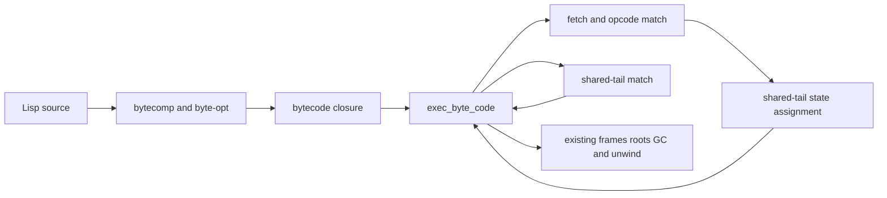
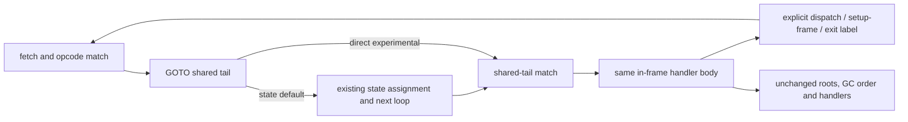

# Lisp runtime modernization: evidence and first bounded implementation

Baseline: `2415a335`, after local-delivery and tooling modernization. The user authorizes interpreter/compiler performance work and investigation of native/JIT compilation and generational GC. The real shared-tail dispatcher experiment below has been rejected and its production/build changes removed. The delivered VM stays unchanged; the historical design is retained to explain the measured result. It is neither a new bytecode format nor a claim that Lisp native compilation or a new collector has shipped. Current tracking remains in `modernization.md`.

## What exists today

```text
lisp/emacs-lisp/bytecomp.el, byte-opt.el  source -> optimized bytecode/constants
src/eval.rs                            Ffuncall -> funcall_general -> funcall_lambda
src/bytecode.rs                        exec_byte_code, bc_frame, shared-tail state loop
src/alloc.rs                           roots, conservative stack marking, heap tracing/sweep
src/include/lisp.rs                    tagged values and mutator stores
src/comp.rs                            native compiler integration, inactive target arm
build-support/macos/{terminal,cocoa}/config.json  HAVE_NATIVE_COMP undefined
xtask/src/main.rs                      configured unit compiler and independent linking/dumps
```

`src/eval.rs:3103` recognizes compiled closures with a fixnum argument descriptor and calls `exec_byte_code` (`src/bytecode.rs:524`). Lisp byte compilation already exists. The Rust implementation of the VM is compiled to machine code, while ordinary compiled Lisp still executes bytecode. `Fnative_comp_available_p` (`src/comp.rs:1232`) returns nil under the active configurations; the inactive integration uses external libgccjit APIs. Transcription coverage does not validate that inactive compiler or its dependency/ABI/cache/loading chain.

The current VM maintains its Lisp frame and stack in `bc_thread_state`/`bc_frame`. At `src/bytecode.rs:654`, a dispatch loop first handles a nonzero `goto: c_int` by matching one of eight shared tails. Opcode arms otherwise fetch/decode an instruction, then some set that state for the next iteration. This is a plausible cost, not demonstrated causal attribution: LLVM may already fold parts of it, and source branches are not branch measurements. The rejected external asm leaf had state-transfer costs; it does not establish that all in-frame dispatch designs fail.



## Actual measurements and their limits

Stage II recorded five alternating rounds, 110 samples, actual executable/dump/corpus hashes and median/MAD/IQR. The existing local reference is an explicit comparison artifact; its presence does not prove a fresh stable-version build. Selected medians in milliseconds:

| case | candidate | existing reference | ratio |
| --- | ---: | ---: | ---: |
| bc-loop | 7.3562 | 5.0490 | 1.457 |
| bc-sum | 15.4400 | 11.9581 | 1.291 |
| bc-car | 7.4520 | 4.9021 | 1.520 |
| load | 11.9400 | 6.2230 | 1.919 |
| edit | 21.0249 | 22.2270 | 0.946 |
| gc | 120.7421 | 115.8969 | 1.042 |

The host was busy (load/core about 1.00) and baseline saving was explicitly forced. These are investigative readings, not reliable speedup/slowdown promotion criteria. A similar GC time to the reference cannot show that generational collection would be useless: both run related collection algorithms, and no pause distribution or object-survival study was collected. Likewise, a load gap does not isolate reader, evaluator, allocator and filesystem costs. All 95 authored differential forms passed; this is bounded compatibility evidence, not full ERT, all plugins or latest stable language acceptance.

## GC and native backend feasibility

The collector traces static roots (`visit_static_gc_roots`, alloc.rs:6191), frame/bytecode roots and conservative stack regions (`mark_memory`, alloc.rs:5482). It maintains nonmoving object identities, weak tables and finalizers; string byte storage already compacts (`compact_small_strings`, alloc.rs:2313), so describing everything as immobile would be wrong. `XSETCAR`/`XSETCDR` (lisp.rs:905/908), `ASET` (:1374) and `SET_SYMBOL_VAL` (:1528) write directly. They are examples, not a complete inventory of all stores: raw field writes, buffers, hashes, pdump objects and FFI must also be accounted for.

Go's current runtime describes a concurrent, precise, non-generational, non-compacting mark/sweep collector with write barriers and size-segregated allocation. Its locality work is useful design input; a language's name is not a collector specification. [Official runtime source](https://go.dev/src/runtime/mgc.go), [GC guide](https://go.dev/doc/gc-guide), [Green Tea design](https://go.dev/blog/greenteagc).

Java G1 uses regions, young/old generations, remembered sets and evacuation, with a throughput/latency tradeoff. Those facilities rely on runtime/compiler cooperation. A nonmoving young generation would still need complete old-to-young store tracking here; a moving design additionally requires precise relocation or safe pinning of conservative roots and interior pointers. Both are possible research directions, not drop-in substitutions. [G1 design](https://docs.oracle.com/en/java/javase/25/gctuning/garbage-first-g1-garbage-collector1.html).

LLVM supplies compilation and GC integration mechanisms, not the editor's collector or Lisp semantics. ORC can host eager/lazy native materialization. Safepoints/statepoints and stack maps require a root model, and relocation requires consistent updates of derived pointers. Any Lisp backend must also preserve evaluation order, dynamic binding, errors/throw/quit, GC visibility, debugger/advice/redefinition, code lifetime and dump compatibility. [LLVM GC integration](https://llvm.org/docs/GarbageCollection.html), [statepoints](https://llvm.org/docs/Statepoints.html), [ORC](https://llvm.org/docs/ORCv2.html).

| route | reusable work | prerequisite proof | current decision |
| --- | --- | --- | --- |
| in-frame bytecode tail dispatch | current decoder, handlers, frame/GC/unwind ABI | all shared-tail transitions and actual A/B disassembly/timing | first bounded implementation below |
| allocator/reader tightening | existing bitmaps and data structures | phase attribution, retained memory and latency measurements | next measured hotspot, no assumed bottleneck |
| existing libgccjit integration | current Lisp native compiler and comp.rs structure | active-arm compile/FFI/dependency discovery, ABI hashes, real .eln load/unload and bundle delivery | feasibility work, not enabled by a config toggle alone |
| LLVM native/AOT/JIT | mature backend and ORC infrastructure | Lisp IR/lowering, roots/safepoints, unwind/deopt and cache/code lifecycle, real workload cost | candidate backend, not declared best without a prototype |
| nonmoving young generation | mostly stable object addresses | full store/barrier inventory, remembered set, weak/finalizer/pdump semantics and survival/pause data | separate collector design after attribution |
| moving regional collector | potential compactness/locality | precise roots or pinning, interior pointer relocation, every FFI/mutator boundary | largest change; preserve it as an option, not the first patch |

## Historical experiment design (retired; not current build instructions)

No algorithm, opcode, object/frame layout, Lisp compiler input/output or collector policy changes. Both dispatch modes use the same eight handler bodies. The experiment stays behind a build-time switch, so its overhead is eliminated from the unselected binary; there is no per-opcode external function or asm handoff and no runtime environment lookup in the hot loop.

```text
src/bytecode.rs                  MODIFY shared-tail macros + compile-time GOTO selection
xtask/src/vm_dispatch.rs         NEW parse mode -> rustc cfg arguments, primary-owned component cases
xtask/src/main.rs                MODIFY unit_codegen_flags and module registration
xtask/Cargo.toml                 MODIFY register vm_direct_dispatch feature
tools/fixtures/bytecode-runtime.el NEW independent partner-owned semantic and observation cases
tools/test-bytecode-runtime.py   NEW independent partner-owned strict multi-artifact driver
docs/runtime-modernization.md   this design and resulting evidence
docs/modernization.md           sole construction/acceptance checklist
PORTING.md, docs/status.md, docs/current-state.md  decision and delivery boundaries
```



### Precise change map (baseline 2415a335)

| ID | source and anchor | change / invariants | cases |
| --- | --- | --- | --- |
| III-D1 | src/bytecode.rs:513-541 state constants and goto local | Retain state constants and local only for state configuration as needed; retain op/arg/type_/top/pc types and scope. Public exec_byte_code symbol and signature unchanged. | all semantic cases; default/direct compile |
| III-D2 | src/bytecode.rs:649 NEXT and :654-825 state-tail block | Move NEXT definition inside the labelled dispatch body, expand to `continue 'dispatch` so an invocation inside Bswitch's search cannot continue the inner loop. Define VARREF/VARSET/VARBIND/DOCALL/DOUNBIND/EXIT/OP_BRANCH/PUSHHANDLER macros in that scope with the existing bodies. Keep same raw locals/frame and no Drop-owning local across sys_setjmp. State-only top match calls those same macros. GOTO!(label) expands to direct handler invocation under feature vm_direct_dispatch, otherwise only the original state assignment. | label boundaries; nested calls/GC/errors |
| III-D3 | varref/set/bind/call/unbind arms :841-931; branch/return :935-990; handler :1038/1043; Bswitch :1827/1840 | Replace state assignments with GOTO calls, preserve fetch/decode order and operand consumption. Preserve state-mode trailing NEXT and Bswitch search break; guard only unreachable direct-mode trailing transfers. Exit still reaches the existing frame restoration and TOP return. No opcode arm is removed. | short/8-bit/16-bit operand families; linear/hash switches; returns |
| III-D4 | OP_BRANCH :769-782 and PUSHHANDLER :786-821 | Preserve new_pc comparison, quitcounter wrapping, maybe_gc before maybe_quit, then pc assignment. On setjmp return preserve handler unlink, top/destination/root reload, optional bounds reload, pc reset, pushed thrown value, then branch. DOCALL preserves backtrace/GC/debugger order and lexbound continue setup_frame. Macros are not assumed risk-free; these transitions require runtime tests. | quit, caught signal/throw, nested handlers, GC under bytecode and debug/call state |
| III-D5 | NEW xtask/src/vm_dispatch.rs; main.rs:139 unit_codegen_flags; Cargo.toml [features] | `flags(mode:Option<&str>)->Result<Vec<String>,String>`: absent/empty/state -> empty flags; direct -> `[--cfg, feature="vm_direct_dispatch"]`; other values error. `FEMACS_VM_DISPATCH` read once per compiler invocation, default state. Register feature, test parse/default/direct/invalid without editing shared env. Do not change target CPU/overflow checks/PGO or other configuration. | primary component cases, both compiler legs |
| III-D6 | NEW fixture and driver | ERT tests execute real interpreted/bytecompiled functions, all shared-tail families, operand widths, special variables/watchers, calls/arity, branches/switch, catch/condition-case/unwind, quit and allocation/GC. Record deterministic critical observations and compare them across actual artifacts, beyond equal pass counts. Driver reuses strict ERT parser, isolated HOME/raw logs and real product identity hashes; missing/skipped/error/incomplete cases fail. | independent partner case matrix below |

Representative selection (identical handler bodies are not rewritten into separate Rust helpers):

```rust
macro_rules! GOTO {
    ($label:ident) => {{
        #[cfg(feature = "vm_direct_dispatch")] { $label!(); }
        #[cfg(not(feature = "vm_direct_dispatch"))] { goto = $label; }
    }}
}
```

The exact handler macros are moved from the existing state arms; calls to OP_BRANCH from the restored handler also use GOTO. `NEXT!` is deliberately bound to the outer dispatch label. Conditional branch fallthrough still consumes/discards its value once. Source-level removal of a state transition is not proof that generated machine code is faster.

### Required test matrix and ownership

The independent partner owns only the two new test files, writes all cases before execution and returns their exact map. Primary owns all production/build/documentation changes and compiler-mode component cases. No subagents or remote CI.

- T-VM1: varref/set/bind short, one-byte and two-byte operands, including >255 constant indices; emitted opcode/disassembly evidence must establish widths instead of assuming the compiler emitted them.
- T-VM2: subr/interpreted/lexbound compiled calls, optional/rest/wide arity, nested returns and wrong arity/error; preserve backtrace/evaluation depth restoration and argument order.
- T-VM3: conditional/unconditional forward/backward branches, nil/non-nil else-pop stack behavior, small linear and larger hash switch, exact once-only side effects.
- T-VM4: dynamic binding/unbinding, trapped symbol writes/watchers and unbound symbols, success and exceptional unwind with restored state.
- T-VM5: nested catch/throw/condition-case/unwind-protect, normal/popped handlers and nonlocal returns; allocate/collect while relevant bytecode constants/locals/return values remain live.
- T-VM6: backward-loop quit behavior, deep/nested calls, root/stack growth, forced-GC cases; compare deterministic observations across compiled modes/reference rather than demanding that an interpreter allocate identically.
- T-VM7: default/state/direct/invalid build-mode parsing and unchanged public ABI/opcode set; static label assertions supplement, never replace, execution.
- T-VM8: actual state/default and direct builds/dumps, full authored differential corpus, selected real ERT, terminal keys/files and direct Cocoa key/file/IME regression if the candidate survives semantic testing.
- T-VM9: alternating state/direct measurements with all samples, product/source/config identity, code-size/disassembly comparison and real workloads. Record host load/variability. No fixed invented speed threshold, no slower substitute reference or reduced functional standard.

### Build and acceptance recipe

After all A/B/C work is written, freeze exact sources and test files. First compile/check mode parsing and both VM configurations on the changed unit. Then export the complete staged tracked snapshot into an owned source tree without reference/cache and build the state terminal once. Preserve its executable/dump quartet and manifest. Existing compiler/link/dump commands may rebuild only bytecode for the direct variant if every reused object/config/source is bound to that same snapshot; otherwise rebuild the full object set. Both variants load the same immutable generated Lisp corpus. Keep the delivered root terminal/app intact during experiments. Record every command/config/mode and product hash; file presence alone is not build provenance.

Reusing standalone target configuration means preserving its actual config/epaths/object/tool-object/build-root environment and PGO-off state. Re-linking requires the current fingerprint tool and a fresh dump bound to that executable. Never mix a stale dump with a new binary or a checking/cross-target object with the normal host set. If incremental reuse cannot be established, use a clean full build rather than infer compatibility.

Run all semantic cases against state/direct and the existing reference. Then run the 95-form audit and real terminal workflows. Only a semantically sound candidate proceeds to full Cocoa build and native UI/IME checks. Any failure is retained and investigated in one consolidated repair batch; no retry-to-green or skipped required case. Performance promotion requires reliable actual-workload benefit without unresolved correctness, memory, key/IME or important workload regression. Busy-host results cannot alone justify switching the default. If the direct route fails, remove its active experiment from normal delivery and retain an honest compact conclusion; do not reflexively escalate to JIT, moving GC or a full asm rewrite.

The larger native/compiler and collector routes remain open after this bounded result. Before a collector change, collect object age/survival, allocation and retained-heap data, GC phase/pause distributions and a complete mutator/root inventory. Before a new native backend, specify typed/boxed IR, runtime calls, exact roots, safepoints, deoptimization and error/debugger/redefinition/code-lifetime behavior, then test real Lisp functions in the actual editor. No backend or collector is called best from documentation or an arithmetic toy.


### Independent design challenges resolved before B/C

The review identified concrete hazards and the design adopts them: explicitly cfg-remove the state guard/match in direct builds; define OP_BRANCH before PUSHHANDLER; merge Bpushcatch/Bpushconditioncase into one opcode arm selecting the unchanged handlertype so the direct VM has one setjmp expansion site; merge Bcall..Bcall7 into one arm that decodes arg with `match op { Bcall6 => FETCH!(), Bcall7 => FETCH2!(), _ => op - Bcall }` and expands DOCALL once. Tiny varref/set/bind/unbind tails may remain at their original operand-decode sites. State/default and direct use those same bodies. Seven old immediate trailing NEXT/break transfers are cfg-kept only in state mode, preserving default behavior without suppressing unreachable-code lints. No new external instruction dispatch function is introduced.

The state terminal is rebuilt from the full experimental source before comparison, so macro factoring is not confused with selecting direct dispatch. Preserve the original delivered terminal as a third control. Incremental direct rebuild is permitted only after verifying that vm_direct_dispatch affects bytecode.rs alone, its public ABI/layout is unchanged, all other objects belong to the exact same source/config, and both bytecode normal/checking objects are replaced. Record the actual standalone child environment and rebuild fingerprint/link/dump with that same environment. Copy every complete quartet/manifest before replacing a variant. If objects are absent or input identity is uncertain, full rebuild is required. Object filename or modification time is insufficient proof.


## Follow-up: release compiler bytecode coverage (A)

The state/original control exposed a different issue: fresh-export load median 95.005 ms vs delivered-tree 18.318 ms. This does not attribute the gap to dispatch. Direct inspection shows the clean build lacks `emacs-lisp/{byte-opt,bytecomp,cl-extra}.elc`, while the delivered tree contains them; macroexp/cconv are already compiled by the dump closure. The load workload explicitly reloads those five libraries. A release should not derive compiler-library performance from old ignored products.

Exact bounded change: `tools/bootstrap-resources.py`, `Generator.bytecode`, after collecting the bootstrap load history and before international tables, add the five tracked compiler libraries (byte-opt, bytecomp, macroexp, cconv, cl-extra) with deduplication. Missing mandatory source must fail. Before compilation remove only those five owned generated outputs, so an old ignored file cannot conceal a batch compilation error; after compilation verify their `.elc` products exist. Keep the original Lisp sources untouched, no reference/cache/network/native backend dependency and no all-library compilation expansion. `--all-bytecode` still includes them; an explicit user scope remains scoped and does not acquire unrelated mandatory outputs.

B cases in `tools/test-compiler-resources.py`: isolated minimal owned input tree and command recorder prove dump closure + history + compiler inputs remain selected exactly once; missing required source fails; explicit scopes stay scoped. These light cases do not execute a Lisp compiler. D separately runs the actual owned generator in the clean export, checks source/output identity, then compares immutable before/after five-library input snapshots with one identical actual VM, alternating order and retaining every sample/median/MAD. Each snapshot contains identical raw source bytes; only the three missing compiler bytecode outputs differ. Source-only and compiled input loading must produce equal defined compiler/closure observations. Existing bytecode semantic/ERT acceptance remains separate; no JIT/GC claim follows from precompiling existing Lisp libraries.

Source tree change: one Python generator and one new component test; existing Lisp/data and VM production sources are unchanged. Primary owns both; independent partner reviews the frozen final change. Checklist continues in modernization.md.


## D results and delivered boundary

Both VM configurations compiled normal/checking; mode components 3/3, original driver contracts 9/9. A tracked-only clean export completed the full terminal build/dumps with 324 compiler legs, 823.914 seconds, peak RSS 422084608 bytes; incremental direct rebuild replaced only bytecode.o and bytecode.checking.o, then re-linked and regenerated the matching dump (9.029 seconds). Hashes bound every reused object/config and both complete executable/dump quartets. Root terminal/app were not overwritten by the experiment.

Both state/direct passed all 95 authored differential forms against the existing local C reference. Selected eval/alloc ERT passed 27+4 cases on each of state, direct and reference. Initial new semantic suite failed the same five cases on all three: undeclared generated specials, lexical variables accessed through dynamic symbol values, folded wide constants, and captured nil recursive closure. A depth test also accepted any error instead of specifically proving excessive nesting; all original logs are retained and the fixture is corrected rather than changing VM semantics or skipping cases. Final corrected-suite evidence is appended below.

Eleven alternating rounds (242 observations including startup) on the same generated Lisp input tree:

| workload | state median ms | direct median ms | direct/state |
| --- | ---: | ---: | ---: |
| bc-loop | 9.670 | 9.938 | 1.028 |
| bc-sum | 18.852 | 20.506 | 1.088 |
| bc-car | 9.541 | 9.731 | 1.020 |
| load | 95.541 | 93.361 | 0.977 |
| edit | 27.414 | 28.122 | 1.026 |
| gc | 160.393 | 162.426 | 1.013 |

Load/core was 0.706. These are bounded investigation results, not quiet-machine certification. The VM text grew 6784 -> 7196 bytes (1696 -> 1799 AArch64 instructions); each still has one indirect dispatch branch. Static counts are not dynamic branch/predictor measurements. There is no demonstrated benefit sufficient to retain this candidate, so all active VM macro/feature/build-mode code is removed. Do not generalize this to the infeasibility of JIT, LLVM or generational GC. Current Cocoa/terminal product code remains the stage-I delivered VM.

Seven state/original control rounds (154 samples) showed compiler-library load 95.005 vs 18.318 ms; bytecode medians alone were near each other. That resource-tree difference prevents attributing this load gap to the macro factoring. The exact missing bytecode inputs were identified and corrected as above.

Actual corrected compiler generation in the clean export completed in 20.759 seconds (RSS 126304256 bytes). Four component cases pass with per-case timing; no reference tree is consulted. Before/after scopes retain identical five raw source files and the same existing macroexp/cconv bytecode; only the three missing bytecode products differ. One identical actual state VM alternates order for seven rounds (154 samples). All fourteen runs confirm the selected path/extension was really loaded and produce identical compiled closure results plus wrong-arity observations. Selected five-library load median 69.520 -> 12.2292 ms (MAD 3.098/0.5362 ms, about 82.4% lower); load/core0.419 remains a limitation. This is not an overall editor speed claim and startup/microbench noise is not promoted as a separate optimization.

Persistent raw evidence is in the ignored build/modernization-stage3 directory: freeze manifests, state/direct build logs and object/config hashes, semantic-1 failures, 95-form reports, selected-ert-1, bench-direct-state-1, bench-state-original-1, compiler-generation-1 and compiler-load-1. No binaries, private sessions or raw logs are committed. The selected input/measurement recipes above allow independent regeneration without a reference checkout.


Final semantic acceptance: all corrected ten groups and deterministic observations
agree on state, direct and the existing C reference; the original delivered root
VM independently passes the ten groups with the same observations. Root eval/alloc
ERT is 27/27 + 4/4, terminal keys 26/26 and Unicode save/reopen pass. The independent
partner's final driver contracts are 9/9 and frozen source review found no blocker.
Cocoa code/products are unchanged by stage III; strict app signing still passes,
while prior GUI/IME evidence is reused only for those unchanged artifacts. Real
cross-window drag remains unaccepted. No experimental candidate remains to require
an additional Cocoa build or to justify a default switch.

After all runs exited, targeted process/handle checks preceded deletion of 685
owned idle compiled files: 187264824 logical bytes (188780544 allocated bytes).
Retired comparison executables/dumps and exported object/compiler cache leaves are
removed; source, generated Lisp/data, sample/JSON/log/assembly evidence and normal
root trial products are preserved. Git state was unchanged by cleanup. This count
is not a measurement of host-wide free-space change.

Reproducing the scoped loading check: build the owned terminal; copy the five
compiler `.el` files into each of two owned `emacs-lisp/` input scopes. Copy the
same macroexp/cconv `.elc` into both, and the generated byte-opt/bytecomp/cl-extra
`.elc` into only the after scope. Run the same program with `-Q --batch --eval
"(add-to-list 'load-path SCOPE)" -l tools/pgo/eval.el`, alternating scopes each
round. Verify `load-history`/`locate-library` identify the intended scope and
extension, record every marker rather than a single best result, and compare an
actually byte-compiled closure result and wrong-arity error on both sides. Hash
all ten source/product inputs, the binary/dump and corpus; keep the scopes immutable.
This is a selected compiler-library loading experiment, not native compilation.

Final test maintenance removes source-shape assertions for private state labels/arms:
future runtime work is constrained by public ABI/opcode compatibility and the actual
ten semantic groups, not by spelling the old implementation identically. Retired
experimental build flags remain absent. The final driver-only contract run passes
9/9; runtime execution/observation code and the accepted Lisp fixture are unchanged.


Cleanup provenance is now maintained separately as engineering records: [retired
uncommitted dispatch experiment](../maintenance/cleanup/reports/2026-10-24-03-dispatch-experiment.md)
(inert patch and frozen file identities), [685 generated artifacts](../maintenance/cleanup/reports/2026-10-24-04-generated-artifacts.md)
(per-path byte inventory and explicit missing content hashes), and the [cleanup ledger](../maintenance/cleanup/LOG.md).
These reports supplement the original bounded results; archiving them performs no new cleanup or runtime change.
