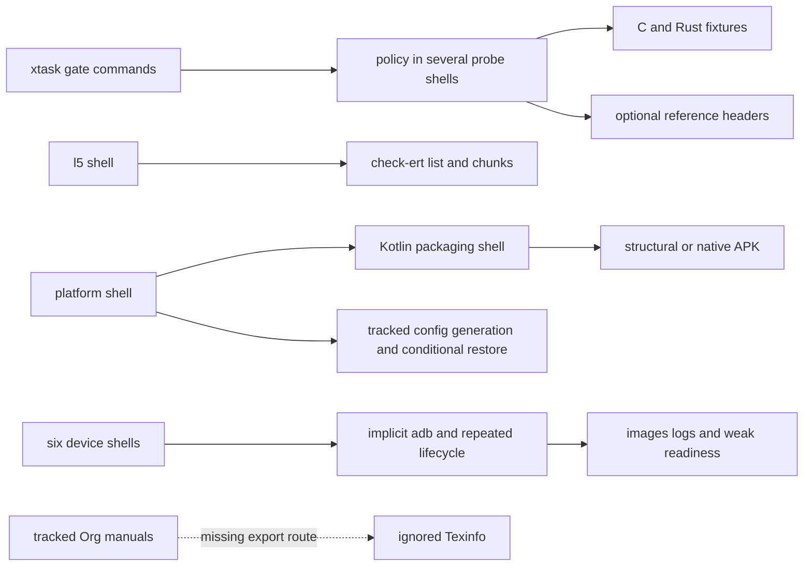
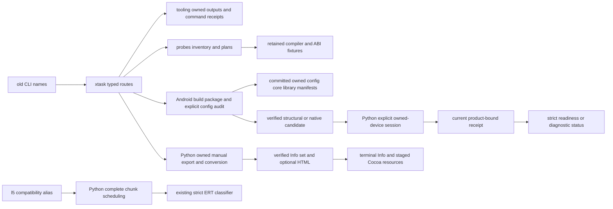

# G4: tooling, support obligations and reproducible documentation

D22 final affected independent review completed: adopted P-343/P-344/P-345
and the current Android22/Mac recovery receipts, with no new blocking source
defect. The mistaken Ctrl-A and adjacent-root claims were explicitly retracted.
Metadata corrections now distinguish old failed runs from current products and
bind CLN03-06 to their actual isolated Git/blob/hash recovery. This stage's
declared Mac delivery artifact is dist/candidates/g4-macos-2/Femacs.app; replacing
the older Root trial app remains dependent on G1 native acceptance. Production,
test and configuration hashes are unchanged after the frozen review. Signed
implementation5118ed08 was pushed and verified at remote master. The
[delivery audit](../maintenance/releases/2026-10-25-g4-modernization.md) records
product identities, retained failures, recovery and acceptance limits. G4's
scoped delivery is complete; full Goal stays open for G1 native gaps and the
subsequent G5-G7 runtime stage.

D22 Mac recovery result: both fresh independent products build successfully:
terminal537.413s, Cocoa526.680s, each15/15 actual CCL cases. Terminal68-Info
lookup, relocated Cocoa68-Info lookup while the source export is unavailable,
both strict signatures, binary/dump identity and root-source preservation pass.
Protected total1073.449s, peak871890944 bytes, cleanup complete. A verified copy
is retained at dist/candidates/g4-macos-2/Femacs.app, with exact file identities
and another strict-signature check. Retained terminal binary/dump copies still
require their original export's resource tree; no terminal relocation claim.
The new candidates directory is ignored without deleting local artifacts.
The older Root trial app remains unchanged. This closes missing-product
recovery; final independent/Git delivery subsequently completed as recorded
above. It does not complete locked native interaction.

D21 current result: P-345 platform selection is implemented, source-extracted
Android table/offset plus NTGUI/host selections pass20/20. The PNG/error-attempt
and per-key evidence repairs pass14/14 affected component cases, including
existing render assertions. Inventory is239 baseline entries plus16 additions;
the new compiled offset runner is wired into the component recipe. Native
keyboard normal/checking rebuild and both links/export/import gates pass,
with358 unchanged objects and unchanged nonnative APK members. Production
candidate10 is retained in dist/candidates/g4-android-10. Real owned API36 ARM
device22 passes identity/install/launch/input, all four key movements, exact
Chinese clipboard, battery, per-run glyph rendering, both rotations, native
initialization and20.492s survival. Installed APK/SO hashes match; zero fatal
markers; owned children are reaped. Protected device total72.294s, peak
5031985152 bytes. These are the stated normal-product device cases, not every
Android version, JNI exception branch or full compatibility certification.
Full G4 final independent approval/Git delivery and current Mac product
recovery remain pending; no locked-desktop acceptance is inferred.

D21 consolidated input repair design (P-345): device20's individual command
observations show Ctrl-A reaching point1 and Ctrl-E reaching point6. The later
left-arrow case stays at6; the retained screen says KEYCODE_DPAD_LEFT is
undefined. The aggregate key failure must not be described as Ctrl-A failure.
Actual keyboard.rs preserves the Android table's21=left and22=right, but uses
the frozen host's unconditional FUNCTION_KEY_OFFSET=0xff00. The real input
branch therefore bypasses that table and requests an Android platform name.
Restore the original platform selection: Android/NTGUI offset0; other targets
retain0xff00. Keep tables, unknown-symbol fallback, modifier handling and Lisp
bindings unchanged. Before production editing, add a source-extracted compiled
offset/table regression for Android navigation/function keys, both zero-offset
configurations and the retained host value. Then rebuild the affected keyboard
normal/checking objects and run actual unchanged movement/render/rotation.
No new key bindings or additional unneeded device diagnostic run is required.

D21 adds the independent review's narrow P-343 evidence corrections: fully
decode the PNG before accepting its dimensions; retain the attempted capture
record and exception type when capture, XML/PNG parsing or either observation
fails, then fail immediately. Only actual geometry mismatch may consume the
existing three snapshots. This remains bounded initial geometry readiness,
not an atomic screenshot/UI snapshot claim. Write cases for corrupt pixel data,
malformed XML, failed capture and failed before/after observations before the
helper change. Extract a per-key movement helper that writes each actual argv,
expected point, successful observation or failure and elapsed time to a private
JSON sidecar; keep the aggregate keys evidence/strict expectations unchanged.
Write its success/failure preservation cases before implementation. Re-run only
affected component cases and the actual production-device acceptance.

D20 retained results: the actual-source host capacity probe passes11/11 cases
with zero skips, per-case timings and unchanged production-source identity.
Its first compile failed because the fixture used the obsolete VaList::arg;
the fixture now uses the pinned toolchain's next_arg, as production doprnt does.
The failure is retained separately. The incremental production build rebuilds
both android objects and reuses358 individually verified unchanged objects.
Normal/checking links, actual ELF/JNI export/import ratchets and signed/aligned
APK checks pass; all nonnative package members and original inputs/products
are preserved. The new retained candidate is dist/candidates/g4-android-9.
This is an incremental product rebuild, not a new full-source build or device
pass. Current inventory is239 baseline entries plus15 owned additions; the two
new entries are the capacity fixture and its explicit component-test runner.

The same canary compiled with the unchanged old function correctly rejects
the ordinary Java-name case: its first byte after the64-byte buffer changes
from166 to0. The repaired-source11-case run is separate. Actual production
device20 no longer exhibits the prior native GC fault during this attempt;
HELLO and the exact Chinese clipboard are observed. Individual command logs
show Ctrl-A reaching point1 and Ctrl-E reaching point6, then left-arrow fails
to reach point5. The key case fails and render/rotation are unexecuted.
No device acceptance is claimed. Continue source-bound input diagnosis and
independent review; do not discard the demonstrated capacity fix or weaken
the movement assertion. The whole G4 remains open.

D20 consolidated repair design (P-344, actual P-341 writer): android.rs's
android_get_keysym_name at7497 copies capacity-1 but writes at capacity in its
three special-key, null-result and normal-JNI paths. The actual terminal
buffer occupies exactly the64 bytes preceding the fingerprint global; the
change-only diagnostic observes its first byte cleared before GC. Add an
early capacity0 return and terminate at capacity-1 in every existing path,
preserving names, truncation and JNI ownership/errors. The frozen original
also has the out-of-bounds statement; no GC or Lisp algorithm change is needed.
Prepare an actual-source host Rust probe with controlled JNI and byte canaries
before production edits, then compile/run it under external resource control.
Rebuild affected Android normal/checking native products with verified unchanged
other inputs, repack, run the existing real gates and device acceptance. Old
diagnostic failures remain failed; a shifted linker layout alone is not proof.

D19 additional real failure and repair design (P-343): initial Android
observation/screenshot/UI acquisition can straddle startup resize. Bind a new
coherent_capture helper to before/after geometry and the unchanged strict
content_region validator, retaining every actual attempt. At most three
snapshots; persistent mismatch and identity/format errors remain failures.
Tests cover both resize timings, permanent mismatch and identity rejection.
This repairs the harness only; diagnostic18 failed before input and does not
disprove the P-341 fault. Writer/GC diagnostic source remains private.

P-343's four new component cases and four retained render-region cases passed
in0.068s, with per-case timings; this is not device acceptance. The next real
run uses the same separately identified diagnostic native product and the
updated harness. CLN-24 removes92 stopped AVD transient files from diagnostic
runs15–18, retaining all products, partial/complete traces and failure evidence.

P-341 diagnostic17 has97968 complete48-byte records, no truncation. The first
symbol decoded from the unfinished root exactly matches the native fault;
the installed ELF maps that slot to Vandroid_build_fingerprint. Its raw stored
value is inconsistent with the required Lisp string. The native producer and
UTF-8 creation instructions nevertheless return/store correctly tagged strings;
earlier valid observations in a different diagnostic do not establish when this
run changed. Independent D19 agrees that the writer is not proven. Its extra
adjacent-root concern is rejected: the adjacent observed slot is actually
Vandroid_wait_for_event_timeout, whose tag7 agrees with make_float(0.1), not a
second corrupt build variable. Source GC/encoding remains unchanged while the
isolated native/forwarded-store/GC-boundary watch discriminates the write.

D18 output repair design (P-342): check-android-layout.py main's old explicit
output check accepts only build, whereas the typed Android parent and assets
tool accept build/cache. Add new_run_directory(requested), called by main in
place of its existing directory block. Explicit resolved paths must be fresh
children of the literal repository build/cache roots, outside the resolved
read-only reference, with no leaf symlink. The default build path receives the
same escape/reference check before mkdir. No measurement or baseline changes.
Before implementation, add eight AndroidLayoutOwnership cases in
test-g4-workflows.py: actual CLI build/cache selection with only measurement
mocked, existing destination preservation, foreign path, escaped parent link,
reference link, protected default-root link and fresh leaf link. Preserve
normal/checking native objects from retained build7; once these cases and real
layout pass, continue remaining real constant/package legs on the exact same
native inputs. Original failed aggregate remains failed. Final independent
affected review remains required.

D18 result: the eight new output-ownership cases passed, followed by the real
NDK layout, mandatory constants, JNI and fresh package legs. The retained-cache
resume completed in606.383s; its controller exited0 in610.610s, peak accounted
1142046720 bytes, cleanup complete. Original build7 remains failed; its completed
native steps were reused only after source/config/object identity checks. The
fresh APK and both native variants are retained separately in
`dist/candidates/g4-android-8`; P-341 is still unresolved, so none is device
accepted. The separately identified static-root diagnostic builds/signs in
11.127s and preserves the baseline source/objects/products and all nonnative
APK members. Diagnostic device execution is pending; this is not a GC fix.

Latest D17 observation (2026-10-25): Android6's actual fresh normal/checking,
package and source-preservation checks passed in983.416s (controller986.060s,
peak accounted1158840728 bytes, cleanup complete). Device13 installed matching
APK/SO bytes and observed HELLO input and the exact Chinese clipboard, confirming
the P-340 output repair. GUI acceptance then failed at keys: a SIGSEGV in
process_mark_stack's symbol path, called from the staticvec part of
visit_static_gc_roots. The independent owned batch returned exactly `(3 1)`;
that does not accept GUI/render/rotation. Both owned process trees were reaped.
P-341 tracks source-bound diagnosis; final frozen adoption and signed delivery
remain open. CLN-23 removes only the two stopped AVD data trees, with retained
receipts/logs/screenshots and explicit transient-state recovery limits.

This is the detailed construction specification referenced by the seven-part [persistent plan](modernization.md#persistent-goal-complete-the-seven-part-modernization-plan), not a second Goal. Baseline: `01bfbb7f3e1d8e6793a2dd71b81ac8ba43b29f99`, master, clean at investigation start. Status: **A/B/C written; D integration in progress**. The final contracts below incorporate the independent partner's actual source findings and the primary's decisions; differences and retained scope are explicit. At the C freeze, no G4 functional tests, product builds, target scripts or device actions had run. D component results and remaining real-product acceptance are recorded below. Production writing is complete for C01–C13; dependency lock generation is complete. This was construction status at C freeze; subsequent D evidence is recorded below. Source investigation is not final review.

B sequence deviation: the partner prematurely invoked `python3 -m py_compile` on the new Python test file and later `git diff --check` while writing B. Both violated the no-early-verification order and are not counted as test/acceptance evidence. The primary interrupted that owned CLI invocation, preserved the written tests, and requested a same-session no-tool handback/correction. Continue the complete B/C writing sequence with no additional verification. Preserve the events, interruption and correction in private collaboration evidence; do not rewrite this as a clean zero-verification run.

G1's actual multi-window IME and external Finder drag remain unaccepted while the desktop is locked. The delivered editor, TTY repair, bounded language comparisons and trial products stay available. Independent G4 source/design work continues without calling the stable-delivery native acceptance complete. G5–G7 are still future implementation work.

## Requirements and existing obligations

| ID | Required result | Scope and observable effect |
| --- | --- | --- |
| Q01 | Current dependency and retention map | Classify all239 tracked tools/spikes at this baseline,29 shell entrypoints and their positive readers; distinguish compiler fixtures, generators, measurements, tests, live commands and historical recipes. A missing literal mention is not proof of dead code. Keep unproved candidates. |
| Q02 | One owner for probe build/gate policy | Rust xtask owns probe compilation, running, comparison, errors and isolated evidence. Retain C/Rust/JNI fixtures and the meaning of every currently reachable probe. Thin aliases preserve old entrypoints. |
| Q03 | No obsolete flat-layout assumptions | Remove undefined shell `HERE`, obsolete parent-relative probe inputs and shared destructive materialization. Current root, pinned toolchain and source/output ownership are explicit. |
| Q04 | Reliable complete ERT scheduling | Python owns L5 chunk policy; shell only forwards arguments. Include the first enumerated file, retain every chunk/failure, preserve normal versus GC-stress argv, and never overwrite prior evidence. |
| Q05 | Safe necessary linker adaptation | Keep the Linux linker bridge and its two documented unsupported-flag filters. Remove `eval`, preserve each argument exactly, discover the requested Zig through PATH/environment, and retain existing Linux source. |
| Q06 | One Android build/package/config owner | Rust xtask owns SDK/JDK discovery, owned config/object roots, Kotlin/resource/dex/native packaging and static gates. A failed command must not modify tracked config or replace a usable APK with an incomplete candidate. |
| Q07 | One Android device/evidence owner | Python owns explicit device identity, owned AVD lifecycle, install/launch/capture, diagnostic subcommands and strict receipts. Do not use bare adb against an unknown receiver, ignore installation failures, erase shared tombstones, or kill another run's emulator. |
| Q08 | Android independent input path | Normal build reads committed target configuration/manifests and owned sources, never optional reference configure or old object/Lisp caches. Keep optional reference-based discovery as an explicit audit into fresh output, without automatic tracked promotion. |
| Q09 | Exact support and Java policy | Existing macOS arm64 terminal/Cocoa delivery and Android arm64/API36 test scope remain. Existing API21 compile/min-SDK values do not certify old devices. Latest LTS JDK only; no silent ambient/JBR downgrade. Other OS/ABI source is retained/deferred, not silently retired. |
| Q10 | Complete owned manual source chain | Generate the two Org-derived Texinfo manuals from tracked Org/exporter inputs; build all selected Info roots and optional HTML from owned sources; ship Info resources and verify actual lookup. No missing Makefile/reference dependency is hidden by an ignored pre-generated file. |
| Q11 | Truthful readiness and layer selection | Structural APK, native package, diagnostic output and actual device acceptance are separate statuses. Old screenshots alone cannot establish current startup. Every requested missing/failed layer fails its gate. |
| Q12 | Traceable retirement and preservation | Remove only replaced policy or positively established unused generated outputs; commit a per-batch report, exact identities, replacement/recovery and ledger references. Preserve licenses, raw Lisp/data/manual sources, required Swift/Kotlin and actionable negative evidence. |
| Q13 | Preserve editor and future runtime work | No evaluator/bytecode/GC algorithm change in G4. Reuse unchanged product evidence; rebuild affected tooling/resources and execute affected integration after the complete G4 A/B/C, then independently review and sign/push. |
| Q14 | Remove unreachable old-device paths | Preserve the existing minimum API21 and all reachable platform behavior. Simplify guards strictly below that floor, remove helpers/classes only after their actual readers disappear, and record each withdrawal/recovery. A class's old SDK name alone is not evidence of obsolescence. |

The latest-LTS requirement is already a human decision. As checked during this design, Java25 is the current LTS and29 is planned for September2027 in the [official support roadmap](https://www.oracle.com/java/technologies/java-se-support-roadmap.html). This is a dated toolchain fact, not a promise to freeze Java25 forever. A future policy update must record its source and actual supported tools; a missing required JDK is an actionable dependency failure, not permission to use an older one.

No new blanket resource approval flag is introduced. The caller protects the entire heavy process tree with the current external resource executor. A native helper does not import private assistant paths, wrap ordinary filesystem commands, create a shared budget, or detach its emulator from the owning command.

## Current source and data flow

```text
xtask/src/main.rs
  probe_build:1416                 materializes in shared build/probes/<stem>
  gate_fast:1587                   metadata probes and fam/shadow/macro shells
  probe_programs:2010              sixteen real Rust source readers
  link_shared:2180                 target objects, generated runtime shim, NDK link
  android_linker:2498              target compiler discovery
  gate_probes:3437                 eight live shell probes then dead_arms
xtask/src/check_units.rs           owned unit-list and normal/checking compiler
xtask/src/{standalone,macos}.rs    independent macOS inputs, generation/dump/package
xtask/src/bundle.rs                exclusive staging, verify and atomic publication
spikes/*-probe.sh + run.sh         fourteen policy-bearing probe/bring-up entrypoints
spikes/*.{rs,c}, miri/, shim/      compiler/ABI/unsafe fixtures, not product C objects
tools/l5-sweep.sh                  list/chunk/stress scheduling in Bash
tools/zig-linux-linker.sh          argv rebuilt into eval, host-specific default
tools/check-android-kotlin.sh      SDK/JDK/resource/Kotlin/dex/APK policy
tools/check-authorized-platforms.sh static/native/package aggregation
tools/gen-android-config.sh        optional reference configure, unsafe output replacement
tools/{try-android-emulator,device-run,android-accept,
       android-batch-eval,android-gui-eval,android-input-probe}.sh
                                  duplicated emulator/install/evidence lifecycle
tools/{check-android-apk,android-readiness,gen-android-assets,
       gen-emacs-config,gen-target-sources}.py
                                  retained readers/generators, some historical assumptions
build-support/macos/               current independent target inputs
docs/baseline/config/android-arm64.json
                                  tracked Android snapshot, not independent regeneration
docs/baseline/*sources*android*    current Android core/library membership
doc/{emacs,lispref,lispintro,misc} tracked manual sources and include inputs
doc/misc/{org.org,org-setup.org,modus-themes.org}
                                  tracked originals for ignored Texinfo exports
lisp/org/ox-texinfo.el:2005        org-texinfo-export-to-texinfo-batch
tools/bootstrap-resources.py:87   two version stamps; no manual export/build
src/bitmaps/                      fourteen tracked raw inputs, including README
maintenance/cleanup/              prior reports/manifests/recovery and ledger
```

The graph service has no femacs index. These locations were read directly; this is not an exhaustive graph claim. The retained fixed reference was read only for recipe/provenance: verified upstream mirror identity, HEAD `fd7afced4036fc1a221567d70705d20a2bd64713`, no fetch or checkout update. Its optional audit state is not a product build input.



### Confirmed defects and retained scope

- Nine probe/guard entrypoints invoke an undefined `HERE` and/or old `../spikes` paths after root expansion. `gate-fast` and `gate-probes` still call these paths; their fixtures cannot be deleted as unused.
- `probe_build` materializes into a shared stem directory; `materialize` removes its destination. New calls need owned per-invocation scratch, while object/link consumer paths remain explicit.
- `l5-sweep.sh` drops the first line unconditionally. The actual enumerator prints a count heading, but existing deterministic stubs print only filenames. The new parser must recognize the optional heading and validate all actual file rows; it cannot just subtract one from any output.
- The Zig adaptor quotes into an `eval` command. The replacement must preserve whitespace, Unicode, quotes and shell metacharacters as literal argv while filtering exactly the two existing flags.
- Android platform aggregation writes `src/include/config.rs` and restores Darwin only after preceding steps succeed. New configuration generation always targets owned build scratch instead.
- Device scripts use inconsistent SDK paths, fixed/global logs and serial selection, and sometimes ignore boot/install failures. `android-readiness.py` treats an old PNG's presence as launch evidence. These semantics require replacement, not merely moving filenames.
- Normal macOS generation omits manual building. Tracked Org source and `ox-texinfo` are present; the reference recipe explicitly uses `org-texinfo-export-to-texinfo-batch` with its own load path, version-check override and disabled global Org-ID tracking. Reproduce the owned recipe, not the missing build system.
- `src/bitmaps` really is tracked and its fourteen files match the frozen raw inputs. The asset-generator comment claiming it does not exist is misleading; retain the files and correct the description rather than copy or fabricate replacements.
- Two568-byte raw profiles in `spikes/pgo-probe` are historical generated evidence, while actual PGO merging reads a fresh training directory. Keep source probes, recorded outcomes and recovery identities; their exact retirement decision is part of the full reader map, not the entire G4 scope.

## Target architecture and exact core interfaces

```text
xtask/src/tooling.rs             NEW: owned output and streamed command receipts
xtask/src/probes.rs              NEW: complete probe inventory/plans/execution
xtask/src/probes_tests.rs        NEW: independent B-phase component cases
xtask/src/android/{mod,toolchain,package,config,gate}.rs
                                NEW: unified build/package/config owner
xtask/src/android/tests.rs       NEW: independent B-phase Android contracts
xtask/src/main.rs                route new commands and replace shell policy readers
xtask/src/{standalone,macos}.rs  wire manual generation/publication and bundle resources
xtask/src/manuals.rs             NEW: manual integration and verified Info publication
xtask/src/bundle.rs              generic directory transaction, app compatibility wrapper
build-support/manuals.json       NEW: complete explicit manual/include/output registry
build-support/android/arm64/     NEW: owned config and exact core/library inputs
maintenance/tooling-inventory.json NEW: versioned retention/reader/replacement map
tools/l5_sweep.py                NEW: bounded chunk scheduling and evidence
tools/build-manuals.py           NEW: owned Org/Texinfo/data-generation route
tools/android-device.py         NEW: device lifecycle and evidence owner
tools/fixtures/android-acceptance.el NEW: owned deterministic device observations
tools/test-tooling-modernization.py NEW: independent Python/CLI contracts
tools/test-ert-harness.py        adapt copied sweep workspace and retain all16 contracts
tools/{check-android-apk,android-readiness,gen-android-assets}.py
                                update readers/receipt and correct source facts
spikes/*-probe.sh, run.sh        reduce to thin xtask aliases after all replacements exist
tools/*android*.sh, device-run.sh, check-authorized-platforms.sh
                                reduce to typed aliases after reader cutover
tools/l5-sweep.sh                thin Python alias
tools/zig-linux-linker.sh        necessary argv-only linker adaptor, no eval
spikes/pgo-probe/*.profraw       proposed generated-output retirement with recovery
docs/{modernization,current-state,repository-bootstrap,retired-scaffolding,status}.md
                                current scope/results/readers; preserve historical reports
maintenance/cleanup/            new per-batch exact retirement/withdrawal reports
platform/android/kotlin/*.kt    simplify the exact API21-floor cases listed below
platform/android/kotlin/EmacsSdk8Clipboard.kt
                                retire after factory/reader cutover; full recovery report
```

Planned names above are new interfaces, not claims that their implementation exists. No other platform tree is deleted by this design.



### Core data and ownership contracts

`tooling.rs` owns the reusable execution boundary; it does not implement a second memory controller:

```rust
struct StepPlan {
    id: String, program: std::ffi::OsString, args: Vec<std::ffi::OsString>,
    cwd: PathBuf, env: Vec<(std::ffi::OsString, std::ffi::OsString)>,
}
struct StepReceipt {
    id: String, exit_code: Option<i32>, elapsed_ms: f64,
    stdout_log: PathBuf, stderr_log: PathBuf, completed: bool,
}
struct RunDirectory { path: PathBuf }
fn owned_new_output(repo: &Path, requested: Option<&Path>, family: &str)
    -> Result<RunDirectory, String>;
fn execute_step(plan: &StepPlan, run: &RunDirectory)
    -> Result<StepReceipt, String>;
```

`owned_new_output` resolves existing ancestors, rejects the optional reference or a symlink into it, rejects files/reused output, and creates an exclusive directory. Default output is `build/acceptance/<family>/<pid-time-nonce>`; caller-selected output must be owned scratch, not a tracked source/data tree. It never removes a previous run. `execute_step` invokes an argv vector, streams separate logs, records elapsed/exit and propagates failure. No `eval`, unbounded captured log or secret-bearing command is introduced. Failed receipts/logs remain available. Declaration/return/cleanup tests must cover missing executables, nonzero children and interrupted own children.

The probe inventory uses `ProbeKind::{Differential,RustRun,RustMetadata,AbiSyntax,Jni,Miri,Bringup}` and `ReferenceRequirement::{None,Tree,ConfiguredTree}`. `ProbeSpec` fields are `name: &'static str`, `kind: ProbeKind`, `rust_source: Option<&'static str>`, `c_source: Option<&'static str>`, `generator: Option<&'static str>` and `reference: ReferenceRequirement`. Static entries cover inline/accessor/write/va/syshdrs, gmp-abi/lisp-abi, fam/shadow/macro, jni, miri and the historical three-probe bring-up route; Kotlin's complete-source versus single-file diagnostic contract is specified with the Android owner.

New CLI: `xtask audit-probe <name> [--out DIR] [--reference-source DIR] [--reference-build DIR] [--ndk DIR]`; `--list` only enumerates names/requirements. Validate every requested dependency before creating outputs or compiling. Optional reference defaults may point to the existing local tree for an explicit audit but are never build prerequisites for the editor. Compile C audit fixtures separately; they are never linked into the Rust editor. Rust fixtures use the pinned compiler and normal graph materialization in this invocation's directory. Differential success requires both exits0 and byte-equal stdout; metadata/ABI success requires actual compiler success. Miri absence is a requested-case failure, never skip-to-green. The historical bring-up command must not overwrite the tracked layout baseline; promotion/output destination is explicit and reports the complete data identity. `gate-fast`/`gate-probes` call the typed owner directly. Low-level `probe <source> <out> [flags...]` remains, but its materialized graph is unique to the invocation, not shared by stem.

The exact14-entry inventory is below. Preserve include order from the baseline scripts: configured lib, shim via `-idirafter`, configured src, source src/lib for inline/accessor/write; lisp-abi's configured src, source src/lib, configured lib ordering remains explicit. ABI generators' unmapped/skipped diagnostics stay in their receipts. The eight `gate-probes` entries are not eight differentials: five differential, two ABI and one JNI.

| Name / old alias | Kind / inputs | Dependencies and retained behavior |
| --- | --- | --- |
| `inline`, `accessor`, `write` / corresponding `*-probe.sh` | Differential / `spikes/<name>_probe.{c,rs}` | Configured reference headers/shim; C gnu23/O1 and pinned Rust edition2024/O; run both and compare exact stdout. |
| `va`, `syshdrs` / corresponding aliases | Differential / `spikes/<name>_probe.{c,rs}` | Host system headers only, same actual executions/comparison; no reference required. |
| `gmp-abi` / `gmp-abi-probe.sh` | AbiSyntax / `tools/gen-gmp-abi-probe.py` → harness | Reference mini-gmp header, gnu23 syntax-only incompatible-pointer error and stdio preinclude; no link or C editor object. |
| `lisp-abi` / `lisp-abi-probe.sh` | AbiSyntax / `tools/gen-lisp-abi-probe.py` → harness | Configured reference lisp headers, exact diagnostic and declared/skipped coverage. |
| `fam`, `shadow` / corresponding aliases | RustRun / `spikes/<name>_probe.rs` | Run pinned materialized fixture; any compile/runtime failure propagates. |
| `macro` / `macro-probe.sh` | RustMetadata / `spikes/macro_probe.rs` | Preserve source crate attributes and explicit metadata output; no fake execution of metadata. |
| `jni` / `jni-probe.sh` | Jni / actual NDK jni.h and owned `src/include/jni.rs` | Compare complete ordered table names, generate/assert C offsets under Android24 and compile/run Rust layout assertions. NDK host prebuilt directory is discovered, not hardcoded to one host label. |
| `miri` / `miri-probe.sh` | Miri / `spikes/miri` | Read pinned toolchain, require its cargo-miri/rust-src, isolated target output, real run and nonzero failure. |
| `bringup` / `run.sh` | Bringup / `layout_c.c`, `layout.rs`, `jump.rs`, `scan.rs` | Generate field list, C/Rust layout comparison, actual jump and scan at opt0/2/3; collect all failures and aggregate. Optional `--write-baseline PATH` writes only an explicit safe non-source destination after successful measurements. Never overwrite tracked baseline by default. |
| `kotlin` / `kotlin-compile-probe.sh` | Kotlin diagnostic / explicit owned Kotlin inputs and their owned closure | Rust Android Kotlin owner, real generated R/EmacsConfig; default has no Java stand-ins. Explicit `--reference-java` is a separately labeled source-audit diagnostic and never the native package's class path. |

Add `ProbeKind::Kotlin`, `ProbeOptions{out:Option<PathBuf>,reference_source:Option<PathBuf>,reference_build:Option<PathBuf>,ndk:Option<PathBuf>,extra_sources:Vec<PathBuf>,write_baseline:Option<PathBuf>,reference_java:bool}` and `inventory()->Vec<ProbeSpec>`, `plan(repo:&Path,spec:&ProbeSpec,opts:&ProbeOptions,run:&RunDirectory)->Result<Vec<StepPlan>,String>`, `run_probe(repo:&Path,name:&str,opts:&ProbeOptions)->Result<ProbeReport,String>`. `ProbeReport` serializes schema/name/kind/dependency and source identities/steps/output comparisons/status/errors. Pure plan construction is independent of execution; `run_probe` checks dependencies then creates the exclusive run and executes/compares. Thin aliases use `exec cargo run -q -p xtask -- audit-probe <name> "$@"` from the resolved repository root and preserve `CFG` as the old configured-reference alias only for explicit audits. The low-level probe's requested output must reject reference/symlink/source/reused paths too; its scratch allocation is exclusive before `materialize` can remove anything. Gate names and the existing sixteen-source `probe_programs` gate stay intact.

`l5_sweep.py` exports `parse_file_list(text: str) -> list[str]`, `chunk_ranges(total: int, start: int, size: int) -> list[tuple[int,int]]`, and `main(argv: list[str] | None = None) -> int`. A leading `enumerated N file(s)` heading is optional; if present require N equal to the unique valid relative filenames. Do not accept empty, duplicate or escaping file rows. Retain the old start/chunk/timeout/program/stress flags. Explicit `--out` must be fresh; default uses a unique child of `build/acceptance/l5`. Each chunk invokes the existing strict `check-ert.py` once, retains full logs/TSV/JSON and elapsed/exit, continues other chunks after one fails, and the aggregate fails if any requested chunk fails or lacks its receipt. Never infer success from the final `tail`/print. The alias owns no scheduling policy. Existing T13–T16 remain assertions; their fixture workspace copies the new Python owner as well as the shell alias.

The Zig adaptor retains exactly the current two unsupported-flag filters and `ZIG`/`ZIG_TARGET` selection. Use direct POSIX positional arguments, not string rebuilding. Its default executable is `zig` resolved by PATH, and every retained arg reaches it unchanged. Existing Linux compiler call sites stay wired to the bridge. Test literal spaces, quotes, Unicode, backticks, substitution syntax and empty arguments without executing any supplied text as shell code.

`build-manuals.py` exports `discover_manuals(repo: Path) -> list[ManualSpec]`, `export_org(program: Path, spec: ManualSpec, out: Path) -> dict`, `build_manual(spec: ManualSpec, format: str, out: Path) -> dict`, and `main(argv=None) -> int`. `ManualSpec` carries `source: Path`, `info_name: str` (the output stem without `.info`), `language: str` and `org_source: bool`. Select real `.info` roots from tracked Texinfo `@setfilename`, plus the two tracked Org source roots; reject duplicate output names. Print-only covers/spines are not silently treated as Info manuals. Discovery distinguishes included Texinfo fragments from manual roots. The source tree and documents are unchanged.

CLI: `xtask build-manuals [--format info|html] [--program PATH] [--out DIR]`. Info is the required local-help product; HTML is an explicit optional artifact using the same source/recipe. Version stamps come from the existing owned versions generator. Org export invokes the owned editor, `-Q --batch`, own Org load path, `org--inhibit-version-check`, fixed GC threshold50000000, disabled global ID tracking, and the existing batch exporter. Its working directory preserves tracked setup/version-macro resolution; output goes to owned scratch. Each `makeinfo` invocation uses explicit include/output arguments, not a Makefile or `@setfilename`'s relative output traversal. Record source/exporter/recipe/tool/product identities and every manual's duration/result. Missing tools/includes, failed export, duplicate/missing expected output or partial conversion fail the requested whole set. [Texinfo documentation](https://www.gnu.org/s/texinfo/manual/texinfo/texinfo.html) specifies Info as default and explicit HTML/no-split output.

Normal-build/manual publication and Cocoa resource wiring use the final transaction contract below: default build shall not inherit old Info output, and a failed manual build shall not replace the previous valid set. Bundle signing/publication stays with the publisher. Real acceptance requires Info lookup and relocated bundle-contained data, not only generated-file presence. Printed/TeX intermediates remain explicit optional toolchain products; this stage does not claim unrun TeX/PostScript acceptance.

### Android owner: resolved source decisions

The source discussion establishes one Rust Android build owner and one Python device/evidence owner. Required Rust routes are complete package/native build, explicit structural-only package, typed platform gates, and optional reference configuration audit. Normal configuration/object generation uses explicit `FEMACS_CONFIG_FILE`, `FEMACS_CONFIG_RS`, `FEMACS_UNITS_DIR` and `FEMACS_BUILD_ROOT` in owned scratch; it does not need a restoration trap around tracked configuration because it never writes there. Keep existing `check-units`, shared-runtime shim/NDK link, JNI member/import/layout/assertion checks and raw asset recipes.

New owned Android configuration derives from committed snapshots, preserving macro/true/numeric cfg semantics and required target strings, while excluding historical host pathname metadata. Do not mistake replacing a false-valued metadata string for permission to alter a target feature. Core/library manifests must match the actual reached object membership with an explicit mini-gmp includee and auxiliary-program exclusions. A host asset-directory tool is separately configured/built, not borrowed from a mutable macOS object directory. Preflight checks current SDK/NDK/build-tools/kotlinc/stdlib/android.jar/JDK dependencies in one place; versions are compared numerically and recorded. Missing latest LTS fails, without an older fallback or repeat approval question.

The single-file Kotlin probe retains a diagnostic contract; its historical Java stand-ins must not become inputs of the default fully ported Kotlin build. Resource generation uses the committed manifest/res directory, dex carries Kotlin runtime, native+assets variants require their real members, directory-tree storage and archive executable modes remain explicit, and signing is verified before candidate publication. No structural-only APK is called native-ready. The optional reference-config audit requires explicit reference/new build/output directories; it never removes caller-selected data or automatically promotes tracked baselines.

`android-device.py` exposes explicit inspection, smoke/accept and batch/gui/probe/dump diagnostics through the exact `DeviceSession`/receipt/case contract below: explicit serial for every adb operation, no implicit uninstall on a user's existing device, no shared tombstone/log cleanup, owned fresh AVD for launch/install tests, checked boot/install/launch status, current APK/native identities and finally-based own-process cleanup. Use an installed arm64/API36 image without deleting existing AVDs. A diagnostic command can succeed at collecting evidence while its receipt remains diagnostic; only complete, current, product-bound acceptance can make strict readiness pass. An image merely existing is never sufficient. The fixed20-second survival observation is inherited smoke coverage, not proof of all Android behavior.

The support matrix records delivered versus retained/deferred/experimental scope and distinguishes API21 compile/min-SDK metadata from tested API36 devices. No other platform source is removed. The existing manifest has minimum21 and target37; the selected SDK/image API36 is a tool/device scope, not a claim that the manifest target is36. Preserve both manifest values. Any later proposal to remove an OS/ABI or raise a supported minimum needs its exact affected files/replacement/impact made reviewable first; existing decisions are not reopened just to delay independent work.

### Final Android configuration and link contracts

Use new `android/{mod,toolchain,package,config,gate}.rs` as the Rust owners, with these public-to-xtask types (paths are runtime values, not committed host locations):

```rust
enum BuildTarget { MacTerminal, MacCocoa, AndroidArm64 }
struct Jdk { home: PathBuf, major: u32, version: String }
struct ToolchainOptions {
    sdk: Option<PathBuf>, ndk: Option<PathBuf>, jdk: Option<PathBuf>,
    kotlinc: Option<PathBuf>, stdlib: Option<PathBuf>, api: u32, ndk_api: u32,
}
struct AndroidToolchain {
    sdk_root: PathBuf, build_tools: PathBuf, ndk_root: PathBuf,
    clang: PathBuf, readelf: PathBuf, nm: PathBuf, jdk: Jdk,
    kotlinc: PathBuf, kotlin_stdlib: PathBuf, android_jar: PathBuf,
}
struct BuildOptions {
    run_root: Option<PathBuf>, support_dir: PathBuf,
    tools: ToolchainOptions, package: bool, assets: bool, debuggable: bool,
}
struct PackageOptions {
    run_root: Option<PathBuf>, native_so: Option<PathBuf>, assets: bool,
    debuggable: bool, tools: ToolchainOptions,
}
struct UnitsManifest { core: Vec<String>, library: Vec<String> }
struct ConfigOptions {
    reference: PathBuf, build_dir: PathBuf, out: PathBuf,
    tools: ToolchainOptions,
}
fn config_source(stem: Option<&str>) -> Result<Option<PathBuf>, String>;
fn build_target() -> Result<BuildTarget, String>;
fn support_directory(target: BuildTarget) -> PathBuf;
fn load_units(support: &Path) -> Result<UnitsManifest, String>;
fn expected_objects(units: &UnitsManifest, root: &Path, checking: bool)
    -> Result<Vec<PathBuf>, String>;
fn discover_toolchain(opts: &ToolchainOptions) -> Result<AndroidToolchain, AndroidError>;
fn build_android(opts: &BuildOptions) -> Result<BuildReport, AndroidError>;
fn package_apk(opts: &PackageOptions) -> Result<PackageReport, AndroidError>;
fn measure_reference_config(opts: &ConfigOptions) -> Result<ConfigReport, AndroidError>;
```

`AndroidError::{Input(String),Command(String),Verification(String)}` maps to exits2/3/4. Reports serialize through `serde`/`serde_json`; hashes use `sha2`. Add these small explicit xtask dependencies and update the workspace lockfile in C. `StepReceipt` remains the command record; report schema names are `femacs-android-build-v1`, `femacs-android-package-v1`, `femacs-android-config-audit-v1`. Every report contains `schema`, `status`, `steps`, `inputs` with SHA256 identities, `products` with relative paths/SHA256, `toolchain` versions and `errors`. Additional package fields are `package`, `activities`, `classes`, `dex`, `native`, `assets`, `debuggable`, `signer`; structural packages have `native=null`, `assets=null`, `device_ready=false`. Build reports record core/library manifest identities, generated config hash, normal/checking object membership and final library identity. Reports are private run evidence; public summaries contain no host paths or credentials.

`config_source` gives a nonempty `FEMACS_CONFIG_FILE` priority, then explicit stem or `FEMACS_CONFIG`, then no override. An explicit missing/unreadable/invalid configuration is an error, never silently empty cfg. `config_features` becomes `Result<Vec<String>,String>`; all existing compiler call sites propagate it. `gen_config` and feature-string extraction read the same resolved file. `FEMACS_BUILD_TARGET=macos-terminal|macos-cocoa|android-arm64` selects support data, falling back to the existing Cocoa flag/host selection only when absent; unknown explicit values fail. Android's driver always sets the explicit target. `target_manifest` selects the corresponding support directory; Android builds use their source manifests through `load_units` rather than accidentally entering the macOS object-filter branch in `build_finished_tus`.

The owned `build-support/android/arm64/config.json` preserves `macros`/`features` shape and all truthy/numeric/negative feature semantics. Metadata fields `schema`, `target`, `api=36`, `ndk_api=21`, `abi=arm64-v8a` and `provenance` are not cfg macros. Preserve `EMACS_CONFIGURATION`, `EMACS_CONFIG_FEATURES`, `SYSTEM_TYPE`, `ANDROID_API_GE_9` and the existing non-host target values. Replace only host-path-valued metadata with a truthful stable target recipe description. In particular `EMACS_CONFIG_OPTIONS` describes the owned Rust/Kotlin arm64/API21 build with assets and selected API36 SDK; it does not pretend to be the old configure invocation. Record the original string's SHA256, the change and its observable `(system-configuration-options)` consequence; never copy raw machine paths into provenance. Compare the two macro/feature dictionaries in tests, allowing only this named metadata normalization. Do not rewrite historical snapshot files.

Copy noncomment entries from the two tracked Android source manifests into `core-units.txt` and `lib-units.txt`; validate canonical source ownership, C-to-Rust mapping, uniqueness including object stems, and existing Rust sources. Keep the explicitly documented `mini-gmp` includee. Form one combined run-local manifest for the existing normal/checking compiler. Exclude separate auxiliary programs and `cm/termcap/terminfo` from the shared link. `link_shared` receives `--units-manifest PATH` and rejects missing normal objects and unexpected target objects; an expected normal object's `.checking.<target>.o` twin is permitted but linked only when checking was explicitly requested. Do not silently use a normal object as a requested checking fallback. The generated shared runtime/panic/allocator driver and core/alloc/compiler-builtins archives remain the existing Rust implementation; no C editor object is introduced.

Build order is preflight → exclusive run → owned base resources → run-local config → combined normal/checking units → exact shared link → current static import/JNI/layout/assertion gates → optional owned assets → optional package. Child env sets `FEMACS_TARGET=aarch64-linux-android`, the resolved NDK compiler, `FEMACS_CONFIG_FILE`, `FEMACS_CONFIG_RS=<run>/config/config.rs`, `FEMACS_UNITS_DIR=<run>/units`, `FEMACS_TOOL_UNITS=<run>/units`, `FEMACS_BUILD_ROOT=<run>/native`, `FEMACS_BUILD_TARGET=android-arm64` and PGO off. Clear inherited macOS/GUI/global/epaths overrides. Android keeps the existing cfg-selected `src/include/epaths.rs` runtime asset paths; do not replace them with host paths. Static configuration/assertion tools gain explicit owned config/unit inputs where currently hardcoded; an audit requiring reference headers is labeled separately and never masquerades as an independent build prerequisite. The normal/checking final libraries are separate products.

Assets use a separately configured host tool under `<run>/host-tool`: terminal support config, independent config/epaths, object and tool-object directories, build root and explicit `link-program lib-src/asset-directory-tool.c`. `gen-android-assets.py --asset-directory-tool PATH --out DIR` receives that actual executable and fails if directory-tree generation fails. Native build never borrows normal macOS objects. Required Lisp/data/DOC resources use the existing owned generation recipe and owned host editor, building one in this run when no explicit usable host product is supplied. Assets copy current owned Lisp/data/bitmaps and the verified Info set if requested; report the exact included trees. `gen-emacs-config.py` receives explicit NDK `--readelf` and the current shared library for its actual NEEDED closure.

Toolchain preflight resolves explicit arguments first, then existing named SDK/NDK/JDK/compiler environment inputs, then platform discovery. SDK build-tools/NDK versions compare numeric components, not lexical strings. Require all executables/files before output creation; probe Java's actual major and require the recorded current LTS25, including for explicit JDK paths. Never fall back to old ambient Java or JBR. Resource Java bytecode uses `--release17`; this is a target class format, not an installed old JDK. Keep Kotlin runtime in dex. Preflight the pinned Rust Android target core/archive availability. Dependency errors name the missing input and remedy without changing policy.

Packaging order is resource compile/link with the owned manifest → generated R classes using the selected JDK → generated EmacsConfig → full owned Kotlin classes → d8 including stdlib → unsigned archive with explicit stored assets and native library → zipalign → owned debug signing → apksigner verification and archive/member/class/native identity assertions. The debuggable option changes only the staged manifest. Create a key inside this owned run, never remove or reuse unknown user keystores. Store executable mode for any supplied wrap helper and preserve its opt-in diagnostic meaning. A native variant requires the real `lib/arm64-v8a/libemacs.so`; a structural variant cannot satisfy native/device gates. Build in fresh run output, publish a complete verified APK by adjacent same-filesystem temporary-file rename, and leave an existing requested publication unchanged until verification succeeds.

CLI routes are `xtask android build [--out DIR] [--support-dir DIR] [--assets] [--package] [--debuggable]`, `xtask android package [--out DIR] [--native-so PATH] [--assets] [--debuggable]`, `xtask android kotlin [--out DIR]`, `xtask android config --reference DIR --build-dir DIR --out DIR [--api N] [--ndk-api N]`, and `xtask gate-platforms [--macos] [--android-static] [--android-native] [--android-package] --out DIR`. Shared tool flags are `--sdk`, `--ndk`, `--jdk`, `--kotlinc`, `--stdlib`, `--api`, `--ndk-api`; defaults API36/NDK21. `android config --check-prereqs` is read-only; a real audit requires fresh explicit output/build and never promotes tracked baselines. With no gate selection use the already-authorized macOS and Android host/static/native/package legs, never automatically attach to a device. Gate reports separate requested/executed/passed/not-met; no failed child becomes a successful final print.

Compatibility names remain thin argv aliases. `check-android-kotlin.sh` forwards to the Rust `kotlin` compatibility route, which translates its existing `--keep`, `--apk`, `--native`, `--assets` to typed options. `gen-android-config.sh` maps to `android config`; `check-authorized-platforms.sh` maps to `gate-platforms`. Their policy lives only in Rust. Unknown/unsupported old flags fail with their replacement, rather than being silently ignored. `check-android-apk.py` invokes the new Rust package route once and validates the actual JSON/member output, not incidental prose in stdout.

### Device state, observation and command contracts

`tools/android-device.py` is the sole new filename. Public Python values and methods are:

```python
@dataclass(frozen=True)
class DeviceSpec:
    avd_name: str; avd_home: Path; serial: str; port: int
    system_image: str; api: int; abi: str
@dataclass(frozen=True)
class Product:
    apk: Path; so: Path; apk_sha256: str; so_sha256: str; package: str
class DeviceSession:
    def start(self) -> None: ...
    def wait_boot(self) -> None: ...
    def install(self) -> dict: ...
    def launch(self, startup_args: list[str]) -> dict: ...
    def shell(self, args: list[str], *, input: bytes | None = None) -> bytes: ...
    def capture(self, name: str) -> Path: ...
    def stop(self) -> dict: ...
def load_receipt(path: Path) -> dict: ...
def judge(receipt: dict, apk: Path, so: Path) -> dict: ...
def main(argv: list[str] | None = None) -> int: ...
```

Modes `inspect` and `dump` require `--serial` and remain read-only; never install, root, stop, clear logs/tombstones or change settings there. Modes `smoke`, `accept`, `batch`, `gui`, `probe` require current `--apk`/`--so` and create a fresh owned AVD under the exclusive `--out` run, not reuse a human AVD by name. `--avd` chooses the new owned name prefix, `--port` an available even emulator port, and serial must equal `emulator-<port>`. Default port selection inspects free local ports and fails on a race/foreign receiver; it never kills that receiver. Use installed `system-images;android-36;default;arm64-v8a`, unique `ANDROID_AVD_HOME`, no snapshots, headless graphics, no detached processes, and explicit serial on every adb command. An existing ownership receipt is not a license to delete an arbitrary path; it must match the originally created run, emulator identity/home/name/image/serial and product. Simple implementation starts fresh for every mutating mode.

Keep emulator and persistent helper children under the owning invocation. Use checked bounded subprocesses, boot deadline300s, launch deadline40s and inherited20s smoke survival with periodic PID/boot checks. Limits are failure bounds, not repeated restart loops. Track the emulator child PID/start identity; `finally` requests `adb -s <owned> emu kill`, waits and terminates only owned remaining children if needed. No global adb kill-server, root, user-device uninstall or tombstone cleanup. Start an isolated adb server on an owned server port for device modes if the SDK would otherwise daemonize an unowned server; set `ADB_SERVER_SOCKET` for every client and stop only that owned child. Read-only diagnostics may use an existing server without taking ownership of it.

After checked install, verify `pm path`, pull the installed base APK into the owned evidence and compare SHA256 to the requested APK; extract/pull the installed native library and compare SHA256 to the packaged native member. A fresh AVD needs no preliminary uninstall; failed install stops before launch. Record package/activities/debuggable from the actual package report. Capture current main/crash logs starting at this run's timestamp, exit-info and the app PID; reject native linker/init/abort failures even if `am start` exits0. No old log or screenshot can satisfy a new case.

For fixture transfer use `run-as <package> pwd` to discover the installed application's data directory, create a unique relative directory below its files tree, and checked stdin transfer through `run-as`; the test package must be explicitly debuggable. The harness's remote shell builder quotes each argument with `shlex.quote` because adb shell joins words; Lisp strings are serialized, never interpolated into executable shell code. `batch` obtains the installed APK/native locations and calls the existing `org.femacs.EmacsNoninteractive` through app_process with a dummy argv0 followed by `--batch -l <fixture>`. The dummy launcher filename is not a loaded library: `EmacsNoninteractive.main1:76` passes arguments to `EmacsNative.initEmacs`, whose class initializer loads the real shared runtime. Do not implement the deferred native launcher just to supply argv0. `gui`/`accept` use `EmacsActivity.EXTRA_STARTUP_ARGUMENTS` with a comma-free `--load,<fixture>` pair, keeping arbitrary expressions inside the transferred file.

The Lisp fixture records schema/run token, exact buffer text, modified flag, point, selected frame/window-system, PID, default/working directory and error via a run-owned report. Accept first creates an empty named visible buffer; host uses checked `input text HELLO` to send exact uppercase input (bare H/E/L/L/O keycodes need not produce uppercase), then checks Ctrl-A/Ctrl-E and left/right movement with explicit key combinations and app-side point observations. A timer writes observations without changing the selected editing buffer. Wait for app-side exact text/point/modified observations and capture the editor's content region. Also execute tap/portrait→landscape→portrait cases inherited from the old accept route; check actual dimensions plus a surviving editor/PID/current buffer observation after each transition, not only whole-image inequality. Render evidence requires valid decoded dimensions/nonblank content inside the editor region; an unrelated status bar change cannot pass. Region is determined from app window/insets observations and cross-checked against screenshot bounds. Preserve full screenshots/logs for diagnosis. Diagnostics remain `acceptance=false` even if their requested collection succeeds.

Device receipt `femacs-android-device-v1` fields are `run_id`, `mode`, `acceptance`, `owned_avd`, `serial`, `port`, `product{apk_sha256,so_sha256,package,device_apk_sha256,device_so_sha256}`, `install`, `process{pid,alive_seconds}`, `native`, `crashes`, `cases[{id,kind,status,evidence,elapsed_ms}]`, `cleanup`, `started_at`, `completed_at`. Write a final failure receipt even on install/boot/case failure; interrupted/incomplete results cannot pass. `android-readiness.py --receipt FILE --apk FILE --so FILE [--require]` requires the complete schema/current hashes, owned device identity, passed mode-specific cases, no errors/crashes and successful cleanup. Smoke is only startup readiness; full editing readiness requires accept's text/input/rotation/render cases. Missing input/receipt produces NOT MET; default read-only reporting is not a release pass, `--require` exits nonzero. Historical import-ratchet/readiness descriptions stay historical, not substitutes for the current product's actual gates.

### Complete manual manifest, staging and publication

New `build-support/manuals.json` schema `femacs-manuals-v1` contains `manuals[{source,info_name,language,org_source}]`, `excluded[{source,reason}]`, `include_roots` and `staged_inputs`. Build it from actual owned Texinfo declarations plus the two Org roots, committing the explicit result, not a wildcard that can change unnoticed. At baseline there are71 declarations,67 with `.info`; `doc/lispref/lay-flat.texi` is an inner-cover print artifact with no Info Top node and is explicitly excluded. The other66 `.info` declarations plus Org and Modus form68 manual outputs. `bovine`, `semantic` and `wisent` have lowercase `top` nodes and remain included. `emacs-xtra` is principally a print split but contains a real separate Info Top/index and can be generated; do not mistake it for `lay-flat`. `info.info` and `transient.info` are real local-output declarations; the Eglot declaration has a different parent-relative prefix, but the explicit output basename is `eglot.info`. Basename uniqueness, owned source existence and equality between discovery and the manifest are required. Raw declaration parent paths are never used as output destinations.

Stage all tracked `doc/` inputs under `<run>/src/doc` and the tracked `lisp/org/org.el` at its matching relative location. Copy only committed paths plus explicitly generated version files; do not inherit ignored Org exports, old manuals or arbitrary untracked files. Generate version stamps from the existing owned template/recipe into this stage rather than requiring a stale source export. Each Org export runs from staged `doc/misc` so `org-setup.org` and its relative `lisp/org/org.el` version macro resolve. Use the real owned dumped editor and its owned Org load path; clear user data/doc/load/path overrides, set `load-prefer-newer`, disable site/user init and Org global-ID tracking, load `ox-texinfo`, then call the existing batch exporter with staged input/output basenames. Write `org.texi` and `modus-themes.texi` only in this stage. No manual source is changed.

For each spec run `makeinfo --no-split --enable-encoding -I <source-parent> -I <staged-doc/emacs> -I <staged-doc/misc> -o <run>/info/<info_name>.info <source>` with only owned staged inputs; HTML adds `--html` and uses `<run>/html/<stem>.html`. Keep tool stderr and require exit0/nonempty declared outputs; do not use `--force` to turn unresolved conversion errors into green. Include `trampver.texi`, all manual fragments/licenses/style and the generated version stamp. Gather all independent conversion failures into the run receipt; publish nothing unless the whole requested set passes. Run `install-info` from the same Texinfo toolchain for every generated Info file into one fresh `info/dir`; verify actual index entries and file identities. Record per-manual source/include/exporter/recipe/output hashes and durations. `ManualSpec`/`ManualReport`/`ManualSetReport` use dataclasses; receipt `femacs-manuals-v1` distinguishes requested format, expected/passed count, errors and all products.

Add `xtask/src/manuals.rs` with `build(repo:&Path,program:&Path,out:Option<&Path>,format:ManualFormat)->Result<ManualReport,String>`, `verify_set(root:&Path,manifest:&Path)->Result<(),String>` and `publish_info(repo:&Path,verified:&Path)->Result<(),String>`. Python `build-manuals.py` generates and measures; Rust owns integration/publication. `ManualFormat::{Info,Html}`; `ManualReport` deserializes the builder's receipt. Factor `bundle.rs`'s existing implementation into `publish_directory(destination:&Path,keep_previous:Option<&Path>,populate,verify)->Result<Published,String>` with `Published{destination:PathBuf,previous:Option<PathBuf>}`. Retain `publish` as the app compatibility entry mapping its successful result to `()`. Generic stage names/messages no longer assume `.app`. The existing implementation deletes the exchanged old directory; it does not already provide a backup. The new optional backup must be a fresh owned adjacent destination, validated before population; after successful swap rename the old stage to it. Failure before swap leaves the previous valid set untouched. Failure preserving the exchanged old set retains its actual stage and reports its path rather than letting Drop silently delete it. A successful publication is distinguished from backup/cleanup failure in its receipt. The Info publisher copies only a complete verified set into adjacent exclusive staging, verifies hashes again, then atomically publishes `repo/info` with a unique owned previous-set backup. Other platforms do not silently use remove-then-rename in place of unsupported atomic exchange. Default normal builds on the current supported macOS host call `manuals::build` after the final owned `dump`; terminal publishes Info and keeps its existing `PATH_INFO`, Cocoa generates its own verified run-local set and `populate_app` copies that set into `Contents/Resources/info` before signing. A package-only command requires a complete current verified set or generates it with that exact dumped product, never accepts arbitrary old `repo/info`. Add `info/{dir,emacs.info,elisp.info,org.info,modus-themes.info}` to staged mandatory resources; complete manifest validation covers the remaining files. Ignore root generated `/info/` and owned adjacent Info stage/backup names explicitly. Backup retention/cleanup uses exact owned paths and records the replaced set's identities; do not silently collect unrelated backups.

Real D checks look up Top and a known non-Top node in terminal/Cocoa; they enumerate every manifest manual's actual Top node, accepting case as declared, and verify all resources inside a relocated bundle with original owned build/source unavailable. This is batch/help-resource acceptance, not a claim of Finder input or IME GUI acceptance. Optional HTML's actual output is separately recorded. Printed covers, TeX/PDF/PostScript source and raw licenses remain; no unrun printed-document toolchain is claimed.

### Existing API21 floor and concrete old-device withdrawal

`platform/android/AndroidManifest.xml:213` is the invariant, not a new proposed minimum. Replace explicit comparisons that are constant for every SDK≥21. Do not replace reachable O/N/M/R/S/newer decisions. Required source changes are:

| Kotlin source / baseline anchor | Exact simplification |
| --- | --- |
| `EmacsClipboard.kt:27 makeClipboard` | Always construct `EmacsSdk11Clipboard`, retain static factory/name/return descriptor. Remove obsolete Build import/comment. `EmacsSdk8Clipboard.kt` can retire only after this sole constructor reader and JNI/reflection strings have been accounted for. |
| `EmacsPixmap.kt:59 needCollect` | Use the existing allocationByteCount threshold directly; preserve the reachable O bitmap-creation choices and collection action. |
| `EmacsService.kt:194 getLibraryDirectory` | Return nativeLibraryDir directly; remove only the dead dataDir fallback/local apiLevel. |
| `EmacsService.kt:825 detectMouse/:871 nameKeysym` | Keep modern InputManager/supportsSource/keyCodeToString behavior, remove pre16/21/12 alternatives. |
| `EmacsService.kt:897/:919 browseUrl/:967 restart` | Keep content URI conversion and persistable flags; restart via existing startActivity branch. Delete unreachable alarm-restart code and unused locals/imports only when no other reader remains. |
| `EmacsService.kt:1052 updateIC/:1221 queryBattery/:1325 requestDirectoryAccess` | Remove impossible early returns/fallback. `queryBattery19:1164` is private with only that old branch caller and can retire; keep all live battery property/status version choices and URI security checks. |
| `EmacsWindow.kt:102 eventModifiers/:655 onKeyDown/:719 onKeyUp` | Use existing normalizeMetaState and META_META_MASK paths directly; keep Ctrl/Alt/right-Alt semantics and native key descriptors. |
| `EmacsWindow.kt:869 buttonForEvent/:1065 motionEvent/:1371 setWmName/:1647 recreateActivity` | Remove impossible pre14/21/11 early returns, retain current mouse-state/task-name/posted recreation behavior. |
| `EmacsActivity.kt:157/:202/:303/:407/:493/:507` | Unconditional modern name updates; simplify lower halves of `<R` fullscreen conditions, retain R-and-newer insets path, existing early return, flags and lifecycle order. |
| `EmacsWindowManager.kt:220/:270/:335/:392` | Keep modern document/task token setup; remove impossible pre21 alternatives while preserving null-service guard, consumer type checks, N launch-bounds branch and task ownership. |
| `EmacsDocumentsProvider.kt:186/:197` | Rename support flags become unconditional; keep N move/remove differences and all permission checks. |
| `EmacsDialog.kt:212` | Existing modern button styling always runs; retain resource/theme failure handling, parent restoration and M/O branches. |
| `EmacsPreferencesActivity.kt:107` | Existing modern settings theme always runs before super; remove old-theme alternative; keep newer SDK behavior. |
| `EmacsOpenActivity.kt:214/:487/:522/:570` | Always use existing content-name path after readable-file fast path; delete unreachable stream-copy block and only its unused locals/imports; remove redundant lower guards elsewhere without removing scheme/null/descriptor checks. |
| `EmacsContextMenu.kt:337` | Remove lower bound only; preserve rc, `<N` workaround and dismissal timing. |
| `EmacsDesktopNotification.kt:211/:221` | After existing O+ branch, use existing modern preO Builder/priority/actions path directly; remove getNotification/RemoteViews-only old branch and unused imports/local. Keep raw notification XML as retained raw platform input, not silently delete it. |

Retain `EmacsSdk7FontDriver`: `EmacsSdk23FontDriver` actually subclasses it and SDK21/22 still select it. Retain `EmacsSdk11Clipboard`: it is the modern live implementation despite its name. Keep reflection exception fallbacks in `EmacsNoninteractive`; comments about older systems do not prove those exception paths unreachable on vendor runtimes. Keep JNI names, classes used by native lookups and existing fields/descriptors; no package renaming in this stage.

Add source-floor contracts and API-matrix fixtures for21/22/23/24/26/30/36 with expected selected modern paths, proving equivalent branch selection and preservation of reachable alternatives; lowering the manifest below21 must fail these contracts until the removed obligations are restored. Build the actual Kotlin/dex with the declared min21 and execute current API36 owned-device cases for keys/modifiers/clipboard/bitmap/dialog/task/notification/battery/URI behavior where safely exercisable. An unexercisable interactive/platform case is named pending, never inferred from class compilation or a mock. Record static floor proof separately from runtime/API certification. No API21 emulator coverage is invented.

## File changes and acceptance mapping

| Change | Baseline anchor | Planned difference | Requirements / cases |
| --- | --- | --- | --- |
| D01 | new `maintenance/tooling-inventory.json`; current239 paths | Commit current hashes, family, positive readers, retain/replace/retire decision, replacement and uncertainty. No machine/session data. | Q01/Q12; T01–T03 |
| D02 | new `xtask/src/tooling.rs` | Owned run directory, streamed command plans/receipts, failure propagation; shared by new build/audit routes. | Q02/Q03/Q06; T04–T07 |
| D03 | `main.rs:1416 probe_build`, `:1989 gate_fast`, `:2010 probe_programs`, `:3437 gate_probes`; new `probes.rs` | Typed probe inventory/runner and route; unique materialization, no undefined shell cwd/path, keep actual fixtures. | Q02/Q03; T08–T14 |
| D04 | fourteen `spikes` shell drivers | Thin aliases after every equivalent route exists; remove policy duplication and automatic tracked baseline writes. Report all withdrawn old bodies. | Q02/Q12; T13–T15 |
| D05 | `tools/l5-sweep.sh:29–45`, new `l5_sweep.py`, `test-ert-harness.py:542` | Complete list/chunk owner, exclusive output, old argv/error compatibility, fixture copy update. | Q04; T16–T20 |
| D06 | `tools/zig-linux-linker.sh:14–24` | PATH/env executable, exact positional argv without eval, same two flag filters. | Q05; T21–T22 |
| D07 | new Android Rust modules and target inputs; `main.rs:2178 link_shared/:2498 android_linker` | Independent configured native build, toolchain/package/static-gate owner, scratch-only config, exact membership and interfaces specified above. | Q06/Q08/Q09; T23–T28 |
| D08 | Android shell entrypoints and `check-android-apk.py:27/36` | Preserve CLI capabilities through typed aliases, replace shell policy callers and unsafe implicit/temporary paths. | Q06/Q11/Q12; T27–T30 |
| D09 | new `android-device.py`, fixture; `android-readiness.py:61–68` | Explicit owned lifecycle/current receipt and strict versus diagnostic states; reject old-PNG success, with the device schema above. | Q07/Q11; T31–T35 |
| D10 | new manual builder/manifest/Rust owner; `bootstrap-resources.py:87 versions`, owned Org exporter; macOS package:200; `bundle.rs:10 publish` | Own complete Info/optional HTML generation and transactional data publication; generic verified publisher with optional previous-set retention; include Info in the signed bundle. | Q10/Q13; T36–T40 |
| D11 | `spikes/pgo-probe/{nostd-main,nostd-exit}.profraw` and README | Proposed raw-output retirement only after complete current reader inventory, record hashes/Git recovery; keep source/rejection facts, ignore future generated raw profiles. | Q01/Q12; T03/T41 |
| D12 | `.gitignore`, support/retirement/build/current-state docs, cleanup ledger | Correct generated-output ownership/current commands, retained policy and per-batch recovery references; no raw data/license/platform deletion. | Q09/Q12/Q13; T42–T44 |
| D13 | the exact Kotlin sources/one class listed in API21-floor table | Simplify impossible guards, retire only Sdk8Clipboard and private queryBattery19/unused locals; retain reachable SDK choices, defensive reflection, raw resources and Sdk7/Sdk11/Sdk23 drivers. | Q14; T45–T48 |

Baseline line numbers above bind the stated source snapshot; new names are planned. Actual inserted locations will be recorded after C, not invented now. Four already-thin compatibility launchers (`bench`, `smoke`, `differential`, `check-all-units`) retain their current owners. Python generators and meaningful C/Rust/Java/JNI fixtures are not removed for their language.

Inventory schema `femacs-tooling-inventory-v1` records `baseline`, all239 baseline `entries[{path,sha256,git_blob,family,readers[{path,anchor,kind}],decision,replacement,reason,uncertainty}]` and `new_entries` separately; `cleanup_manifests` lists the four actual G4 recovery manifests. Families are `rust-build`, `generator`, `comparison-gate`, `measurement`, `test`, `fixture`, `compatibility-entry`, `linker-adaptor`, `raw-generated-evidence`, `historical-recipe`. Decisions are `retain`, `replace-body`, `retire`. Positive readers include actual dispatch/import/generator inputs and documented manual CLI use, with exact source anchors; indirect glob/toolchain inputs are labeled. All unproved no-literal-hit files remain retained with uncertainty. The only whole-file retirement proposals are two generated profiles and Sdk8Clipboard after reader cutover. The API table and25 rewritten shell bodies (14 probes,9 Android,1 L5,1 linker adaptor) are withdrawals with exact before/after recovery even when the filenames survive; four already-thin wrappers stay unchanged. Original raw notification XML/resource qualifiers remain retained: no need to expand this batch into data removal merely because a code reader disappears.

Cleanup batches use the existing `maintenance/cleanup` report/manifest/reverse-patch format and ledger: one for probe/sweep/linker withdrawn bodies, one for Android tooling bodies/config normalization, one for API21-floor source/class withdrawal, and one for the two raw profiles. Each binds base Git blob/full before hash, final after hash or absent status, dependency/replacement reason, restored-before identity and a real isolated recovery receipt. No cleanup report embeds private run paths, shared rules or session identities. Generation/publication replacement records old/new set identities and owned backups separately from source retirement. Historical reports/baselines are not rewritten to look current.

### Exact construction order and ownership

| Item | Written | Work / source binding | Dependencies / final acceptance |
| --- | --- | --- | --- |
| C01 | [x] | D01 inventory schema and all baseline entries; keep unresolved candidates | Q01; T01–T03 |
| C02 | [x] | D02 tooling execution/output helpers and structured serialization/hash dependencies | C01 design; T04–T07 |
| C03 | [x] | D03 probe inventory/plans/runner, low-level scratch, both gate dispatches | C02; T08–T15 |
| C04 | [x] | D04 all14 spike aliases and exact policy withdrawal reports | C03; T13–T15 |
| C05 | [x] | D05 L5 Python owner, alias and existing test workspace adaptation | C02; T16–T20 |
| C06 | [x] | D06 Zig argv-only adaptor preserving two filters | T21–T22 |
| C07 | [x] | D07 owned Android config/manifests, unified source/target, exact normal/checking link, build/package/gates/host tool | C02; T23–T30 |
| C08 | [x] | D08 nine Android aliases and actual package-reader cutover | C07; T27–T30 |
| C09 | [x] | D09 device owner, app fixture, checked lifecycle/identity and strict readiness | C07; T31–T35 |
| C10 | [x] | D10 complete68-manual manifest/staging/generator, generic transaction, normal terminal/Cocoa wiring | C02; T36–T40 |
| C11 | [x] | D11 two profile retirements/ignore/recovery while preserving source/outcomes | C01; T41 |
| C12 | [x] | D12 complete support/readers/build/cleanup documentation and ledgers | C01–C11/C13; T42–T44 |
| C13 | [x] | D13 every explicit floor-guard simplification and proven helper/class retirement, with per-source recovery | C07 design; T45–T48 |

Primary owns all production files, fixtures, inventory, reports and docs. The formal independent partner owns new `xtask/src/{tooling_tests,probes_tests,bundle_tests}.rs`, `xtask/src/android/tests.rs`, `tools/test-tooling-modernization.py` and the copied-workspace adjustment in `tools/test-ert-harness.py` during B. Test modules are included under their owning modules using explicit `#[cfg(test)]`/path wiring in C; no test implementation is smuggled into production bodies. The primary writes `tools/g4-acceptance.py` and `tools/fixtures/android-acceptance.el` in B for complete explicit real-local recipes and app observations. All B cases/recipes must exist before any C production edit; tests remain unrun until all C01–C13 are written. Partner can return specific interface contradictions, but does not start review early. Later final review binds the complete frozen implementation/test/config snapshot.

The real-local recipe has separate `--layer components|host|build|device` selectors and fresh `--out`. Components run the Rust and Python contract groups with per-case framework timing. Host executes the actual compiler/NDK/Miri probes, static aggregate and explicit optional HTML using an owned `--program`; optional reference audit inputs must be supplied explicitly. Build copies the current frozen tracked/eligible source snapshot into a new owned export, excluding reference/caches/outputs, and independently builds terminal, Cocoa and Android native/assets/package there. It checks complete terminal Info and a moved Cocoa bundle with only that owned source export temporarily unavailable, restoring it in `finally` with inode/identity evidence. Root source inputs must remain equal before/after. Device requires explicit current `--apk`/`--so`, runs actual accept/readiness and batch diagnostic with no implicit old package selection. Aggregate host dispatch does not rebuild unchanged native inputs a second time; native/package routes are exercised by the clean build layer, while component cases test aggregate routing/failure semantics. These layer receipts supplement per-manual/per-case product receipts and never auto-mark a whole Goal acceptance item from exit0 alone.

### B handback and remaining writing

The independent partner returned all six assigned files and explicitly adopted the sequencing correction, stopped editing and returned ownership. Its four Rust modules and Python/retained ERT contracts are written, not executed. The primary's real-local recipe and Android app observation fixture are also written; the latter carries real text/point/frame, clipboard round-trip and battery return observations without claiming any run. Real probe/Info/build/device recipe construction exists. The primary has now written the remaining component/failure groups below. **B0 is written; C starts without executing them.**

Primary completed the missing test construction in separate files `tools/test-g4-workflows.py`, `tools/test-g4-platform-floor.py` and `xtask/src/android/package_tests.rs`: package modes/member/signature assertions; actual fake-command boot/install/ownership/quoting/failure cases; staged Org/version/include/export/makeinfo/failure cases; cleanup/recovery/support contracts; explicit21/22/23/24/26/30/36 branch-selection cases. Reuse the already written publisher failure cases and real integration recipes, rather than duplicate them. These groups are wired into the component/host recipe. The five new Rust case modules use a test-only CaseTimer for per-case elapsed output, wired by C. Scope/coverage presence is construction bookkeeping, not an early review or passing evidence.

The C testability bindings to use while finishing B are `parse_numeric_version(text:&str)->Result<Vec<u64>,String>` for numeric dependency ordering and a pure `validate_package_report(opts:&PackageOptions,report:&PackageReport)->Result<(),AndroidError>` before publication. A package report exposes the already specified structured fields to validation; tests must not accept archive/log prose as identities. `DeviceSession` construction takes `(spec:DeviceSpec,product:Product,out:Path,sdk_root:Path,*,boot_timeout:float=300,launch_timeout:float=40)`; fake SDK executables exercise the actual subprocess/serial boundary, without a production fake-success mode. Manual `export_org`/`build_manual` use explicit staged inputs/tool executables so fake-command failure cases can observe real argv and output ownership. Export source/frame/version facts stay separate from API/device certification. Additional helper visibility belongs to `pub(crate)`/owning-module test inclusion, not public product API.

## Whole-stage B cases, before any execution

The independent partner owns new Python contracts and Rust test modules after interfaces are accepted; primary owns production integration, generators and documentation. Separate files avoid concurrent writes. Existing16 strict ERT/wrapper cases,31 relevant delivered component groups and unchanged editor results are reused where unaffected. New or affected cases run only after the entire G4 implementation is written.

| Cases | Given / when / then | Layer and evidence |
| --- | --- | --- |
| T01–T03 | Complete baseline tracked inventory; positive executable readers, fixtures/generators and two profile candidates; every retirement has a real replacement/proof or stays retained with uncertainty. | Source/manifest contracts, actual hashes; no runtime inference from absence. |
| T04–T07 | Fresh/occupied/reference/symlink outputs and failed/unknown child; reject before mutation, preserve old sentinel, stream bounded logs and propagate exit; another run's tree stays intact. | Rust component and CLI integration; per-case durations. |
| T08–T12 | Probe plans for every inventory kind; pinned rustc, C include order, cfg/reference/NDK dependencies and metadata flags; exact paths/argv; no silent missing requested fixture. | Rust components, fake-command integration. |
| T13–T15 | Real representative Rust run/metadata, va-list differential, relevant ABI/JNI/Miri requests and historical bring-up route; old aliases route correctly; failures or missing dependencies cannot pass; tracked baselines remain unchanged. | Real local compiler/audit integration; optional reference cases separately named, never full editor build prerequisites. |
| T16–T20 | Enumerator with/without heading, first file, duplicate/escape/empty/count mismatch, partial last chunk, start offset, stress argv, failed first chunk and reuse; include every requested file and retain failures while collecting later chunks. | Python components plus actual stub CLI; existing T13–T16 retained. |
| T21–T22 | Argument containing spaces/quotes/Unicode/substitution syntax/empty string, exact two filtered flags and missing requested executable; capture exact literal argv without executing supplied text. | Linker-adaptor component integration; existing Linux callers preserved. |
| T23–T26 | Toolchain versions/paths, absent/old JDK, numeric SDK ordering, owned Android cfg/object roots, injected native build failures; no tracked config mutation or wrong ABI input. | Rust component/fake-command integration, target config identity checks. |
| T27–T30 | Actual resource/Kotlin/dex/native/assets/package/signature variants and caller aliases; reject missing runtime/member/signature, preserve prior APK on failure; standalone input export has no reference dependency. | Real SDK/NDK host integration; structural/native scopes reported separately. |
| T31–T35 | Fake and real owned emulator lifecycles: explicit serial/ports, install or boot failure, stale product/receipt, death/fatal, wrong text, old screenshot, interruption and other emulator present; strict readiness only from complete bound acceptance. | Isolated Python components and actual owned-device system/acceptance runs; diagnostics never substitute. |
| T36–T38 | Manual roots/includes/Org setup/version metadata and missing/duplicate tools/outputs; complete owned generation, failed publication preserves previous set; no reference/source writes. | Python components and real own-editor/texinfo integration with all per-manual times. |
| T39–T40 | Actual terminal and Cocoa Info lookup and relocated bundle with original source/output unavailable; correct manual/node/resource identity. | Real editor batch/resource integration, not GUI input acceptance. |
| T41 | Exact proposed generated-output retirement and recovery; raw source probes/evidence remain, newly produced profiles stay untracked. | Git/blob/hash and isolated recovery, not performance proof. |
| T42–T44 | Support/retention/readers agree, every withdrawal has report/manifest/recovery, full affected standalone generation/build/package and independent frozen review pass, signed commit/push. | Consolidated D; native G1 cases stay separately open until actually passed. |
| T45–T46 | Existing manifest floor21/target37 and API21/22/23/24/26/30/36 selection fixtures; remove only proven impossible paths, preserve live font/clipboard/notification/insets branches and JNI factories. Lowering the floor fails the obligation contract. | Source-bound component/API decisions and actual SDK Kotlin/dex build; not an API21 device certificate. |
| T47–T48 | Current owned API36 modifier/clipboard/bitmap/window and applicable platform observations, plus exact withdrawn source recovery and unchanged raw-resource identities. Every unexercised interactive/platform case remains named pending. | Real device fixture and cleanup evidence; no mock-to-device promotion. |

### Construction and acceptance stay separate

- [x] A0: complete the conservative baseline retention/replacement decisions, exact Android/device/manual publication interfaces, API21-floor source changes and source-bound file table; independent source discussion incorporated, no new invented policy questions.
- [x] B0: write all new Rust/Python/CLI/fixture cases and complete real integration recipes; no functional execution. The separately recorded premature checks are not acceptance.
- [x] C0: implement every D01–D13 production, route, generator, alias, preservation and report change; retain per-file ownership and mark implementation separately from acceptance.
- [ ] D0: freeze, execute all requested component/integration/device/manual/build cases, collect failures and repair the whole affected set, independently review the final content.
- [x] A01: T01–T15 inventory/probe/output coverage passes in the retained component/real-probe cohort; original inline failure stays failed, repaired inline3 passes.
- [x] A02: T16–T22 scheduling/linker coverage passes in the retained isolated component cohort.
- [x] A03: T23–T35 Android build/device/readiness coverage passes at the declared normal/checking-build and API36-device scope.
- [x] A04: T36–T40 complete manual generation/lookup/relocation passes for the current recovered products.
- [x] A05: T41–T44 preservation, isolated cleanup recovery, independent D22 review, good signature and actual remote delivery pass; implementation5118ed08 and the delivery audit retain scope and artifacts.
- [x] A06: T45–T48 seven-value source-method floor matrix, current API36 native cases and isolated source recovery pass within their declared scope; no API21-device or Windows-target claim.

Do not mark GC4/GC5 or GA4 complete from the written design. C01-C13 are now written; current work is the consolidated D repair/verification/review stage. The later D records below supersede construction-time pending notes. All required production implementation follows B; independent review belongs to D. Missing real device/support/user decisions block only their dependent actions and never become passing evidence. The retained raw SDK8 notification XML differs from the partner's broader deletion suggestion by deliberate primary choice: avoiding unnecessary raw-data removal is sufficient while its unreachable production code and class are withdrawn. The source discussion confirmed the superclass, resource-qualifier, argv0, target37 and publication-backup facts; those are incorporated above.

B construction interface resolutions: package reports use JSON-compatible `PackageReport` with the declared schema, status, package, all five activity/class identities, `apk{members,min_sdk,target_sdk,sha256,zipaligned}`, `dex{sha256,kotlin_runtime}`, optional `native{sha256,abi,jni_exports_verified,needed_verified}` / `assets{count,directory_tree,stored,sha256}`, debug state, verified signer/certificate hash, device-ready scope and errors. The pure validator rejects each missing/mismatched field; it does not replace real archive/SDK verification. Native install receipts include `device_apk_sha256` and `device_so_sha256` after actual checked pulls. Smoke requires strict install/identity/native/liveness cases; accept additionally requires render/input/keys/clipboard/battery/rotation. A nonmet required platform observation does not become a passed case. The JVM API-floor matrix executes three actual extracted before/after methods with deterministic API fakes across seven floor-or-newer values; it is explicitly not an API21 device certificate. Current API36 integration remains separate.

Returned B sources had two construction contradictions: C-named manifest entries were treated as physical C files despite the actual Rust unit mapper, and the unexpected-object test expected success with an extra object. The primary corrected their construction to validate mapped Rust existence and reject the extra object after a valid normal/checking pair. Receipt case fixtures now cover the complete strict case set and a consistent survival interval. These are explicit requirement/interface corrections before production, not relaxed assertions after a failure. The canonical manual `info_name` is a stem; generated output appends `.info`, matching the written discovery contracts. The independent partner will receive these changes as adoption context and review the final complete implementation only in D.

## C completion and D handoff (2026-10-25)

The typed execution/probe/Android owners, all25 policy-bearing aliases/adaptor bodies, target inputs, strict device/readiness owner, complete manual chain/publication and exact API21-floor changes are written. The21-package dependency lock generation completed without compiling or running tests. Inventory contains baseline239 entries plus current new tooling/readers. Four cleanup reports carry before/final construction identities and ledger references; isolated recovery remains a D case. See [support matrix](support-matrix.md). No new product or device result is asserted.

Archive generation/measurement is a bounded Python format helper called by the Rust package policy; actual DEX class definitions, archive membership, stored assets and native hashes are measured. Optional reference Java remains an explicit source-audit path, never a default package classpath. API21 JNI/NEEDED host checks retain their existing ratchet scope; they do not certify loading on every API21 device. Device acceptance uses a fresh app fixture, current text/point/clipboard/battery/rotation/content observations and exact installed hashes. The genuine SDK/GUI run may identify integration defects, which belong to the single consolidated D repair pass.

One written L5 fake enumerator/result pairing may need fixture correction during D: its old generic returned filename is not the enumerated slice. The collector intentionally requires exact current ordered files. Do not weaken that check to accept mismatched evidence. No test has been executed to infer a result.

## D first component run and repairs

The first complete component recipe ran after all C writing: Rust58 cases produced53 passes/5 failures; Python28 cases produced24 passes/2 failures/2 errors; workflow17 cases produced11 passes/6 errors; retained ERT16 cases produced15 passes/1 failure. This is a failed run, not partial acceptance. Its full logs remain private evidence. The new Rust production modules compiled successfully. Initial repairs address system-Python hashing API availability, valid owned positive fixture paths, actual configured/source include assertions, symbolic JNI planning versus real dependency validation, and L5 fake results covering their enumerated slice. Strict product/evidence assertions remain. Device fake startup deadlines are separated from the explicit timeout case. The accidental bootstrap-document body replacement with inventory text was restored from its unchanged baseline, preserving the new introduction. Independent review receives an immutable current/before source snapshot and these failure logs; final acceptance must bind the repaired candidate and actual new runs.

D repair component results now include Rust58/58, Python28/28, workflow18/18 and retained ERT16/16 (120 cases, zero skips). These bind the repaired working candidate before nonsemantic formatting; the final frozen candidate still needs consolidated validation, independent final review and actual host/build/device acceptance. The first reviewer output is an intermediate work record, not a completed review.

D render correction: current UI hierarchy bounds must match the app's observed frame size, then app-relative editor edges are translated into screenshot coordinates. Missing/ambiguous geometry fails. The text-entry render case compares the new editor region against this run's empty-buffer capture and rejects mere displaced-caret/status-bar changes. Three bounded regression cases distinguish those failures from current content changes. UI hierarchy collection is read-only inside the fresh owned emulator and does not interact with the macOS desktop. Actual emulator coverage remains pending. Kotlin discovery now supports the unique installed IDE bundle found through its application identifier, without a committed host installation path.

## D independent seven-finding repair batch

The final bounded source review found seven actionable gaps: unknown NEEDED providers or failed symbol tools could be labelled verified; normal-only native gating omitted the checking library; Org loaded exporter code outside its staged hash closure; the reusable Info registry omitted builder/version recipe identities; device receipts accepted missing per-case evidence/foreign ownership/cleanup errors; unrelated repaint could count as rendering; and Info observations did not bind each named manual to its exact file. These are implementation defects, not acceptance waivers. The reviewer also disclosed unread inventory/cleanup/Kotlin/probe scope and absence of real product/device validation.

The complete repair batch validates measured import arrays and provider closure while retaining the explicitly named unresolved-symbol ratchet scope; separately runs both native library gates under independent owned log directories; stages and hashes the tracked Org source closure, loads only that source and rejects preloaded/untracked Org; binds reuse to both generation recipes; validates mode-specific observation identity/text/keys/clipboard/eight-field native battery/rotation and exact owned run-root/AVD cleanup; and requires file-equal Info paths in both Lisp and Python. Rendering uses five fresh-token-derived background colors on the five actual typed HELLO character cells. The real editor supplies glyph positions without changing text/point/modified state; current screenshots must contain those colors in the current UI-bound editor geometry, including after both rotations. This is deterministic display-pipeline evidence, not a claim of OCR or broad font correctness.

New cases cover failed nm/readelf, unknown providers and malformed reports, both recipe mutations, source-only staged Org, missing/mismatched device evidence, foreign homes, duplicate cases, cleanup errors, unrelated overlays/wrong-token patterns, and named Info files. Primary owns production/fixture integration; the independent partner owns three new focused regression sources. All seven repairs and cases are written before the next consolidated run. No real product/build/device pass is inferred from these repairs or synthetic component fixtures.

The partner's new `stale` regression was corrected from actual checker algebra before execution: `new = unresolved - pending`, `stale = pending - unresolved`. A stale symbol is therefore disjoint from current unresolved imports, not a member of them. The corrected test requires acceptance of genuinely stale names and rejection of a contradictory stale/current name. This is an evidence-based correction to a new fixture, not weakening a failed product assertion. Per-case timing is wired for the new Rust/Python cases.

D real-host run1 generated all68 optional HTML manuals successfully (including staged Org), and passed va/syshdrs/fam/shadow/macro/JNI probes. It did not pass overall: Miri's original source crate was incorrectly seen as a root-workspace member; the inherited Java home selected JDK21 and was correctly rejected by the latest-LTS gate, so Kotlin/platform checks and the dependent API matrix did not run successfully. Miri is now prepared as a fresh standalone Cargo workspace and lockfile within the owned invocation, using the same exact-source materializer as other Rust probes; a regression checks the source manifest remains unchanged. The installed JDK25 will be selected explicitly for affected revalidation without changing global environment or accepting an old JDK. The successful unmodified host results are retained rather than rerun.

D affected-host run2: Rust68/68, the isolated real Miri probe and complete own Kotlin/resources closure compile passed using explicit JDK25. The primary initially inverted the private Runner constructor arguments: logs landed at the repository root (exclusive-create, no overwrite) and the API-floor script was looked up relative to the output directory, so that dependent command failed without testing its subject. Those exact owned logs are retained/moved with hash identities; the run is not presented as fully passing. The API matrix will be rerun with the correct cwd/output; successful unchanged checks are reused. This was an acceptance-driver error, not a product success or API branch failure.


## D physical ownership, materialized inputs and CLI migration repair

The next bounded review correctly identified missing full materialized-source identities, physical owner validation and explicit old-CLI disposition. Its claimed nm defect was refuted against its own immutable D5 lines93–99 and the actual passing regression; the reviewer had started its source read at100 and missed the existing return-code guard. A correction/adoption request is pending in the same native review session; no unverified P1 waiver is substituted.

All Rust probe builds now record the exact materialized graph with relative file keys and streamed SHA256, including included mirrors/configuration copies; Miri records its fresh materialized graph; the16-root metadata gate preflights/hashes every required root and records each compiled graph, steps and failures. Source/graph identity is not inferred from the root filename alone. Physical readiness additionally requires the actual run/AVD directories and matching bounded `ownership.json` run/spec/child identities; a nonexistent clean-looking path cannot pass. Guest memory is recorded with that ownership. New failure cases exercise missing/mismatched ownership, graph input mutation/symlink rejection, and nonexecuting plan/explicit dump receiver behavior.

Legacy plan/dump-only/memory/tail controls are retained under the Python owner. Focus collection is read-only on an explicit receiver. Every withdrawn positional diagnostic stage and its maintained replacement or exact missing scope is listed in [CLI migration](repository-bootstrap.md#android-device-command-migration) and CLN-04, including retired temporary instrumentation/root/signal experiments. A legacy spelling no longer implies unsupported historical arguments still work. The existing platform floor and actual editing acceptance remain unchanged. This repair batch is written before affected component/real-probe validation; no new product/device result is asserted.

The existing16-root metadata function is also exposed as `xtask gate-probe-programs` so its changed input receipts can be exercised directly without replaying unrelated historical fast gates. It calls the same function used by `gate-fast`, with the same mandatory roots and failure propagation; the actual gate run, not a source-string assertion, must show16 successful steps and16 root/graph identities.

Actual all-probe run2 passed every requested route except the inline differential, and passed all16 metadata roots/graphs. Inline differed in exactly27 short-form rows because the C fixture read uninitialized array tail bytes while the Rust fixture used a zeroed six-byte vector. The C input is now explicitly initialized to the same vector; no sweeps, comparison or editor semantics are changed. Original failure and bounded mismatch evidence are retained; CLN-03 records this input repair and recovery. The affected real inline comparison must pass before the tool cohort can be considered complete.

D6 narrow independent source review explicitly adopted the final graph/probe identity, physical ownership, CLI migration, deterministic C fixture and current inventory/recovery corrections, with no additional actionable source issue in that bounded scope. The earlier nm P1 is withdrawn. Source review does not close actual fresh terminal/Cocoa/Android builds, package/device, exact Info lookup/relocation, signatures or affected changes after D6. Continue those real layers before acceptance/delivery.


## D first fresh-product run and affected repair

The first new tracked-only export built terminal and Cocoa successfully (652.782s and462.684s), generated69-entry Info sets, passed actual68-file Top and Basic lookup checks inside Lisp, and preserved the source/relocation fingerprints. The aggregate still FAILED: Android's ELF-header gate received readobj-style output because tool discovery canonicalized the `llvm-readelf` leaf symlink to `llvm-readobj`, changing its argv0 interface; the library itself is an actual AArch64 ELF shared object. Preserve the executable leaf name while canonicalizing only its parent, with a real symlink/multicall-mode regression. Do not weaken the AArch64/DYN assertion to paper over the wrong tool interface.

Both Info collector commands exited0 after their Lisp checks, but the Python evidence assertion rejected `non_top_node=null`: `with-temp-file` changed the current buffer before encoding the buffer-local `Info-current-node`. Capture the checked Basic node before changing buffers. The follow-up additionally resolves every logical manual name through default Info search and still requires exact delivered files/Top nodes; it does not replace this with a count-only pass. Unchanged Mac binaries/Info payloads can be reused for these affected evidence checks; the Android toolchain repair needs a fresh independent Android build. Original aggregate failures remain retained. The completed private-log relocation is recorded separately as CLN-07 and does not alter runtime inputs.

D7 affected Info result: logical lookup initially tripped a second collector mistake: `Info-current-file` is documented as the requested stem, not the physical filename with the suffix selected by Info. Actual source and runtime inspection refuted the suspected system-manual fallback. The collector now observes successful `insert-file-contents` returns during default-name lookup, requires each actual physical file to equal the delivered manifest entry, removes its advice in `unwind-protect`, and captures Basic before switching buffers. Both unchanged clean Mac products passed all68 logical Top lookups plus Basic; the relocated app passed with its original exported source tree unavailable and its binary/dump fingerprints unchanged. The two earlier collector failures remain failed records. No product path/Info implementation was changed.

D7 second fresh Android run passed both AArch64/DYN headers, JNI exports and the normal import gate, then correctly failed the checking import gate on new `open_memstream`. This is a real configuration-selection defect in `search.rs`, not a reason to expand the pending-import baseline. The configured undefined macro emits `not_have_open_memstream`; the old checking body ignored availability and its fallback named an unproduced feature. P-336 binds the minimal mutually exclusive guard correction and registered key rename. Keep both bodies and all normal behavior, then rebuild the affected target and continue assets/package/device checks. No API21-device certificate or unchanged Mac runtime rebuild is inferred.

D8 full Android3 reached a real signed, aligned candidate with generated assets, complete native/static gates and successful Kotlin/DEX/manifest steps, but still FAILED after1061.493s: the archive step had correctly reserved `archive.json` for its receipt, while the child measurement attempted exclusive creation of the same name. Split actual archive measurement into `archive-measurement.json`, retaining the independent archive/measure step receipts and the same strict measurements/validator. A regression runs the actual ZIP producer, step recorder and archive observer together, checking the original receipt remains byte-identical and both observation/measure receipt exist. Revalidate the affected package chain with unchanged already-validated native input; no native/host result is relabelled from the failed aggregate.

D8 concentrated components5 ran150 cases (Rust71, Python33, workflows24, independent6, retained ERT16):149 passed and one workflow failed because a stale source-string assertion still prescribed `file-equal-p Info-current-file file`. Actual source/runtime had already disproved that logical-stem assumption. Preserve all positive/wrong-physical/foreign-file behavior checks, replace the implementation-text assertion with logical-stem positive and wrong-node/missing-manual negatives, then rerun that affected workflow class. The real archive receipt-collision regression passed. No failed aggregate is rewritten.

D9 affected package4 completed actual measurement (4430 stored assets, directory tree,1216 DEX classes) but still FAILED at manifest verification: current installed AAPT2 spells the existing minimum as `minSdkVersion`, while the parser only accepted legacy `sdkVersion`. Actual badging reports21/37 and all five expected activity identities. Parse exactly one quoted numeric field from either supported minimum spelling and the exact target field; reject duplicates, ambiguity, malformed numbers and substring-only matches. Keep required21/37 and all package/native/asset assertions unchanged. A direct parser regression covers both real/legacy shapes and negatives; package must still actually pass before device acceptance. The repaired Info negative cases isolate wrong-node and missing-manual independently.

D9 actual package5 then PASSED in368.947s: unchanged-source/native reuse checked, complete Kotlin/DEX/assets/signature/alignment/manifest and strict package validator passed. Device-ready means installable input, not device acceptance. The original failed aggregates remain failed. SDK parser1/1 and affected Info1/1 pass supplement the component5 results;151 unique cases have combined evidence rather than a fabricated single151-green run.

D10 first real owned-device layer FAILED before application acceptance: both own ADB servers rejected the hostname form of their `-L` listener. Keep the client `ADB_SERVER_SOCKET=tcp:127.0.0.1:PORT`, but pass the supported local `tcp:PORT` to the server. The isolated SDK fixture now models that real rejection. Both originally started owned emulator/server trees were reaped; no foreign receiver was killed. Revalidate the affected lifecycle and actual device with the same package5 APK, without rebuilding it.

D11 actual device2 was cancelled after repeated missing-device responses exposed the emulator notification port still using its default server. Set its per-run `ANDROID_ADB_SERVER_PORT` to the same owned server port; do not change shared defaults. Actual device3 then booted, passed image identity and installed the APK in both modes, but failed native-path discovery: API36 reports `legacyNativeLibraryDir` plus the package ABI rather than the old complete `nativeLibraryDir`. Support the observed ARM64 root/subdirectory shape only with a matching package ABI, then still pull the real installed APK/library and compare exact hashes. The SDK fixture rejects a wrong installed-library path and exercises both observed forms; lifecycle11/11 passed. No application or GUI acceptance is inferred yet.

Five stopped failed AVD data trees were retired under CLN-08:114 files,2171981268 logical bytes,1852624896 pre-removal allocated-byte accounting, with hashes and a private exact-path ledger. Owner directories, receipts and logs remain; shared SDK images and foreign devices were untouched. This is not exact recovery of failed transient guest state or a guaranteed physical-volume free-space claim. Final affected source/device validation and independent adoption remain open.

D12 device4 passed actual boot/image identity, installation with pulled APK/SO hashes, application launch and the separate batch result `(3 1)`. The GUI acceptance still failed: its observation file was absent. A PID is not an editing/rendering pass. Failure handling now retains bounded main/crash logs, activity/window dumps and a screenshot before owned cleanup; diagnostic capture cannot set acceptance true, and failure of one read does not hide the other evidence. The modern installed-library layout case and diagnostic negative case bring combined component evidence to153 distinct cases, not a new single153-green run. Affected lifecycle/diagnostics12/12 passed after the source repairs.

D13 device5–7 could not boot: the API36 image requires a6GiB data partition and approximately7373MB available. A smaller requested partition, both command-line and owned AVD configuration, was raised to the image minimum by the emulator; it did not solve the disk shortage and is not a reduced-resource acceptance result. CLN-09 removes only61 stopped owned AVD files (1616230114 logical bytes,1488437248 pre-removal allocated-byte accounting), preserving all receipts/logs and the successful batch evidence. Source, APK, SDK images and foreign devices are unchanged. A new real GUI attempt uses the same validated APK and native library; no unchanged native rebuild or duplicate batch test is needed.

D14 actual device9 PID-filtered log confirms startup arguments reached the real native thread and then reports `JNI DETECTED ERROR IN APPLICATION: jmethodID was NULL` in `CallVoidMethod`. Exact source comparison finds the four post-`init_androidmenu` runtime calls absent from `src/emacs.rs:2368`: `init_androidfont`, `init_androidselect`, `init_sfntfont`, `init_sfntfont_android`. Their implementations and declarations already exist; clipboard method/object initialization belongs to `init_androidselect`. Restore the four external declarations and ordered calls under `all(have_android, not_android_stubify)`, after menu initialization and before the existing `if !initialized` loadup branch. Run on every applicable startup, not only the first heap initialization; retain batch/GUI checks inside each initializer. No JNI-null suppression, clipboard bypass, object-layout or Lisp fixture weakening. Add a guarded source-order regression before editing production; actual fresh normal/checking Android compile/link/import, package and GUI clipboard/render/rotation remain necessary. The earlier default scratch screenshot is not evidence that the startup fixture was ignored or that no runtime crash occurred. Mac configurations exclude this new Android-only block.

D14 affected fresh Android4 PASSED in909.632s:180normal+180checking translation units, both strict native gates, static checks, Kotlin/DEX, new host tools/dump, full resource/manual generation and signed/aligned package validation; source preservation passed. The existing cached31.1 stable source has the same four ordered initialization calls. The new source-order regression's first CLI attempt failed on a missing Python `re` import, not a runtime result; fixing the import yields the actual affected five-case CLI pass with both cleanup recovery cases. Native fatal-log detection now rejects CheckJNI's explicit error before its eventual signal even while a PID/window remains. All six fatal-marker forms and a normal negative are checked. Combined distinct component evidence is155 cases, not a single155-green run. Real new-package GUI acceptance and final independent adoption remain pending.

D15 device11 reaches the real fixture without the former JNI fatal error, but the timer reports `Opening output file: No such file or directory`. `fileio.rs:4613` uses `O_WRONLY|O_CREAT` from `lib/include/fcntl.in.rs:107`; that mirror still uses Darwin's512 instead of the actual NDK64. Repair the complete related file-control target family in that header, retaining the frozen non-Android definitions: create/truncate/exclusive/append/nonblock, directory/nofollow/sync/direct/dsync/exec/search/noatime/noctty/rsync, duplicate-close-on-exec and the five `AT_*` operations. Existing Android `O_CLOEXEC`/`AT_NO_AUTOMOUNT` stay intact. NDK sources are the installed API21 toolchain's `fcntl.h`, `linux/fcntl.h`, `asm-generic/fcntl.h`; absent gnulib exec/search flags use the original template's documented read-only fallback. No file operation is bypassed.

The old constant checker skipped C octal literals and whole expressions and skipped duplicate Rust declarations, so its earlier91-name result never established these file flags. Add a mandatory complete fcntl family comparison: compile the actual Rust header under Android cfg and C NDK constants to LLVM data, require every named64-bit value and equality, retain generated inputs/IR in a fresh owned build directory and reject compiler/parser/missing/duplicate results. Existing broad numeric discovery remains explicitly bounded. Write parser/mandatory-family negative cases before implementation; actual target measurement and fresh affected full builds/device file I/O follow. Also preserve the fixture's first-line lexical-binding cookie when prepending private settings, avoiding an artificial warning buffer. This is an acceptance-harness correction, not a change to shipped Lisp.

D15 actual compiled34-flag comparison first found three additional architecture-specific mistakes: ARM64 overrides the generic Linux `O_DIRECTORY`, `O_NOFOLLOW` and `O_DIRECT` values. Retain that failed measurement; the corrected actual NDK/Rust comparison passes34/34. A separate actual LLVM-data comparison compiles the previous and new header for macOS and confirms all34 host values unchanged. Parser failure/mandatory-family negatives and the affected startup/diagnostic/recovery CLI pass6/6; combined distinct component evidence is156, not one all-green156-case invocation. These metadata comparisons still do not prove file creation; a fresh full Android build/package and real device workflow are required next.

D15 fresh Android5 PASSED in1024.753s: full normal/checking native builds and strict gates, current Kotlin/DEX, host tools/dump, resources/manuals and signed/aligned package validation; tracked-input preservation passed for6767 files, no reference exported. Controller accounted peak1069318144bytes and cleanup complete. This is the actual file-flag repair candidate; real device file I/O/clipboard/render/rotation still has to pass. P-339 reconciles stale rule/comments with the unchanged inherited overflow-checks=off default from status4.896; normal/checking source features are not checked-arithmetic configurations, and no arithmetic-fidelity certificate is inferred.

D16 device12 actually boots/installs the Android5 package with pulled APK/SO hash equality and starts its real native fixture. File creation now succeeds. Acceptance still FAILS: the fixture's error sentinel becomes the string `json-null`, and the clipboard contains the requested text followed by `CCL: Unknown error type (0)`. Do not weaken observation or clipboard equality. The former is a fixture serialization defect: json.el defaults json-null to nil, so bind it explicitly to the fixture's keyword during its actual json-encode call. The latter is a runtime control-flow defect: ccl.rs:1168 stores the original finish/error target as ccl_goto, but the diagnostic block at2508 ignores it. Original C's SUCCESS/SUSPEND goto finish bypasses diagnostics. Guard only the existing labelled error block with the emitted error-target variant; leave its invalid/quit/debug bodies and all final bookkeeping unchanged. This affects CCL on Mac too, not only Android.

D16 repair plan before implementation: add a separate owned ERT fixture for actual CCL normal ASCII/multibyte output, empty input, suspension/resume and invalid-program errors; retain the unmodified official CCL ERT file. Add an actual-Lisp fixture serializer component test with isolated mocked Android boundaries, explicitly not a device/clipboard pass. Write all cases before changing ccl.rs or the Android fixture. Then make both complete repairs, run the new and original applicable cases against installed stable Mac and rebuilt candidate, rebuild the affected Mac/Android products with fresh identities, and continue real device editing/clipboard/render/rotation. Retain original device12 failure, current app and protected products; no performance or universal compatibility conclusion follows from this repair.

D16 B/C: the seven new actual-Lisp cases were written before both repairs. The driver now gates the unchanged error block on the emitted error target; the fixture binds its actual json-null keyword during encoding. Both rebuilt terminal/Cocoa build legs invoke the unmodified official CCL tests plus the new fixture. The tooling inventory retains this thirteenth new input with an explicit reader. Installed system31.1 passed15/15 (eight original, seven new) with individual timings; this is a reference control, not a repaired-candidate or real Android result. Reproduce the reference selection with `"$STABLE_EDITOR" --batch -Q -l test/lisp/international/ccl-tests.el -l tools/fixtures/ccl-finish.el -f ert-run-tests-batch-and-exit`, after explicitly selecting the installed program.

The attempted incremental diagnostic correctly stopped before compilation because the retained root object directory contains source graphs but no complete baseline objects. Do not relink an incomplete mixture. A fresh affected candidate remains necessary. Host free space fell to117MiB and a source update failed without changing that file; heavy rebuilds are deferred until sufficient space is available. Only stopped owned artifacts are reclaimed/archived, with reports and protected trial products. This environment failure is not a CCL test pass, and the current Goal remains open.

D16 after bounded owned-cache recovery, fresh tracked-only Mac products PASSED in869.538s: terminal441.774s, Cocoa421.832s, each actual15/15 CCL/serializer cases, actual terminal and relocated Info68 Top/Basic identities, both strict signatures, relocation integrity and root source preservation. Controller peak1063157760bytes, cleanup complete. The eight original CCL cases are byte-identical to cached stable31.1 source, and the installed31.1 binary/dump identities were rechecked unchanged. These are correctness/resource/build controls, not a throughput gain or universal compatibility certificate. The root trial products have not been replaced. Android's repaired CCL build/package and actual device acceptance remain necessary; reusing this same independently generated source export is allowed only after checking all production inputs unchanged and recording exact documentation/cleanup-metadata refreshes.
